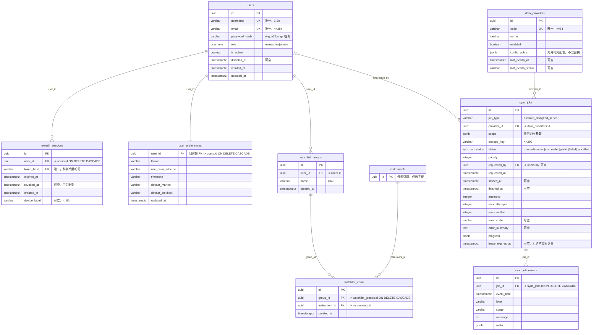
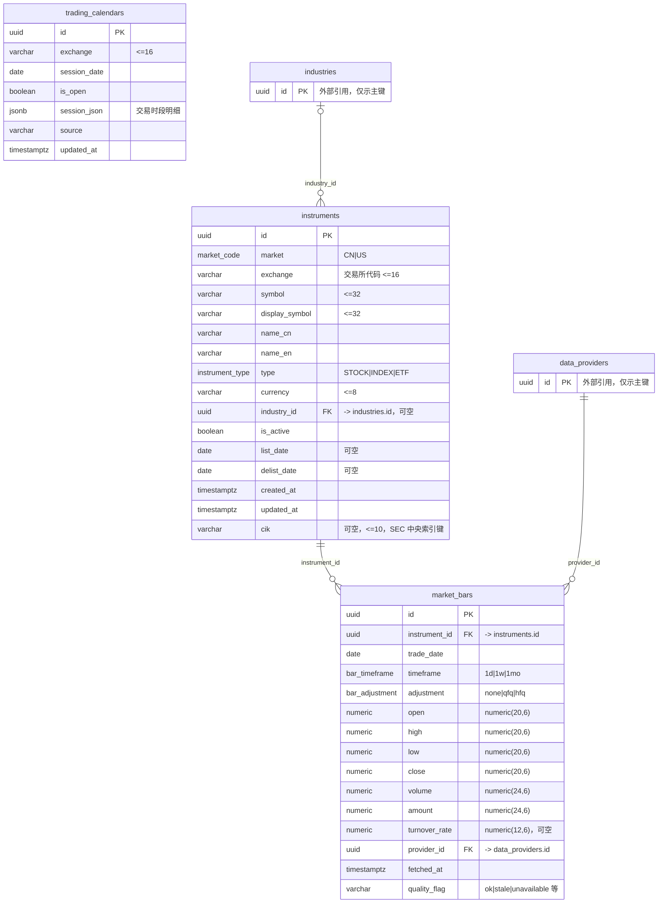
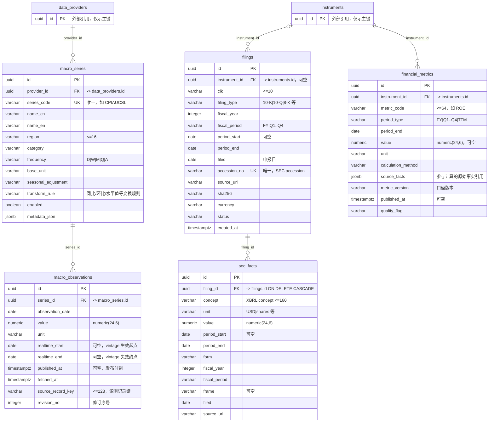
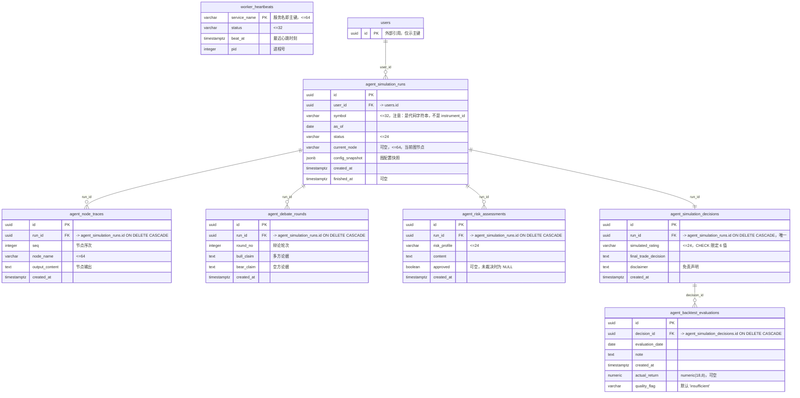
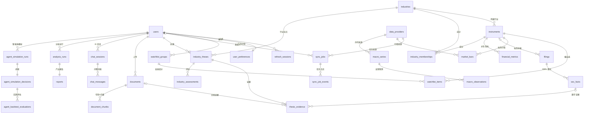

# FinScope AI 实体关系图（ER 图）

> 本文档由**运行中的 PostgreSQL 实例真实 schema 反查**生成，并用 `backend/alembic/versions/*.py` 迁移源码交叉验证。
> **口径声明：以数据库为准，迁移源码用于解释约束来源与交叉核对。** 凡两者不一致之处，文档中以数据库实际结构为准并显式标注。

---

## 0. 统计口径与总览

| 项目 | 实测值 | 说明 |
|---|---|---|
| 业务表总数 | **35 张** | `information_schema.tables`，`table_schema='public'` AND `table_type='BASE TABLE'` |
| 连同框架表 | **36 张** | 含 `alembic_version`（Alembic 记账表，非业务表） |
| 列总数 | **326 列** | `information_schema.columns`，`table_schema='public'` |
| 外键总数 | **39 条** | `table_constraints.constraint_type='FOREIGN KEY'` |
| 索引总数 | **68 个** | `pg_indexes`；其中 36 个主键索引、25 个唯一索引、7 个普通/专用索引 |
| 自定义枚举类型 | **6 个** | `pg_type` + `pg_enum` |
| CHECK 约束 | **1 条** | `agent_simulation_decisions.ck_agent_decisions_rating` |
| 数据库版本 | PostgreSQL **16.2** (x86_64-pc-mingw64) | `select version()` |
| 扩展 | `vector 0.6.2`、`plpgsql 1.0` | `pgvector` 提供 `vector` 类型与 HNSW 索引 |
| 迁移 head | `20261015_0017` | `alembic_version.version_num`。**比规格书/TASKS 声明的 `20261015_0016` 多一支**：写作期间并行任务新增了 `20261015_0017_news_event_industry.py`（给 `news_events` 加 `industry_id` + 外键 + 索引），本文所有数字已按 0017 重新核对 |

> **快照时点声明**：本表的数字取自 `2026-10-15` 的实时查询。erDiagram 与 §7 表清单的**结构**以
> `20261015_0017` 为准；若后续再新增迁移，表数/列数/外键数可能继续变化，复核时请重跑 §9.1 的 SQL。

### 与规格书 §4 的表数差异（**必须如实说明**）

规格书 §4 声明"四组共 33 张表"，实际库中为 35 张业务表。差异逐条核对如下：

| 规格书声明的表 | 库中实际 | 结论 |
|---|---|---|
| `market_snapshots`、`market_indicators`、`market_breadth_daily` | **不存在** | 规格书 §4.2 画了 6 张行情表，实际只落地 3 张（`instruments`、`trading_calendars`、`market_bars`）。行情快照/技术指标/市场宽度未建表 |
| `macro_assessments` | **不存在** | 宏观评估结果为**规则即时计算**，未落表；`macro_rules.assess_macro()` 现算现返 |
| `financial_facts`、`valuation_snapshots` | **不存在** | 实际以 `sec_facts`（SEC XBRL 原始事实）+ `financial_metrics`（派生指标）替代。估值快照未建表 |
| — | **多出** `sec_facts` | 规格书未列，实际承载 SEC XBRL fact 原始层 |
| — | **多出** `worker_heartbeats` | 规格书未列，实际为 §20.5 常驻 Worker 的存活心跳表 |
| — | **多出** `agent_simulation_runs` 等 **6 张** | 对应规格书 §20.5 增量章节（原编号 34–39） |
| `alembic_version` | 存在但为**框架表** | 不计入业务表 |

因此：**8 + 3 + 5 + 12 + 7 = 35 张业务表**（分组沿用规格书 §4 的四个分组 + §20.5 增量组）。
分组沿用规格书框架，但**组内实际表数与规格书声明的 8/6/7/12 不完全一致**，已在每组开头标注。

---

## 1. 图 1：§4.1 账户与任务（8 张表，与规格书一致）

覆盖：用户身份、会话令牌、个人偏好、自选股、数据源注册表、同步任务与任务事件。



**本组真实唯一约束 / 索引**

| 表 | 约束 | 定义 |
|---|---|---|
| `users` | `users_pkey` / `uq_users_username` / `uq_users_email` | PK(`id`)；UK(`username`)；UK(`email`) |
| `refresh_sessions` | `refresh_sessions_pkey` / `uq_refresh_sessions_token_hash` / `ix_refresh_sessions_user_id` | PK(`id`)；UK(`token_hash`)；普通索引(`user_id`) |
| `user_preferences` | `user_preferences_pkey` | PK(`user_id`) —— 主键即外键，锁死"一人一份偏好" |
| `watchlist_groups` | `watchlist_groups_pkey` / `uq_watchlist_groups_owner_name` | PK(`id`)；UK(`user_id`, `name`) |
| `watchlist_items` | `watchlist_items_pkey` / `uq_watchlist_items_group_instrument` | PK(`id`)；UK(`group_id`, `instrument_id`) |
| `data_providers` | `data_providers_pkey` / `uq_data_providers_code` | PK(`id`)；UK(`code`) |
| `sync_jobs` | `sync_jobs_pkey` / `uq_sync_jobs_active_dedupe` | PK(`id`)；**部分唯一索引** `UNIQUE(dedupe_key) WHERE status IN ('queued','running')` —— 同一去重键只允许存在一个未完成任务 |
| `sync_job_events` | `sync_job_events_pkey` / `ix_sync_job_events_job_id` | PK(`id`)；普通索引(`job_id`) |

> `uq_sync_jobs_active_dedupe` 是**部分唯一索引**（`CREATE UNIQUE INDEX ... WHERE (status = ANY (ARRAY['queued'::sync_job_status, 'running'::sync_job_status]))`），它保证幂等入队：任务完成后同一 `dedupe_key` 可再次入队。

### 图 1 溯源

| 项 | 来源 |
|---|---|
| 8 张表名 | `select table_name from information_schema.tables where table_schema='public' and table_type='BASE TABLE'`（36 张中属本组者） |
| 每列名与类型 | `select table_name, column_name, data_type, character_maximum_length, is_nullable, column_default from information_schema.columns where table_schema='public' and table_name in ('users','refresh_sessions','user_preferences','watchlist_groups','watchlist_items','data_providers','sync_jobs','sync_job_events') order by table_name, ordinal_position` |
| FK / PK / UK / CHECK | `information_schema.table_constraints` × `key_column_usage` × `constraint_column_usage`（同 §9.1 的 SQL） |
| 索引名 | `select tablename, indexname, indexdef from pg_indexes where schemaname='public'` |
| 迁移交叉核对 | `backend/alembic/versions/20261015_0002_auth_accounts.py`（users / refresh_sessions / user_preferences）、`20261015_0003_market_and_macro.py`（data_providers / sync_jobs / sync_job_events）、`20261015_0005_sync_job_lease.py`（`lease_expires_at` + 部分唯一索引）、`20261015_0012_watchlists.py`（watchlist_groups / watchlist_items） |

> 完整命令行与逐条比对结论见 §9.1 与 §9.2，此处不重复贴全文。

---

## 2. 图 2：§4.2 证券与行情（**实际 3 张表**，规格书声明 6 张）

覆盖：可交易标的注册表、交易日历、日/周/月行情 K 线。



**本组真实唯一约束 / 索引**

| 表 | 约束 | 定义 |
|---|---|---|
| `instruments` | `instruments_pkey` | PK(`id`) |
| `instruments` | `uq_instruments_identity` | UK(`market`, `exchange`, `symbol`) —— 同一市场+交易所+代码唯一 |
| `instruments` | `uq_instruments_cik` | **部分唯一索引** `UNIQUE(cik) WHERE (cik IS NOT NULL)` —— 允许多行 `cik` 为 NULL |
| `trading_calendars` | `trading_calendars_pkey` / `uq_trading_calendars_session` | PK(`id`)；UK(`exchange`, `session_date`) |
| `market_bars` | `market_bars_pkey` / `uq_market_bars_identity` | PK(`id`)；UK(`instrument_id`, `trade_date`, `timeframe`, `adjustment`, `provider_id`) |

> `uq_market_bars_identity` 把 `provider_id` 纳入唯一键，意味着**同一根 K 线允许存在多个数据源版本**，便于跨源比对与质量标记；写入端靠该键做 UPSERT 幂等。

### 图 2 溯源

| 项 | 来源 |
|---|---|
| 本组实际表名 | `information_schema.tables` 实测：只有 `instruments`、`trading_calendars`、`market_bars` **3 张**，规格书 §4.2 声明的另外 3 张（`market_snapshots`、`market_indicators`、`market_breadth_daily`）在库中**不存在**——查证 SQL：`select table_name from information_schema.tables where table_schema='public' and table_name in ('market_snapshots','market_indicators','market_breadth_daily')` → **0 行** |
| 列与类型 | `information_schema.columns`（同上结构），其中 OHLC 为 `numeric(20,6)`、`volume`/`amount` 为 `numeric(24,6)`、`turnover_rate` 为 `numeric(12,6)`，由 `format_type(atttypid, atttypmod)` 对 `pg_attribute` 直接查询确认 |
| 3 个枚举的取值 | `select t.typname, e.enumlabel from pg_type t join pg_enum e on e.enumtypid=t.oid order by t.typname, e.enumsortorder` → `market_code`(CN,US)、`instrument_type`(STOCK,INDEX,ETF)、`bar_timeframe`(1d,1w,1mo)、`bar_adjustment`(none,qfq,hfq) |
| 迁移交叉核对 | `backend/alembic/versions/20261015_0003_market_and_macro.py`（建这三张表 + 四个枚举类型）、`20261015_0004_instrument_cik.py`（`instruments.cik` 与部分唯一索引 `uq_instruments_cik`） |

> ⚠️ 本图**刻意不画**规格书里那 3 张未实现的表——这是"禁止凭想象画图"的直接体现。差异说明见 §0「与规格书 §4 的表数差异」。

---

## 3. 图 3：§4.3 宏观与财务（**实际 5 张表**，规格书声明 7 张）

覆盖：宏观指标序列与观测（含 vintage/修订版）、SEC 申报登记、XBRL 原始事实、派生财务指标。



**本组真实唯一约束 / 索引**

| 表 | 约束 | 定义 |
|---|---|---|
| `macro_series` | `macro_series_pkey` / `uq_macro_series_code` | PK(`id`)；UK(`series_code`) |
| `macro_observations` | `macro_observations_pkey` / `uq_macro_observations_identity` | PK(`id`)；UK(`series_id`, `observation_date`, **`COALESCE(realtime_start,'0001-01-01'::date)`**, `revision_no`) |
| `filings` | `filings_pkey` / `uq_filings_accession` / `ix_filings_cik_filed` | PK(`id`)；UK(`accession_no`)；普通索引(`cik`, `filed`) |
| `sec_facts` | `sec_facts_pkey` / `uq_sec_facts_identity` | PK(`id`)；UK(`filing_id`, `concept`, `unit`, `period_end`, **`COALESCE(period_start,'0001-01-01'::date)`**) |
| `financial_metrics` | `financial_metrics_pkey` / `uq_financial_metrics_identity` | PK(`id`)；UK(`instrument_id`, `metric_code`, `period_type`, `period_end`, `metric_version`) |

> 两条唯一约束使用 **`COALESCE(...)` 表达式索引**，把可空的 `realtime_start` / `period_start` 归一化成非空哨兵值 `0001-01-01`，从而让 NULL 也参与唯一性判定 —— 这是"时点值（point-in-time）不重复入库"的落地手段，普通 `UNIQUE` 做不到（NULL 互不相等）。

### 图 3 溯源

| 项 | 来源 |
|---|---|
| 本组实际表名 | `information_schema.tables` 实测：`macro_series`、`macro_observations`、`filings`、`financial_metrics`、`sec_facts` **5 张**；规格书 §4.3 声明的 `macro_assessments`、`financial_facts`、`valuation_snapshots` 在库中**不存在**（同法查证 → 0 行） |
| 列与类型 | `information_schema.columns`；`filings.cik varchar(10)`、`sec_facts.concept varchar(160)`、`financial_metrics.value numeric(24,6)`、`macro_observations.value numeric(24,6)` 均逐列实测 |
| 两个 `COALESCE` 唯一索引 | `select indexname, indexdef from pg_indexes where schemaname='public' and indexname in ('uq_macro_observations_identity','uq_sec_facts_identity')` → `indexdef` 里可见 `COALESCE(realtime_start, '0001-01-01'::date)`、`COALESCE(period_start, '0001-01-01'::date)` |
| 迁移交叉核对 | `backend/alembic/versions/20261015_0003_market_and_macro.py`（macro_series / macro_observations）、`20261015_0006_sec_filings.py`（filings / sec_facts）、`20261015_0007_financial_metrics.py`（financial_metrics） |

> `sec_facts` 是库里**多出来**的表（规格书 §4.3 未列），它与 `filings` 构成"申报事实"层，替代了规格书设想的 `financial_facts`。见 §0 差异表。

---

## 4. 图 4：§4.4 知识、研究与 AI（12 张表，与规格书一致）

覆盖：文档库与向量块、行业分类与成分、研究论点与证据、行业评估、新闻事件、AI 会话、分析运行记录与报告。

```mermaid
erDiagram
    documents {
        uuid id PK
        uuid owner_id FK "-> users.id，按用户隔离"
        varchar title "<=120"
        varchar storage_path "可空，data/uploads/<uuid>/<sha256>.pdf"
        varchar sha256 "内容指纹"
        varchar mime_type
        integer page_count "可空"
        integer size_bytes
        timestamptz uploaded_at
        varchar parse_status "pending|parsed|failed 等"
        varchar parse_error "可空，<=200"
    }

    document_chunks {
        uuid id PK
        uuid document_id FK "-> documents.id ON DELETE CASCADE"
        integer chunk_index "文档内序次"
        integer page_start
        integer page_end
        integer char_start
        integer char_end
        varchar section_title "可空，<=120"
        text content "块正文"
        varchar content_hash "块内容哈希 <=64"
        integer token_count
        varchar embedding_model "如 local-hashing-v1"
        vector embedding "vector(1536)，可空，HNSW 余弦索引"
        tsvector tsv "可空，GIN 索引，应用层写入"
        timestamptz created_at
    }

    industries {
        uuid id PK
        varchar code UK "唯一，<=64"
        varchar name
        uuid parent_id FK "-> industries.id，自引用可空"
        integer level "层级"
        varchar description
        varchar taxonomy_version "分类标准版本"
    }

    industry_memberships {
        uuid id PK
        uuid industry_id FK "-> industries.id"
        uuid instrument_id FK "-> instruments.id"
        varchar source "来源"
        date valid_from
        date valid_to "可空，闭区间右端"
    }

    industry_theses {
        uuid id PK
        uuid industry_id FK "-> industries.id"
        uuid instrument_id FK "-> instruments.id，可空"
        varchar title "<=80"
        varchar hypothesis "<=400"
        jsonb support_condition "支持条件"
        jsonb challenge_condition "挑战条件"
        integer observation_window_days
        uuid created_by FK "-> users.id"
        timestamptz created_at
        timestamptz updated_at
        varchar status
    }

    thesis_evidence {
        uuid id PK
        uuid thesis_id FK "-> industry_theses.id ON DELETE CASCADE"
        uuid fact_id FK "-> sec_facts.id，可空"
        uuid document_id FK "-> documents.id，可空"
        varchar stance "support|challenge"
        varchar quote_text "<=400，原文引文"
        date published_at
        varchar source_url
    }

    industry_assessments {
        uuid id PK
        uuid thesis_id FK "-> industry_theses.id ON DELETE CASCADE"
        date as_of
        varchar status
        jsonb evidence_ids "证据 id 清单"
        varchar rationale "<=400"
        varchar model_version
        timestamptz created_at
    }

    news_events {
        uuid id PK
        varchar title "<=200"
        varchar canonical_url
        varchar source_name
        timestamptz published_at
        timestamptz captured_at
        varchar event_type
        uuid industry_id FK "-> industries.id（迁移 0017 新增，可空）"
        varchar dedupe_hash UK "唯一，去重哈希"
        varchar usage_rights "使用授权说明"
        varchar quality_flag
    }

    chat_sessions {
        uuid id PK
        uuid user_id FK "-> users.id"
        varchar title "<=80"
        timestamptz created_at
        timestamptz updated_at
    }

    chat_messages {
        uuid id PK
        uuid session_id FK "-> chat_sessions.id ON DELETE CASCADE"
        varchar role "user|assistant"
        text content
        uuid client_message_id "前端幂等键"
        varchar completion_status "completed|cancelled 等"
        timestamptz created_at
    }

    analysis_runs {
        uuid id PK
        uuid user_id FK "-> users.id"
        varchar analysis_type "filing_report 等"
        jsonb target "分析目标"
        date as_of "时点，防未来函数"
        varchar status "succeeded|failed"
        jsonb input_snapshot "输入快照，可复现"
        jsonb result
        varchar model_name
        varchar prompt_version
        varchar calc_version
        timestamptz started_at
        timestamptz finished_at
        varchar error_message "可空，<=200"
        jsonb token_usage "令牌用量"
    }

    reports {
        uuid id PK
        uuid user_id FK "-> users.id"
        uuid run_id FK "-> analysis_runs.id ON DELETE CASCADE，唯一"
        varchar report_type
        varchar title "<=120"
        text body_markdown "报告正文（Markdown）"
        jsonb summary_json
        date report_as_of
        timestamptz created_at
        integer version "版本号"
        timestamptz deleted_at "可空，软删除"
    }

    users {
        uuid id PK "外部引用，仅示主键"
    }
    instruments {
        uuid id PK "外部引用，仅示主键"
    }
    sec_facts {
        uuid id PK "外部引用，仅示主键"
    }

    users ||--o{ documents : "owner_id"
    documents ||--o{ document_chunks : "document_id"
    industries ||--o{ industries : "parent_id"
    industries ||--o{ industry_memberships : "industry_id"
    instruments ||--o{ industry_memberships : "instrument_id"
    industries ||--o{ industry_theses : "industry_id"
    instruments |o--o{ industry_theses : "instrument_id"
    users ||--o{ industry_theses : "created_by"
    industry_theses ||--o{ thesis_evidence : "thesis_id"
    sec_facts |o--o{ thesis_evidence : "fact_id"
    documents |o--o{ thesis_evidence : "document_id"
    industry_theses ||--o{ industry_assessments : "thesis_id"
    industries |o--o{ news_events : "industry_id"
    users ||--o{ chat_sessions : "user_id"
    chat_sessions ||--o{ chat_messages : "session_id"
    users ||--o{ analysis_runs : "user_id"
    users ||--o{ reports : "user_id"
    analysis_runs ||--|| reports : "run_id"
```



**本组真实唯一约束 / 索引**

| 表 | 约束 | 定义 |
|---|---|---|
| `documents` | `documents_pkey` / `uq_documents_owner_sha` | PK(`id`)；UK(`owner_id`, `sha256`) —— **同一用户同一内容只允许一份**，这就是上传去重的落地点 |
| `document_chunks` | `document_chunks_pkey` | PK(`id`) |
| `document_chunks` | `uq_document_chunks_position` | UK(`document_id`, `chunk_index`) |
| `document_chunks` | **`ix_document_chunks_embedding`** | **HNSW 向量索引**：`USING hnsw (embedding vector_cosine_ops)` |
| `document_chunks` | `ix_document_chunks_tsv` | **GIN 索引**：`USING gin (tsv)`，支撑全文检索 |
| `industries` | `industries_pkey` / `uq_industries_code` | PK(`id`)；UK(`code`) |
| `industry_memberships` | `industry_memberships_pkey` / `uq_industry_memberships_window` | PK(`id`)；UK(`industry_id`, `instrument_id`, `valid_from`) |
| `industry_theses` | `industry_theses_pkey` | PK(`id`)；**无额外唯一约束** |
| `thesis_evidence` | `thesis_evidence_pkey` | PK(`id`)；**无额外唯一约束**（同一论点可挂多条证据） |
| `industry_assessments` | `industry_assessments_pkey` | PK(`id`)；**无唯一约束**（同一论点可多次评估，按 `as_of` 区分） |
| `news_events` | `news_events_pkey` / `uq_news_events_dedupe` / `ix_news_events_industry_id` | PK(`id`)；UK(`dedupe_hash`)；普通索引(`industry_id`)，支撑按产业链标签筛新闻（迁移 `20261015_0017`） |
| `chat_sessions` | `chat_sessions_pkey` | PK(`id`) |
| `chat_messages` | `chat_messages_pkey` / `uq_chat_messages_client_role` | PK(`id`)；UK(`session_id`, `client_message_id`, `role`) —— 前端重发同一 `client_message_id` 不会产生重复消息，**SSE 重连幂等** |
| `analysis_runs` | `analysis_runs_pkey` / `ix_analysis_runs_user_started` | PK(`id`)；普通索引(`user_id`, `started_at`) |
| `reports` | `reports_pkey` / `uq_reports_run` | PK(`id`)；UK(`run_id`) —— **一次分析运行最多产出一份报告** |

### 4.1 重点：`document_chunks.embedding` 与检索索引

这是全库唯一的向量列，必须单独说明：

```sql
-- 列定义（format_type 实测）
embedding  vector(1536)          -- 可空
tsv        tsvector              -- 可空

-- 索引定义（pg_indexes.indexdef 实测原文）
CREATE INDEX ix_document_chunks_embedding
    ON public.document_chunks USING hnsw (embedding vector_cosine_ops);
CREATE INDEX ix_document_chunks_tsv
    ON public.document_chunks USING gin (tsv);
```

| 事实 | 值 | 证据 |
|---|---|---|
| 向量维度 | **1536** | `format_type(atttypid, atttypmod)` = `vector(1536)` |
| 索引类型 | **HNSW** | `pg_indexes.indexdef` |
| 距离算子 | **`vector_cosine_ops`（余弦距离）** | 同上；检索 SQL 中用 `<=>` 算子 |
| `tsv` 如何生成 | **由应用层写入，不是生成列、也没有触发器** | Alembic `20261015_0009` 迁移源码中 `tsv` 仅声明为普通 `sa.Column`，全库无 trigger；写入发生在 `app/services/text_embed.py::search_document()` |
| 向量由谁产生 | **本地哈希向量，模型名 `local-hashing-v1`** | `app/services/text_embed.py:8` 常量 `LOCAL_EMBEDDING_MODEL = "local-hashing-v1"` |

> **诚实标注**：`embedding_model` 列的实际取值是 `local-hashing-v1`，即由本地确定性哈希函数生成的 1536 维稀疏化稠密向量，**不是调用外部 Embedding API 得到的语义向量**。因此语义检索质量受限，系统以"向量召回 + 全文召回 + RRF 融合"三件套互补（见 `业务流程图.md` 时序图 1 与 `app/services/rrf.py`）。这一点不应在答辩中被说成"用了大模型 Embedding"。

### 图 4 溯源

| 项 | 来源 |
|---|---|
| 12 张表名 | `information_schema.tables`（public / BASE TABLE）实测，与规格书 §4.4 声明的 12 张**逐一对应，无缺无多** |
| 列与类型 | `information_schema.columns` 逐列导出（见 §9.3 的 `columns.txt`）；`documents.sha256 varchar(64)`、`document_chunks.content_hash varchar(64)`、`document_chunks.section_title varchar(120)`、`document_chunks.token_count integer` 等均为实测 |
| `embedding` / `tsv` 两列的真实类型 | `select a.attname, format_type(a.atttypid, a.atttypmod) from pg_attribute a where a.attrelid='public.document_chunks'::regclass and a.attnum>0 and not a.attisdropped` → `embedding = vector(1536)`、`tsv = tsvector` |
| 已安装扩展 | `select extname, extversion from pg_extension` → `plpgsql 1.0`、**`vector 0.6.2`**；版本串 `select version()` → `PostgreSQL 16.2 on x86_64-pc-mingw64` |
| HNSW / GIN 索引 | `select indexname, indexdef from pg_indexes where tablename='document_chunks'` → `ix_document_chunks_embedding`（`USING hnsw (embedding vector_cosine_ops)`）、`ix_document_chunks_tsv`（`USING gin (tsv)`） |
| `tsv` 由谁写入 | 迁移源码 `20261015_0009_document_chunks.py` 中 `tsv` 仅为普通 `sa.Column(postgresql.TSVECTOR, nullable=True)`，**无生成列、无触发器**；写入位置 `app/services/text_embed.py:38 search_document()` |
| `embedding_model` 的实际取值 | `app/services/text_embed.py:8` 常量 `LOCAL_EMBEDDING_MODEL = "local-hashing-v1"`；`app/repositories/document_chunks.py` 的 INSERT 与两条检索 SQL 都以该常量为过滤条件 |
| 迁移交叉核对 | `20261015_0008_documents.py`（documents）、`20261015_0009_document_chunks.py`（document_chunks + HNSW/GIN 索引）、`20261015_0013_industry_theses.py`（industries / industry_memberships / industry_theses / thesis_evidence / industry_assessments）、`20261015_0010_analysis_reports.py`（analysis_runs / reports）、`20261015_0011_chat_sessions.py`（chat_sessions / chat_messages）、`20261015_0014_news_events.py`（news_events） |

> 本组的向量列与两条索引是全文最容易被"想当然"的地方（容易被写成 `vector(3072)` 或"用了 OpenAI Embedding"）。图 4 与 §4.1 里的每个数字都有上面这条 `pg_attribute` / `pg_indexes` 查询兜底。

---

## 5. 图 5：增量表组 —— §20.5 智能体模拟 + Worker 心跳（7 张表）

规格书 §4 未列，来自 §20.5 增量章节（原编号 34–39）与本项目额外落地的 `worker_heartbeats`。



**本组真实唯一约束 / 索引**

| 表 | 约束 | 定义 |
|---|---|---|
| `agent_simulation_runs` | `agent_simulation_runs_pkey` | PK(`id`)；**无额外唯一约束** |
| `agent_node_traces` | `agent_node_traces_pkey` / `uq_agent_node_traces_seq` | PK(`id`)；UK(`run_id`, `seq`) —— 同一次运行节点序次不重复 |
| `agent_debate_rounds` | `agent_debate_rounds_pkey` | PK(`id`)；**无额外唯一约束**（同一 `run_id` 可有多个 `round_no`） |
| `agent_risk_assessments` | `agent_risk_assessments_pkey` | PK(`id`)；**无额外唯一约束**（同一运行可多次风控裁决） |
| `agent_simulation_decisions` | `agent_simulation_decisions_pkey` / `uq_agent_decisions_run` / `ck_agent_decisions_rating` | PK(`id`)；UK(`run_id`) —— 一次运行只有一个终裁；CHECK 限定 `simulated_rating ∈ {buy, overweight, hold, underweight, sell, review}` |
| `agent_backtest_evaluations` | `agent_backtest_evaluations_pkey` | PK(`id`)；**无额外唯一约束** |
| `worker_heartbeats` | `worker_heartbeats_pkey` | PK(`service_name`) —— 服务名即主键，天然 UPSERT 心跳 |

> **全库唯一的 CHECK 约束**就在这里：
> ```sql
> CHECK (((simulated_rating)::text = ANY ((ARRAY['buy','overweight','hold','underweight','sell','review'])::text[])))
> ```
> `agent_backtest_evaluations.quality_flag` 的默认值来自迁移 `20261015_0016`：`server_default="insufficient"`，语义为"样本不足，回测结论不可用"。

### 5.1 与规格书 §20.5 的字段级差异（**务必如实说明**）

规格书 §20.5 声明的字段与库中实际结构**不一致**，以库为准：

| 规格书 §20.5 声明 | 库中实际 | 结论 |
|---|---|---|
| `agent_simulation_runs.instrument_id`（UUID FK → instruments） | 实际为 `symbol varchar(32)` | **未按规格书实现**，用代码字符串而非标的 UUID；因此无法与 `instruments` 建外键 |
| `agent_simulation_runs.total_tokens` | **不存在** | 规格书声明了但库里没有该列 |
| `agent_simulation_runs.total_duration_ms` | **不存在** | 同上 |
| `agent_simulation_runs.report_id`（FK → reports） | **不存在** | 同上 |
| `agent_simulation_runs.error_summary` | **不存在** | 同上（运行级错误摘要无处存） |
| `agent_simulation_runs` 的 FK 只有 `user_id` | 实际 FK 数 = 1 | 与库一致：`agent_simulation_runs_user_id_fkey` |

### 图 5 溯源

| 项 | 来源 |
|---|---|
| 本组 7 张表 | 6 张 `agent_*` 由 `backend/alembic/versions/20261015_0015_agent_simulations.py` **一次性建出**（该迁移内 6 个 `op.create_table`）；`worker_heartbeats` 由 `20261015_0001_enable_pgvector.py` 建出（该迁移同时执行 `CREATE EXTENSION IF NOT EXISTS vector`） |
| 列与类型 | `information_schema.columns` + `pg_attribute`；`agent_backtest_evaluations.actual_return` 为 `numeric(18,8)`、`quality_flag` 为 `varchar(32) NOT NULL DEFAULT 'insufficient'`——两者由 `20261015_0016_backtest_returns.py` 追加 |
| FK 与 CASCADE | `information_schema` 三表联查 + `select conname, confdeltype from pg_constraint where contype='f'`；`confdeltype='c'` 表示 `ON DELETE CASCADE`（本组 5 条：node_traces / debate_rounds / risk_assessments / decisions 指向 runs，backtest 指向 decisions） |
| 与规格书 §20.5 的字段级差异 | 逐列比对 §20.5 的 34~39 号表字段声明与 `information_schema.columns` 结果；**迁移源码里也确实没有** `instrument_id` / `total_tokens` / `total_duration_ms` / `report_id` / `error_summary` 这几列，可反证差异不是查询口径问题 |
| CHECK 约束 | `select conname, pg_get_constraintdef(oid) from pg_constraint where contype='c' and connamespace='public'::regnamespace` → 全库仅 1 条 `ck_agent_decisions_rating` |

> §5.1 的 12 行差异是本图最重要的信息量：**规格书比实现"更丰富"**。答辩时应主动说明这是实现尚未跟进，而不是图漏画。

---

## 6. 图 6：主干关系总览（不画字段）

只画跨组主干外键，用于快速说明数据如何从"外部数据源"流向"用户报告"。



> 图中未出现的外键（共 39 条中的其余部分）为组内父子关系，已在图 1–图 5 逐一画出；`trading_calendars`、`worker_heartbeats` 两张表**无任何外键**，是独立表。（`news_events` 原先也无外键，迁移 `20261015_0017` 之后有了 `industry_id → industries.id`。）

### 图 6 溯源

| 项 | 来源 |
|---|---|
| 全部 39 条外键的源/目标 | 一条 SQL 出全量（**这是本图唯一数据源**）：`select tc.table_name as src, kcu.column_name as src_col, ccu.table_name as dst, ccu.column_name as dst_col, tc.constraint_name from information_schema.table_constraints tc join information_schema.key_column_usage kcu on tc.constraint_name = kcu.constraint_name join information_schema.constraint_column_usage ccu on tc.constraint_name = ccu.constraint_name where tc.constraint_type = 'FOREIGN KEY' and tc.table_schema = 'public' order by tc.table_name, kcu.ordinal_position;` → **39 行** |
| 外键名的第二来源 | `select conname, conrelid::regclass as src, confrelid::regclass as dst, confdeltype from pg_constraint where contype = 'f' order by conname;`（与上一条交叉验证，避免 `information_schema` 在同名约束下串行） |
| 基数（1:N / N:1）的判定 | 依据 `key_column_usage` 里 FK 列是否同时被该表的 PK/UK 覆盖（覆盖 → 1:1，未覆盖 → N:1）。例如 `agent_simulation_decisions.run_id` 带 UNIQUE，故 `runs ||--|| decisions` |
| CASCADE 边 | `pg_constraint.confdeltype = 'c'` 的 15 条，逐条列在 §8.1 |

> 本图**只画关系、不画字段**，所以它的可复核性最强：一条 SQL 的 39 行输出即可与图上每一条边一一对应。若只复核一张图，复核这张。

---

## 7. 表清单（36 张，含框架表）

"列数"为 `information_schema.columns` 实测计数；"关联"列出真实外键目标。

### 组 1：§4.1 账户与任务（8 张）

| # | 表名 | 中文含义 | 主要字段 | 列数 | 关联（外键） |
|---|---|---|---|---|---|
| 1 | `users` | 用户账号 | `username`、`email`、`password_hash`、`role`(枚举)、`is_active`、`disabled_at` | 9 | 被 12 张表引用 |
| 2 | `refresh_sessions` | 刷新令牌会话 | `token_hash`(唯一)、`expires_at`、`revoked_at`、`device_label` | 7 | → `users.id` (CASCADE) |
| 3 | `user_preferences` | 用户偏好 | `theme`、`rise_color_scheme`、`timezone`、`default_market`、`default_lookback` | 7 | → `users.id` (CASCADE)，主键即外键 |
| 4 | `watchlist_groups` | 自选股分组 | `name` | 4 | → `users.id` |
| 5 | `watchlist_items` | 自选股成分 | —（关联表） | 4 | → `watchlist_groups.id` (CASCADE)、→ `instruments.id` |
| 6 | `data_providers` | 数据源注册表 | `code`(唯一)、`name`、`enabled`、`config_public`(jsonb)、`last_health_at`、`last_health_status` | 7 | 被 4 张表引用 |
| 7 | `sync_jobs` | 数据同步任务 | `job_type`、`scope`(jsonb)、`dedupe_key`、`status`(枚举)、`priority`、`attempts`/`max_attempts`、`rows_written`、`error_code`、`progress`、`lease_expires_at` | 18 | → `data_providers.id`、→ `users.id`(可空) |
| 8 | `sync_job_events` | 同步任务事件日志 | `event_time`、`level`、`stage`、`message`、`meta`(jsonb) | 7 | → `sync_jobs.id` (CASCADE) |

### 组 2：§4.2 证券与行情（**实际 3 张**）

| # | 表名 | 中文含义 | 主要字段 | 列数 | 关联（外键） |
|---|---|---|---|---|---|
| 9 | `instruments` | 可交易标的注册表 | `market`(枚举)、`exchange`、`symbol`、`display_symbol`、`name_cn`/`name_en`、`type`(枚举)、`currency`、`cik`、`list_date`/`delist_date` | 16 | → `industries.id`(可空)；被 8 张表引用 |
| 10 | `trading_calendars` | 交易日历 | `exchange`、`session_date`、`is_open`、`session_json`、`source` | 7 | **无外键** |
| 11 | `market_bars` | 行情 K 线 | `trade_date`、`timeframe`(枚举)、`adjustment`(枚举)、`open`/`high`/`low`/`close`、`volume`、`amount`、`turnover_rate`、`quality_flag` | 15 | → `instruments.id`、→ `data_providers.id` |

### 组 3：§4.3 宏观与财务（**实际 5 张**）

| # | 表名 | 中文含义 | 主要字段 | 列数 | 关联（外键） |
|---|---|---|---|---|---|
| 12 | `macro_series` | 宏观指标序列定义 | `series_code`(唯一)、`name_cn`/`name_en`、`region`、`category`、`frequency`、`base_unit`、`seasonal_adjustment`、`transform_rule`、`enabled`、`metadata_json` | 13 | → `data_providers.id` |
| 13 | `macro_observations` | 宏观观测值（含 vintage） | `observation_date`、`value`、`unit`、`realtime_start`/`realtime_end`、`published_at`、`source_record_key`、`revision_no` | 11 | → `macro_series.id` |
| 14 | `filings` | SEC 申报登记 | `cik`、`filing_type`、`fiscal_year`/`fiscal_period`、`period_start`/`period_end`、`filed`、`accession_no`(唯一)、`source_url`、`sha256`、`status` | 15 | → `instruments.id`(可空) |
| 15 | `sec_facts` | SEC XBRL 原始事实 | `concept`、`unit`、`value`、`period_start`/`period_end`、`form`、`fiscal_year`/`fiscal_period`、`frame`、`filed`、`source_url` | 13 | → `filings.id` (CASCADE) |
| 16 | `financial_metrics` | 派生财务指标 | `metric_code`、`period_type`、`period_end`、`value`、`unit`、`calculation_method`、`source_facts`(jsonb)、`metric_version`、`published_at`、`quality_flag` | 12 | → `instruments.id` |

### 组 4：§4.4 知识、研究与 AI（12 张）

| # | 表名 | 中文含义 | 主要字段 | 列数 | 关联（外键） |
|---|---|---|---|---|---|
| 17 | `documents` | 上传文档元数据 | `title`、`storage_path`、`sha256`、`mime_type`、`page_count`、`size_bytes`、`parse_status`、`parse_error` | 11 | → `users.id`（按 owner 隔离） |
| 18 | `document_chunks` | 文档切块 + 向量 | `chunk_index`、`page_start`/`page_end`、`char_start`/`char_end`、`section_title`、`content`、`content_hash`、`token_count`、`embedding_model`、**`embedding vector(1536)`**、**`tsv tsvector`** | 15 | → `documents.id` (CASCADE) |
| 19 | `industries` | 行业分类树 | `code`(唯一)、`name`、`parent_id`(自引用)、`level`、`taxonomy_version` | 7 | → `industries.id`(自引用) |
| 20 | `industry_memberships` | 行业成分（带有效期） | `source`、`valid_from`、`valid_to` | 6 | → `industries.id`、→ `instruments.id` |
| 21 | `industry_theses` | 研究论点 | `title`、`hypothesis`、`support_condition`(jsonb)、`challenge_condition`(jsonb)、`observation_window_days`、`status` | 12 | → `industries.id`、→ `instruments.id`(可空)、→ `users.id` |
| 22 | `thesis_evidence` | 论点证据 | `stance`、`quote_text`、`published_at`、`source_url` | 8 | → `industry_theses.id` (CASCADE)、→ `sec_facts.id`(可空)、→ `documents.id`(可空) |
| 23 | `industry_assessments` | 行业论点评估记录 | `as_of`、`status`、`evidence_ids`(jsonb)、`rationale`、`model_version` | 8 | → `industry_theses.id` (CASCADE) |
| 24 | `news_events` | 新闻事件 | `title`、`canonical_url`、`source_name`、`published_at`、`event_type`、`industry_id`、`dedupe_hash`(唯一)、`usage_rights`、`quality_flag` | 11 | → `industries.id` |
| 25 | `chat_sessions` | AI 会话 | `title` | 5 | → `users.id` |
| 26 | `chat_messages` | 会话消息 | `role`、`content`、`client_message_id`、`completion_status` | 7 | → `chat_sessions.id` (CASCADE) |
| 27 | `analysis_runs` | 分析运行记录 | `analysis_type`、`target`(jsonb)、`as_of`、`status`、`input_snapshot`(jsonb)、`result`(jsonb)、`model_name`、`prompt_version`、`calc_version`、`error_message`、`token_usage`(jsonb) | 15 | → `users.id` |
| 28 | `reports` | 研究报告 | `report_type`、`title`、`body_markdown`、`summary_json`(jsonb)、`report_as_of`、`version`、`deleted_at`(软删除) | 11 | → `users.id`、→ `analysis_runs.id` (CASCADE，唯一) |

### 组 5：增量表组（7 张）

| # | 表名 | 中文含义 | 主要字段 | 列数 | 关联（外键） |
|---|---|---|---|---|---|
| 29 | `agent_simulation_runs` | 多智能体模拟运行 | `symbol`、`as_of`、`status`、`current_node`、`config_snapshot`(jsonb)、`finished_at` | 9 | → `users.id` |
| 30 | `agent_node_traces` | 图节点执行轨迹 | `seq`、`node_name`、`output_content` | 6 | → `agent_simulation_runs.id` (CASCADE) |
| 31 | `agent_debate_rounds` | 多空辩论轮次 | `round_no`、`bull_claim`、`bear_claim` | 6 | → `agent_simulation_runs.id` (CASCADE) |
| 32 | `agent_risk_assessments` | 风控裁决 | `risk_profile`、`content`、`approved` | 6 | → `agent_simulation_runs.id` (CASCADE) |
| 33 | `agent_simulation_decisions` | 模拟终裁 | `simulated_rating`(CHECK 6 值)、`final_trade_decision`、`disclaimer` | 6 | → `agent_simulation_runs.id` (CASCADE，唯一) |
| 34 | `agent_backtest_evaluations` | 决策回测评估 | `evaluation_date`、`note`、`actual_return`、`quality_flag`(默认 `insufficient`) | 7 | → `agent_simulation_decisions.id` (CASCADE) |
| 35 | `worker_heartbeats` | Worker 心跳 | `service_name`(主键)、`status`、`beat_at`、`pid` | 4 | **无外键** |

### 框架表（1 张，非业务）

| # | 表名 | 中文含义 | 主要字段 | 列数 | 关联 |
|---|---|---|---|---|---|
| 36 | `alembic_version` | Alembic 迁移版本记账 | `version_num`(主键) | 1 | 无 |

**列数合计：326 列**（36 张表）。

---

## 8. 自定义枚举类型（6 个）

| 枚举类型 | 取值 | 使用列 |
|---|---|---|
| `user_role` | `researcher`, `admin` | `users.role` |
| `market_code` | `CN`, `US` | `instruments.market` |
| `instrument_type` | `STOCK`, `INDEX`, `ETF` | `instruments.type` |
| `bar_timeframe` | `1d`, `1w`, `1mo` | `market_bars.timeframe` |
| `bar_adjustment` | `none`, `qfq`, `hfq` | `market_bars.adjustment` |
| `sync_job_status` | `queued`, `running`, `succeeded`, `partial`, `failed`, `cancelled` | `sync_jobs.status` |

> 这是 PostgreSQL **原生 ENUM 类型**（`pg_type` + `pg_enum`），不是字符串 + CHECK。新增取值需要 `ALTER TYPE ... ADD VALUE`，属于迁移级别变更。
> 注意：`sync_job_status` 有 `partial`（部分成功）状态，说明同步任务允许"部分数据写入"的中间态，这与 `market_bars.quality_flag`、`financial_metrics.quality_flag` 共同构成项目的**数据质量可见性**设计。

### 8.1 外键删除行为（`pg_constraint.confdeltype` 实测）

`confdeltype='c'` 表示 **ON DELETE CASCADE**。全库共 **15 条 CASCADE 外键**，其余为默认 `NO ACTION`（`confdeltype='a'`）。

| # | 外键约束名 | 目标表 |
|---|---|---|
| 1 | `refresh_sessions_user_id_fkey` | `users` |
| 2 | `user_preferences_user_id_fkey` | `users` |
| 3 | `watchlist_items_group_id_fkey` | `watchlist_groups` |
| 4 | `sync_job_events_job_id_fkey` | `sync_jobs` |
| 5 | `document_chunks_document_id_fkey` | `documents` |
| 6 | `thesis_evidence_thesis_id_fkey` | `industry_theses` |
| 7 | `industry_assessments_thesis_id_fkey` | `industry_theses` |
| 8 | `chat_messages_session_id_fkey` | `chat_sessions` |
| 9 | `reports_run_id_fkey` | `analysis_runs` |
| 10 | `sec_facts_filing_id_fkey` | `filings` |
| 11 | `agent_node_traces_run_id_fkey` | `agent_simulation_runs` |
| 12 | `agent_debate_rounds_run_id_fkey` | `agent_simulation_runs` |
| 13 | `agent_risk_assessments_run_id_fkey` | `agent_simulation_runs` |
| 14 | `agent_simulation_decisions_run_id_fkey` | `agent_simulation_runs` |
| 15 | `agent_backtest_evaluations_decision_id_fkey` | `agent_simulation_decisions` |

> 设计含义：**"从属数据随主体级联删除"**（文档删了块也删、运行删了报告也删、会话删了消息也删）；而 `instruments`、`industries`、`filings`、`documents` 作为被广泛引用的主数据，**故意不设 CASCADE**，避免误删主数据时连带清空大量派生记录。

---

## 9. 溯源（本图数据从哪来）

### 9.1 主数据源：运行中数据库的直接查询

本文档所有表名、列名、列类型、可空性、默认值、约束、索引**均来自对本机运行实例的实时 SQL 查询**，不是从规格书或模型代码抄来的。

连接与查询方式（可原样复核）：

```powershell
# 注意：必须用 -h 127.0.0.1，用 localhost 会先解析到 ::1 而连不上
$env:PGPASSWORD='FsLocalDev2026Pg7x'; $env:PGCLIENTENCODING='UTF8'
& 'C:\finscope-runtime\pgsql\bin\psql.exe' -h 127.0.0.1 -p 5432 -U finscope -d finscope -c "<SQL>"
```

具体执行的查询（逐条对应本文章节）：

| 本文章节 | 查询来源 SQL |
|---|---|
| §0 表数 | `select count(*) from information_schema.tables where table_schema='public' and table_type='BASE TABLE';` → **36** |
| §0/§7 列数与列明细 | `select table_name, ordinal_position, column_name, data_type, character_maximum_length, numeric_precision, is_nullable, column_default from information_schema.columns where table_schema='public' order by table_name, ordinal_position;` → **326 行** |
| §1–§7 主键/唯一约束 | `select tc.table_name, tc.constraint_type, tc.constraint_name, kcu.column_name, kcu.ordinal_position from information_schema.table_constraints tc left join information_schema.key_column_usage kcu on tc.constraint_name=kcu.constraint_name and tc.table_schema=kcu.table_schema where tc.table_schema='public' order by 1,2,3,5;` |
| §1–§7 外键与目标列（39 条） | `select tc.table_name as src, kcu.column_name as src_col, ccu.table_name as dst, ccu.column_name as dst_col, tc.constraint_name from information_schema.table_constraints tc join information_schema.key_column_usage kcu on tc.constraint_name=kcu.constraint_name join information_schema.constraint_column_usage ccu on tc.constraint_name=ccu.constraint_name where tc.constraint_type='FOREIGN KEY' and tc.table_schema='public' order by tc.table_name, kcu.ordinal_position;` → **39 行** |
| §1–§7 索引定义（含 HNSW / GIN / 部分唯一） | `select tablename, indexname, indexdef from pg_indexes where schemaname='public' order by tablename, indexname;` → **68 行** |
| §8 枚举类型 | `select t.typname, string_agg(e.enumlabel, ',' order by e.enumsortorder) from pg_type t join pg_enum e on t.oid=e.enumtypid group by t.typname order by t.typname;` → **6 个枚举** |
| §5 CHECK 约束 | `select conrelid::regclass::text, conname, pg_get_constraintdef(oid) from pg_constraint where contype='c' and connamespace='public'::regnamespace order by 1,2;` → **1 条** |
| §8.1 CASCADE 外键 | `select conrelid::regclass::text, conname, confdeltype from pg_constraint where contype='f' and confdeltype<>'a' order by 1;` → **15 条 `c`** |
| §4.1 向量列精确类型 | `select a.attname, format_type(a.atttypid,a.atttypmod), a.attnotnull from pg_attribute a where a.attrelid='public.document_chunks'::regclass and a.attnum>0 and not a.attisdropped order by a.attnum;` → `embedding` = **`vector(1536)`**，`tsv` = **`tsvector`** |
| §0/§5 数据库与扩展版本 | `select version();` → `PostgreSQL 16.2 ... x86_64-pc-mingw64`；`select extname, extversion from pg_extension;` → `vector 0.6.2`、`plpgsql 1.0` |
| §7 精确 numeric 精度 | `select c.relname, a.attname, format_type(a.atttypid,a.atttypmod) from pg_attribute a join pg_class c on c.oid=a.attrelid join pg_namespace n on n.oid=c.relnamespace where n.nspname='public' and c.relkind='r' and a.attnum>0 and not a.attisdropped ...;` → `numeric(24,6)`/`numeric(20,6)`/`numeric(12,6)`/`numeric(18,8)` |
| §0 迁移 head | `select * from alembic_version;` → **`20261015_0017`** |

原始查询结果已落盘留证（四份纯文本 dump）：
- `C:\Users\26845\Desktop\毕设tl\_tmp_schema\columns.txt`（首轮 dump，325 行）
- `C:\Users\26845\Desktop\毕设tl\_tmp_schema\constraints.txt`（约束清单）
- `C:\Users\26845\Desktop\毕设tl\_tmp_schema\fks.txt`（首轮 38 行外键）
- `C:\Users\26845\Desktop\毕设tl\_tmp_schema\indexes.txt`（67 行索引定义）

迁移 `20261015_0017` 落地后已重新 dump 并逐行 diff，确认**唯一变化**是 `news_events.industry_id`
一列 + 一条外键 + 一条索引（diff 命令：`Compare-Object (旧 columns) (新 columns)`）：
- `C:\Users\26845\Desktop\毕设tl\_tmp_schema2\columns.txt`（**326 行**，现行列明细）
- `C:\Users\26845\Desktop\毕设tl\_tmp_schema2\fks.txt`（**39 行**外键 + 唯一约束，现行）

### 9.2 交叉验证源：Alembic 迁移源码

`backend/alembic/versions/` 下共 **17 个迁移文件**（`20261015_0001` → `20261015_0017`，线性单链，无分叉；与库中 `alembic_version` = `20261015_0017` 一致），逐个 `create_table` 覆盖的表与库中实际一致。做交叉核对的目的与结论：

| 交叉核对点 | 迁移源码 | 数据库实测 | 是否一致 |
|---|---|---|---|
| 建表总数 | 16 个迁移累计 `create_table` 建出全部业务表（第 17 支 `20261015_0017` 不建表，只加列 + 外键 + 索引） | 35 张业务表 + `alembic_version` | ✅ 一致 |
| `document_chunks.embedding` 类型 | `alembic/versions/20261015_0009_*.py` 用自定义 `Vector1536` 类型，`get_col_spec()` 返回 `"vector(1536)"`，并 `CREATE EXTENSION IF NOT EXISTS vector` | `format_type` = `vector(1536)` | ✅ 一致 |
| HNSW 索引写法 | 迁移中 `op.execute("CREATE INDEX ix_document_chunks_embedding ON document_chunks USING hnsw (embedding vector_cosine_ops)")` | `pg_indexes.indexdef` 完全一致 | ✅ 一致 |
| 文本索引写法 | 迁移中 `op.execute("CREATE INDEX ix_document_chunks_tsv ON document_chunks USING gin (tsv)")` | `pg_indexes.indexdef` 完全一致 | ✅ 一致 |
| `document_chunks` → `documents` 外键删除行为 | 迁移中 `sa.ForeignKey("documents.id", ondelete="CASCADE")` | `confdeltype='c'` | ✅ 一致 |
| `tsv` 列如何维护 | 迁移里 `tsv` 只是普通 `sa.Column`，**没有** `Computed(...)`、**没有** trigger、**没有** generated 表达式 | 库中无相关 trigger；`information_schema.columns.is_generated` 非生成列 | ✅ 一致 —— **`tsv` 由应用代码写入**，见 `app/services/text_embed.py` |
| `agent_backtest_evaluations` 的 `actual_return` / `quality_flag` | 迁移 `20261015_0016` 新增：`actual_return Numeric(18, 8)`（可空）、`quality_flag String(32)`（非空，`server_default="insufficient"`） | `numeric(18,8)`（可空）；`character varying(32)` 非空，默认 `'insufficient'::character varying` | ✅ 一致 |
| `agent_simulation_decisions` 评级取值限制 | 迁移中建立 CHECK 约束 `ck_agent_decisions_rating` | `pg_constraint` 中同名的 CHECK，取值 6 个 | ✅ 一致 |
| `news_events.industry_id`（迁移 `20261015_0017`） | 迁移中 `op.add_column("news_events", sa.Column("industry_id", postgresql.UUID(as_uuid=True), nullable=True))` + `create_foreign_key("fk_news_events_industry_id", ...)` + `create_index("ix_news_events_industry_id", ...)` | 库中第 11 列 `industry_id uuid NULL`；外键 `fk_news_events_industry_id → industries(id)`；索引 `ix_news_events_industry_id` | ✅ 一致 |

**唯一发现的"规格书 ≠ 数据库"之处**：即 §0（表数 33 vs 35）与 §5.1（`agent_simulation_runs` 缺 4 列、`instrument_id` 变 `symbol`）两处差异。这两处**不是迁移源码与数据库不一致**，而是**规格书文本与实际实现不一致**——迁移源码与数据库在这两点上是相互印证的（例如 `20261015` 系列的建表语句里确实没有 `instrument_id`，只有 `symbol`）。

### 9.3 无法从代码或数据库证实的点（如实列出）

1. **`market_snapshots` / `market_indicators` / `market_breadth_daily` / `macro_assessments` / `financial_facts` / `valuation_snapshots` 六张规格书声明的表确实不存在**。无法判断是"计划中未做"还是"设计变更后放弃"，规格书与 TASKS 均无变更记录说明。本文档只陈述"库中无此表"。
2. **`agent_*` 表组是否真有写入路径**：表结构存在且含 CASCADE 约束，但本文档只验证了"表存在"，未验证运行期是否有数据写入。若要声称"智能体模拟功能已实现"，需另行查 `select count(*) from agent_simulation_runs;` 并核对 `app/trading_agents/graph.py`。
3. **`news_events` 表的使用情况**：表存在、含唯一去重键，且**已有 repository**（`backend/app/repositories/news_events.py`，与 `backend/app/services/disclosure_events.py` 配套）；迁移 `20261015_0017` 又给它补上了 `industry_id`。但"运行期是否真有数据写入""写入路径是否被 worker 调度到"属运行期行为，本文档只验证了**结构与代码文件**的存在，未查行数。
4. **`worker_heartbeats` 与规格书 §20.5 的对应关系**：规格书未列此表，推测为本项目为实现 Worker 存活探测而自行增加，但无文档明文依据（`docs/thesis/结构图.md` 未提及）。
5. **`config_public`（`data_providers`）是否真能保证不带密钥**：仅从列名与 jsonb 类型无法证实，需读写入端代码确认。

### 9.4 与既有文档的关系

`docs/thesis/结构图.md` 已包含一份简短的表结构说明与若干小组件图。本文档是其**超集与校正版**：该文件中的表清单不含 §0 的表数差异说明、不含 §5.1 的字段级差异、也没有 HNSW/GIN 索引与 CASCADE 规则。两者不冲突时以本文档为准；`结构图.md` 保留原样未做修改。
