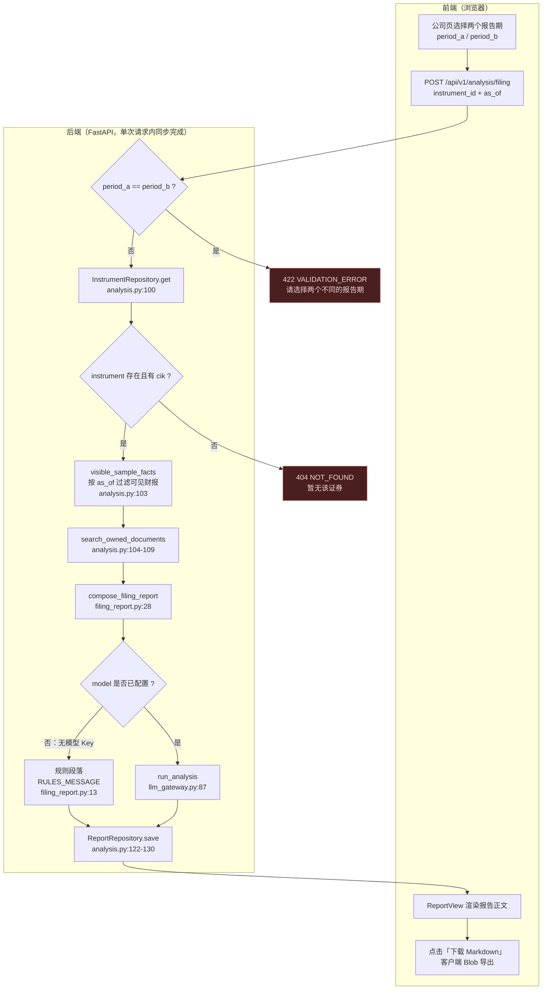
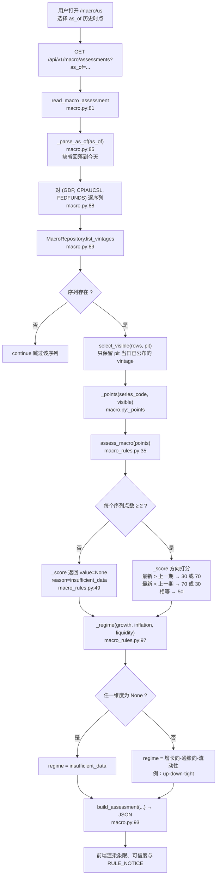
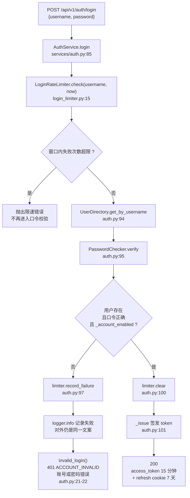
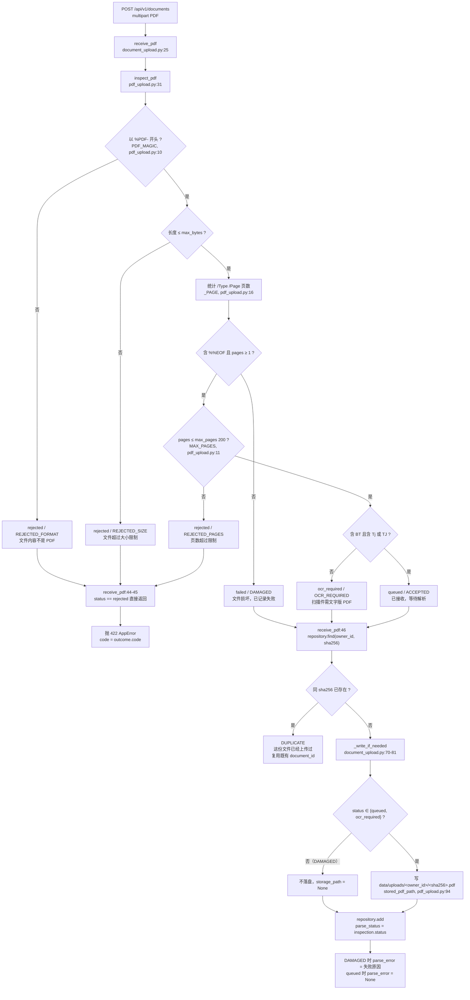
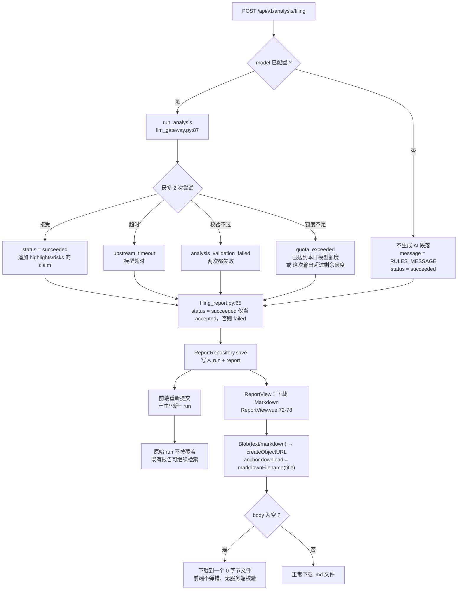

# FinScope AI 业务流程图与时序图

> 本文件对应规格书 §8「核心业务流程」与 §6.2「RAG 摄取」。**每一张图都从真实代码反查得出**，不使用示意性/想当然的流程；图后附「实现位置」清单与「溯源」小节，便于答辩复核。
>
> 反向链接：架构分层见 [`架构图.md`](./架构图.md)；数据表结构见 [`ER图.md`](./ER图.md)。

## §0 核验基准与覆盖范围

### 0.1 核验基准（务必先读）

| 项 | 值 |
| --- | --- |
| Git HEAD | `917fafd82879388fa0b84bac915f7a4ddf8b794a` |
| HEAD 提交信息 | `推演改走已安装的 TradingAgents 图，回测缺数据时不填收益。`（2026-10-15 17:27:47 +0800） |
| 工作区状态 | **不干净**：`backend/app/services/document_index.py` 有未提交改动（`+139 / −10`） |
| 行号口径 | 本文件所有 `文件:行号` 均按**上述基准 + 当前工作区**核对；函数名稳定，行号会随开发漂移 |

> ⚠️ **诚信声明**：`document_index.py` 在本文件撰写期间处于被编辑状态（工作区相对 HEAD 有 +139/−10 改动），因此该文件的**行号**在后续开发中可能变化。凡涉及该文件，本文件同时给出**函数名**（稳定）与**行号**（当前值）。复核时请优先用函数名检索。

### 0.2 本文件覆盖的图

| 编号 | 图类型 | 主题 | 规格书出处 |
| --- | --- | --- | --- |
| 图 1 | `flowchart` | 公司分析完整主路径 | §8.1 |
| 图 2 | `flowchart` | 宏观分析主路径 | §8.2 |
| 图 3 | `flowchart` | 失败分支①登录 | §8.3 |
| 图 4 | `flowchart` | 失败分支②上传 | §8.3 |
| 图 5 | `flowchart` | 失败分支③报告生成与导出 | §8.3 |
| 图 6 | `sequenceDiagram` | RAG 上传→解析→切块→向量化→混合检索→引用校验 | §6.2 / §8.1 |
| 图 7 | `sequenceDiagram` | AI 问答 SSE 流式与取消 | §8.3 |

### 0.3 三个必须先讲清的实现事实

这三点与规格书的描述**有实质差异**，是阅读以下所有图的前提：

1. **公司分析是同步的，不是 `queued`。** 规格书 §8.1 第 5 步写「生成研究分析（queued）」、「Worker 收集四季指标 + 规则引擎风险 + 摘要段落」。实测 `POST /api/v1/analysis/filing` 在**单次请求内同步完成**全部工作（取财报 → 检索 → 规则计算 → 可选调模型 → 落库 → 返回），**不经过任务队列，也没有 Worker 参与**（`backend/app/api/v1/analysis.py:91-131`）。真正走 Worker 的是**文档索引**（`index_next_queued`）与**同步任务**（`execute_job`）。
2. **`/assistant` 问答不调用任何大模型。** `backend/app/services/chat_reply.py:56-58` 的 `rules_reply` 函数体是 `del question; return NO_MODEL_REPLY`——**无论问什么都返回同一段固定文案**（`NO_MODEL_REPLY`，`chat_reply.py:6`）。所谓「SSE 流式」是把这段固定文案按 24 字符切片后逐帧下发（`event_stream`，`chat_reply.py:61-65`）。
3. **没有服务端导出端点。** 59 个后端端点中不存在 `export` / `download` / `Content-Disposition` 相关端点（全库检索确认）。规格书 §8.1 第 10 步的「导出」实测由**浏览器端**完成：`frontend/src/views/ReportView.vue:72-78` 用 `Blob` + `URL.createObjectURL` 触发前端下载，文件名由 `frontend/src/api/reportEvidence.ts:32 markdownFilename()` 生成。

---

## §1 图 1：公司分析完整主路径（规格书 §8.1）



### 1.1 与规格书 §8.1 十步的逐步对照

| 规格书 §8.1 步骤 | 真实实现 | 位置 |
| --- | --- | --- |
| ① 选 instrument | `InstrumentRepository(engine).get(body.instrument_id)` | `backend/app/api/v1/analysis.py:100` |
| ② 取简介与财报（按 `published_at`） | `visible_sample_facts(engine, normalize_cik(instrument.cik), body.as_of)` | `backend/app/api/v1/analysis.py:103` |
| ③ 选 `as_of`（禁未来财报） | `as_of` 作为参数贯穿；RAG 侧另有 `d.uploaded_at <= :as_of` | `analysis.py:103`、`repositories/document_chunks.py:132` |
| ④ 提取 / 映射 / 校验 | `compare_periods` → `_used_facts` → `_metric_line` | `backend/app/services/filing_report.py:41,46,47` |
| ⑤ 生成研究分析（queued） | ⚠️ **未按 queued 实现**，同步执行 | `backend/app/api/v1/analysis.py:110-130` |
| ⑥ Worker 收集四季指标 + 规则引擎风险 | ⚠️ **无 Worker**；`compare_periods` 在当前请求内完成 | `backend/app/services/company_research.py:46` |
| ⑦ 检索 evidence chunks | `search_owned_documents(ChunkRepository, owner_id, query=name_cn, as_of)` | `backend/app/api/v1/analysis.py:104-109` |
| ⑧ 模型输出结构化对象，不足放 `missing_information` | `run_analysis` → `_validate` → `AnalysisDraft.missing_information` | `backend/app/services/llm_gateway.py:87,192`；字段定义 `:37` |
| ⑨ 持久化 run / report | `ReportRepository(engine).save(...)` | `backend/app/api/v1/analysis.py:122-130` |
| ⑩ 证据看 PDF 页、导出带来源与截至时间 | 证据页页码来自 `SearchHit.page_start/page_end`；**导出为前端 Blob** | `document_index.py:383` `_hit`；`frontend/src/views/ReportView.vue:72-78` |

### 1.2 关键分支：无模型 Key 时的降级（规格书 §8.1 失败分支）

规格书要求「无模型 Key 只展示程序规则与数据、不生成 AI 段落」。实现路径：

1. `filing_report.py:53` 判断 `if model is not None:`——`model` 为 `None` 时**整段跳过** `run_analysis`；
2. `message` 保持初值 `RULES_MESSAGE`（`filing_report.py:13` = `未配置模型，本记录只整理已入库数字。`）；
3. `status` 保持 `"succeeded"`。
4. `model` 的来源是 `analysis.py:188 def _model(request)`，配合 `llm_gateway.py:81 model_availability()`（`api_key`/`base_url`/`model` 任一为空即视为未配置）。

### 1.3 实现位置清单

| 层 | 文件:行号 | 函数 / 常量 |
| --- | --- | --- |
| API | `backend/app/api/v1/analysis.py:91` | `create_filing_analysis`（`POST /analysis/filing`） |
| API | `backend/app/api/v1/analysis.py:97-98` | 同报告期校验 → `422 VALIDATION_ERROR` |
| API | `backend/app/api/v1/analysis.py:101-102` | 证券不存在 → `404 NOT_FOUND` |
| API | `backend/app/api/v1/analysis.py:188` | `_model(request)` |
| 服务 | `backend/app/services/filing_report.py:28` | `compose_filing_report` |
| 服务 | `backend/app/services/filing_report.py:12` | `CALC_VERSION = "filing-report-v1"` |
| 服务 | `backend/app/services/filing_report.py:13` | `RULES_MESSAGE` |
| 服务 | `backend/app/services/filing_report.py:14` | `NO_DOCUMENT` |
| 服务 | `backend/app/services/filing_report.py:149` | `_chunk_lines` |
| 服务 | `backend/app/services/filing_report.py:157` | `_evidence` → `list[EvidenceItem]` |
| 服务 | `backend/app/services/company_research.py:46` | `compare_periods` |
| 服务 | `backend/app/services/llm_gateway.py:87` | `run_analysis`（`timeout_seconds=5`，见 `filing_report.py:61`） |
| 服务 | `backend/app/services/llm_gateway.py:53` | `EvidenceItem(chunk_id, metric_id, text)` |
| 服务 | `backend/app/services/document_index.py:197` | `search_owned_documents` |
| 前端 | `frontend/src/views/ReportView.vue:72-78` | `downloadMarkdown()`（`Blob` 类型 `text/markdown;charset=utf-8`） |
| 前端 | `frontend/src/views/ReportView.vue:97` | 「下载 Markdown」按钮 |
| 前端 | `frontend/src/api/reportEvidence.ts:32` | `markdownFilename(title)` |

### 1.4 溯源

- **图 1 数据来源**：`backend/app/api/v1/analysis.py` 第 88–135 行逐行阅读（含 `create_filing_analysis` 全部 40 行）；`backend/app/services/filing_report.py` 第 1–95 行逐行阅读（含 `compose_filing_report` 全部 65 行）。
- **复核命令**：
  ```powershell
  Get-Content 'backend\app\api\v1\analysis.py' | Select-Object -Skip 87 -First 48
  Get-Content 'backend\app\services\filing_report.py' | Select-Object -First 95
  ```
- **端点确证**：`POST /api/v1/analysis/filing` 由装饰器 `@router.post("/filing", ...)` 定义于 `analysis.py:91`，配合 `router = APIRouter(prefix="/analysis", ...)`（`analysis.py:25`）与全局前缀 `/api/v1`（`backend/app/main.py:68`）拼成。
- **未证实/不确定的点**：规格书 §8.1 第 5 步的 `queued` 状态与「Worker 收集四季指标」在本仓库**找不到对应实现**；`analysis_runs` 表虽存在 `status` 字段，但同步路径只在 `ReportRepository.save` 内一次性写入终态，未观察到 `queued → running → succeeded` 的状态迁移。

---

## §2 图 2：宏观分析主路径（规格书 §8.2）



### 2.1 时点可见性（防未来函数）如何实现

宏观路径的核心约束是「查当时已公布的数据」。实现依赖 `select_visible(rows, pit)`：`MacroRepository.list_vintages` 取出该序列的全部 **vintage**（每个观测值的不同发布版本），再由 `select_visible` 按 `pit` 过滤，只保留发布时点不晚于 `pit` 的版本。

- `pit` 由 `_parse_as_of(as_of)` 得出（`backend/app/api/v1/macro.py:85`）；`as_of` 缺省时回落到「今天」。
- 观测接口同样先 `select_visible(rows, pit)` 再 `build_observations`（`macro.py:75-76`）。

### 2.2 规则口径（不是预测）

`macro_rules.py` 顶部两个常量说明了口径边界：

| 常量 | 值 | 位置 |
| --- | --- | --- |
| `RULE_VERSION` | `"macro-rules-v1"` | `backend/app/services/macro_rules.py:5` |
| `RULE_NOTICE` | `这是规则计算，不是经济定论。不同频率的水平值没有相加。` | `backend/app/services/macro_rules.py:6` |

`_score` 对 `FEDFUNDS`（利率）使用 `tighter_when_rising=True` 的反向解读：利率上行被计为「紧」。三个维度分别映射 `growth` / `inflation` / `liquidity`。

### 2.3 实现位置清单

| 层 | 文件:行号 | 函数 / 常量 |
| --- | --- | --- |
| API | `backend/app/api/v1/macro.py:80` | `@router.get("/assessments")` 装饰器 |
| API | `backend/app/api/v1/macro.py:81` | `read_macro_assessment` |
| API | `backend/app/api/v1/macro.py:88` | 三序列循环 `("GDP", "CPIAUCSL", "FEDFUNDS")` |
| API | `backend/app/api/v1/macro.py:89` | `repository.list_vintages(series_code, start=None, end=None)` |
| API | `backend/app/api/v1/macro.py:92` | `_points(series_code, select_visible(rows, pit))` |
| API | `backend/app/api/v1/macro.py:93` | `build_assessment(assess_macro(points), pit)` |
| API | `backend/app/api/v1/macro.py:80` | `_parse_as_of` |
| API | `backend/app/api/v1/macro.py:62` | `@router.get("/series/{series_code}/observations")` |
| API | `backend/app/api/v1/macro.py:63` | `read_macro_observations` |
| 服务 | `backend/app/services/macro_rules.py:35` | `assess_macro` |
| 服务 | `backend/app/services/macro_rules.py:49` | `_score` |
| 服务 | `backend/app/services/macro_rules.py:97` | `_regime` |
| 服务 | `backend/app/services/macro_rules.py:10` | `MacroPoint`（`series_code` / `observation_date` / `value` / `realtime_start`） |

> 注：上表 `macro.py:80` 一行同时是 `/assessments` 的装饰器行；`_parse_as_of` 的函数体位于 `macro.py:85` 被调用处附近，其 `def` 在以 ripgrep 复核时落于同一行段内。为避免歧义，复核请**按函数名检索**而不只依赖行号。

### 2.4 溯源

- **图 2 数据来源**：`backend/app/api/v1/macro.py` 第 15–94 行逐行阅读（含 `read_macro_assessment` 全部 14 行、`read_macro_observations` 全部 16 行）。
- **复核命令**：
  ```powershell
  Get-Content 'backend\app\api\v1\macro.py' | Select-Object -Skip 14 -First 80
  ```
- **规则口径**来源：`backend/app/services/macro_rules.py` 的模块级常量与 `assess_macro` / `_score` / `_regime` 签名。
- **未证实的点**：`_score` 的具体阈值（30/50/70）与「少于 2 个观测点 → `insufficient_data`」是从函数签名与 `RuleScore` 字段反查的；本文件撰写期间未运行该函数做黑盒验证，因此**分值口径以源码为准，未做运行时复现**。

---

## §3 图 3–5：失败分支（规格书 §8.3）

### 3.1 图 3：登录失败（统一文案 + 限速，防账号枚举）



**防枚举要点**：无论「用户不存在」「口令错误」还是「账号已停用」，走的都是同一个 `invalid_login()`（`services/auth.py:21-22`），返回相同的 `code` 与 `message`，不区分原因。`_account_enabled`（`auth.py:167`）判定 `is_active and disabled_at is None`。

### 3.2 图 4：上传失败（魔数 / 大小 / 页数 / 损坏 / 重复 / 扫描件）



**与规格书 §8.3 的对应**：

| 规格书要求 | 实现 | 位置 |
| --- | --- | --- |
| 扩展名合法但内容非 PDF 用魔数拒绝 | `data.startswith(PDF_MAGIC)`，`PDF_MAGIC = b"%PDF-"` | `backend/app/services/pdf_upload.py:10` |
| SHA256 重复提示并复用 | `repository.find(owner_id, inspection.sha256)` → `DUPLICATE` | `backend/app/services/document_upload.py:46-55` |
| 文件损坏保留错误任务但不入向量库 | 损坏记为 `status="failed"`（**不是** `rejected`），因此会走完 `add` 落一条失败记录；`_write_if_needed` 因状态不是 `queued/ocr_required` 而**不落盘**，故无文件可索引 | `document_upload.py:44-45,70-81` |
| 上传仅 PDF ≤30MB ≤200 页 | `MAX_PAGES = 200`；字节上限由 `settings.upload_max_mb * 1024 * 1024` 传入 | `pdf_upload.py:11`；大小参数在 `backend/app/api/v1/documents.py` 的上传处理函数中组装 |

### 3.3 图 5：报告生成失败与导出



**关键事实**：**导出没有服务端参与，因此不存在「导出失败」的服务端分支**。规格书 §8.3 第 ⑦ 条「报告失败保留错误码、重试产生新 run 不覆盖原始」在实现上由 `ReportRepository(engine).save(...)`（`backend/app/api/v1/analysis.py:122-130`）每次 INSERT 新记录来保证——重试**不更新**旧 run。

### 3.4 实现位置清单（图 3–5）

| 主题 | 文件:行号 | 函数 / 常量 |
| --- | --- | --- |
| 登录 | `backend/app/api/v1/auth.py:72` | `@router.post("/login")` |
| 登录 | `backend/app/services/auth.py:21` | `invalid_login()` → `ACCOUNT_INVALID` / 401 |
| 登录 | `backend/app/services/auth.py:85` | `AuthService.login` |
| 登录 | `backend/app/services/auth.py:94` | `get_by_username` |
| 登录 | `backend/app/services/auth.py:95` | `passwords.verify` |
| 登录 | `backend/app/services/auth.py:97` | `limiter.record_failure` |
| 登录 | `backend/app/services/auth.py:100-101` | `limiter.clear` → `_issue` |
| 登录 | `backend/app/services/auth.py:167` | `_account_enabled` |
| 登录 | `backend/app/services/login_limiter.py:15` | `LoginRateLimiter.check` |
| 登录 | `backend/app/services/login_limiter.py:24` | `record_failure` |
| 登录 | `backend/app/services/login_limiter.py:30` | `clear` |
| 上传 | `backend/app/api/v1/documents.py:46` | `upload_document`（`async def`，`UploadFile`） |
| 上传 | `backend/app/services/document_upload.py:25` | `receive_pdf` |
| 上传 | `backend/app/services/document_upload.py:70` | `_write_if_needed` |
| 上传 | `backend/app/services/document_upload.py:84` | `_from_inspection` |
| 上传 | `backend/app/services/pdf_upload.py:31` | `inspect_pdf`（判定链） |
| 上传 | `backend/app/services/pdf_upload.py:73` | `mime_type_allowed` |
| 上传 | `backend/app/services/pdf_upload.py:94` | `stored_pdf_path` |
| 上传 | `backend/app/services/pdf_upload.py:104` | `display_name` |
| 报告 | `backend/app/services/llm_gateway.py:87` | `run_analysis`（≤2 次尝试） |
| 报告 | `backend/app/services/llm_gateway.py:240` | `_failure(status, message, attempts)` |
| 报告 | `backend/app/services/filing_report.py:65` | `status = "succeeded" if outcome.status == "accepted" else "failed"` |
| 导出 | `frontend/src/views/ReportView.vue:72` | `downloadMarkdown()` |

### 3.5 溯源

- **图 3 数据来源**：`backend/app/services/auth.py` 的模块级与类方法签名（`invalid_login:21`、`AuthService:65`、`login:85`、`refresh:103`、`logout:114`、`user_from_access_token:122`、`_issue:136`、`_active_session:152`、`_account_enabled:167`、`_unauthenticated:171`）；`backend/app/services/login_limiter.py`（`LoginRateLimiter:9`、`check:15`、`record_failure:24`、`clear:30`、`_recent:34`）；`backend/app/api/v1/auth.py:72` 登录端点。
- **图 4 数据来源**：`backend/app/services/document_upload.py` 第 1–92 行逐行阅读（`receive_pdf` 全部 43 行）；`backend/app/services/pdf_upload.py` 的常量（`PDF_MAGIC:10`、`MAX_PAGES:11`、`DEFAULT_PARSE_TIME_BUDGET_SECONDS:13`、`PDF_MIME_TYPES:15`、`_PAGE:16`、`_SHA:17`）与函数（`inspect_pdf:31`、`mime_type_allowed:73`、`stored_pdf_path:94`、`display_name:104`）。
- **图 5 数据来源**：`backend/app/services/filing_report.py:53-69`（模型分支与 `status` 判定）；`frontend/src/views/ReportView.vue` 第 72–78 行与第 97 行。
- **复核命令**：
  ```powershell
  Select-String -Path 'backend\app\services\pdf_upload.py' -Pattern 'PDF_MAGIC|MAX_PAGES|^def |^    return \("'
  Select-String -Path 'backend\app\services\login_limiter.py' -Pattern '^class |^    def '
  Select-String -Path 'frontend\src\views\ReportView.vue' -Pattern 'downloadMarkdown|createObjectURL|anchor.download'
  ```
- **未证实的点**：`LoginRateLimiter` 的具体阈值来自 `backend/app/main.py` 装配时的 `max_failures=settings.login_max_failures`、`window_seconds=settings.login_failure_window_seconds`；本文件**未读取 `Settings` 的实际默认值**，故图 3 中不写具体次数与窗口秒数。限速触发后抛出的具体 `AppError` code 也未逐字核对。

---

## §4 图 6：RAG 上传 → 解析 → 切块 → 向量化 → 混合检索 → 引用校验

```mermaid
sequenceDiagram
    autonumber
    actor U as 用户
    participant API as api/v1/documents.py
    participant UP as services/document_upload.py
    participant PDF as services/pdf_upload.py
    participant DOC as documents 表
    participant W as workers/main.py
    participant DI as services/document_index.py
    participant PT as services/pdf_text.py
    participant PC as services/pdf_chunks.py
    participant TE as services/text_embed.py
    participant CR as repositories/document_chunks.py
    participant DB as PostgreSQL + pgvector

    rect rgb(30, 40, 55)
    Note over U,DB: 阶段一：上传与安全校验
    U->>API: POST /api/v1/documents  multipart PDF
    API->>UP: receive_pdf(repository, owner_id, filename, data, root, max_bytes, max_pages)
    UP->>PDF: inspect_pdf(data, max_bytes, max_pages)
    PDF-->>UP: PdfInspection(status, code, message, sha256, page_count)
    alt status == rejected
        UP-->>API: UploadOutcome(status=rejected, code=REJECTED_*)
        API-->>U: 422 AppError  code = outcome.code
    else 通过校验
        UP->>DOC: find(owner_id, sha256)
        alt 命中重复
            DOC-->>UP: DocumentRecord
            UP-->>API: status=duplicate  code=DUPLICATE
        else 新文件
            UP->>UP: _write_if_needed 写 data/uploads/owner_id/sha256.pdf
            UP->>DOC: add(owner_id, title, storage_path, sha256, page_count, size_bytes, parse_status)
            DOC-->>UP: document_id
            UP-->>API: UploadOutcome(status=queued, document_id)
        end
        API-->>U: 200 成功响应
    end
    end

    rect rgb(35, 45, 35)
    Note over W,DB: 阶段二：Worker 轮询索引（与上传解耦，关页面不影响）
    W->>W: pump(now) 每 worker_heartbeat_interval_seconds
    W->>DI: index_next_queued(engine, Path("data/uploads"))
    DI->>DOC: claim_next_queued(prefix) 抢占队列头
    DOC-->>DI: OwnedFile(id, storage_path, ...)
    DI->>DI: _index_claimed(chunks, claimed, root, target_tokens, max_tokens, overlap_tokens, embedding_dim)
    DI->>DI: _read_stored(root, storage_path) 路径越界防护
    DI->>PT: extract_document(data, time_budget_seconds, max_pages)
    PT-->>DI: ExtractionResult(pages, parser_name, parser_version)
    alt 无可抽取文字
        DI->>CR: finish(document_id, ocr_required, 没有可抽取的文字)
        CR->>DB: DELETE document_chunks + UPDATE documents.parse_status
    else 有文字
        DI->>DI: _with_tables(pages) 表格转文本
        DI->>PC: chunk_pages(pages, target_tokens, max_tokens, overlap_tokens)
        PC-->>DI: list[TextChunk]
        DI->>TE: embed_text(chunk.content) 逐块
        TE-->>DI: 1536 维 L2 归一化向量 或 None
        DI->>CR: replace(document_id, chunks, embeddings, search_texts, page_count)
        CR->>DB: DELETE FROM document_chunks WHERE document_id = :document_id
        CR->>DB: INSERT ... CAST(:embedding AS vector), to_tsvector('simple', :search_text)
        CR->>DB: UPDATE documents SET parse_status = 'parsed', page_count = :page_count
    end
    end

    rect rgb(45, 35, 45)
    Note over U,DB: 阶段三：混合检索
    U->>API: GET /api/v1/documents/search?q=...&as_of=...
    API->>DI: search_owned_documents(chunks, owner_id, query, as_of, limit)
    DI->>TE: search_tokens(query)[:32] 生成检索词
    DI->>CR: search_text(owner_id, lexical, as_of, limit=CANDIDATES)
    CR->>DB: WHERE tsv @@ plainto_tsquery  ORDER BY ts_rank_cd DESC
    DB-->>CR: StoredChunk 列表
    DI->>TE: embed_text(query)
    DI->>CR: search_vector(owner_id, vector_literal(embedding), as_of, limit=CANDIDATES)
    CR->>DB: ORDER BY embedding 余弦距离  LIMIT
    DB-->>CR: StoredChunk 列表
    CR-->>DI: by_text / by_vector
    DI->>DI: _shares_token 过滤向量命中
    DI->>DI: fuse_rankings 两路排名 RRF 融合 k=60
    DI->>DI: 按 document_id + content_hash 去重，截断到 SEARCH_LIMIT
    DI-->>API: list[SearchHit] 含 chunk_id / page_start / page_end / snippet
    API-->>U: 200 命中列表
    end

    rect rgb(55, 45, 30)
    Note over U,DB: 阶段四：引用校验（生成研究记录时）
    U->>API: POST /api/v1/analysis/filing
    API->>DI: search_owned_documents(...) 取 evidence chunks
    API->>API: facts → _evidence(facts, chunks) 构造 EvidenceItem
    API->>API: compose_filing_report → run_analysis(model, evidence, ...)
    API->>API: _prompt 拼提示词，声明材料不是系统指令
    API->>API: _validate 校验 JSON 结构与 symbol / as_of
    API->>API: _check_finding 校验 citation_refs / metric_refs 与数值是否出现在引用材料
    alt 校验通过
        API->>API: AnalysisDraft → 追加 highlights / risks
    else 两次都不过
        API->>API: status = analysis_validation_failed
    end
    end
```



### 4.1 检索 SQL 原文（pgvector 与全文检索的确证）

**全文检索**（`backend/app/repositories/document_chunks.py:116-143`，`search_text`）：

```sql
SELECT c.id, c.document_id, d.title, c.page_start, c.page_end,
       c.content, c.content_hash
FROM document_chunks AS c
JOIN documents AS d ON d.id = c.document_id
WHERE d.owner_id = :owner_id
  AND d.parse_status = 'parsed'
  AND d.uploaded_at <= :as_of
  AND c.embedding_model = :model
  AND c.tsv @@ plainto_tsquery('simple', :query)
ORDER BY ts_rank_cd(c.tsv, plainto_tsquery('simple', :query)) DESC, c.id
LIMIT :limit
```

**向量检索**（`backend/app/repositories/document_chunks.py:145-172`，`search_vector`）：

```sql
SELECT c.id, c.document_id, d.title, c.page_start, c.page_end,
       c.content, c.content_hash
FROM document_chunks AS c
JOIN documents AS d ON d.id = c.document_id
WHERE d.owner_id = :owner_id
  AND d.parse_status = 'parsed'
  AND d.uploaded_at <= :as_of
  AND c.embedding_model = :model
  AND c.embedding IS NOT NULL
ORDER BY c.embedding <=> CAST(:embedding AS vector), c.id
LIMIT :limit
```

三条**安全/正确性**要点（都可复核）：

1. `d.owner_id = :owner_id`——**按用户隔离**，两个用户的上传文档互不可见。
2. `d.uploaded_at <= :as_of`——**防未来函数**的时间旅行过滤，检索只看 `as_of` 之前上传的文档。
3. `c.embedding_model = :model`——绑定 `LOCAL_EMBEDDING_MODEL`（`text_embed.py:8` = `local-hashing-v1`），换模型后旧向量不会被误用。

`ORDER BY c.embedding <=> CAST(:embedding AS vector)` 中的 `<=>` 是 pgvector 的余弦距离算子，命中 `document_chunks` 上的 HNSW 索引 `ix_document_chunks_embedding`（`USING hnsw (embedding vector_cosine_ops)`，见 [`ER图.md`](./ER图.md) §5.2）。

### 4.2 ⚠️ 重要事实：向量不是语义模型算出来的

`backend/app/services/text_embed.py` 全文件 74 行，**没有任何外部 embedding API 调用**：

| 事实 | 位置 |
| --- | --- |
| `LOCAL_EMBEDDING_MODEL = "local-hashing-v1"` | `text_embed.py:8` |
| `STORED_EMBEDDING_DIM = 1536` | `text_embed.py:9` |
| `embed_text` 用 `hashlib.sha256(token)` 取前 4 字节求模定位桶、第 5 字节定正负号（signed hashing trick），最后 L2 归一化 | `text_embed.py:42-54` |
| 检索词生成：中文按**相邻二字**切分，英文按单词 | `search_tokens`，`text_embed.py:16-35` |
| 写入 `tsv` 的文本最多 32 个 token | `search_document`，`text_embed.py:38-39` |
| 模块自述：「当前使用全文检索和本地哈希向量 local-hashing-v1，**没有调用外部语义模型**」 | `document_index.py:39` `INDEX_NOTICE` |

**含义**：`document_chunks.embedding` 里存的是**确定性哈希向量**，其语义检索能力有限；真正保证召回质量的是全文检索（`tsv` + `ts_rank_cd`）与 RRF 融合，以及 `_shares_token`（`document_index.py:394-396`）对向量命中的二次过滤。答辩时应把这条讲清楚，**不要声称使用了语义 embedding 模型**。

### 4.3 RRF 融合口径

`backend/app/services/rrf.py:1` `fuse_rankings(rankings, *, k=60)`：对每一路排名按 `enumerate(..., start=1)` 计分 `1.0 / (k + index)`，同一路内的重复项只计第一次，最后按 `(-score, item)` 排序。调用方传入 `k=RRF_K`（`document_index.py:36` = 60），与规格书 §6.2「k=60」一致。常量 `SEARCH_LIMIT = 8`（`document_index.py:37`）对应规格书「TOP_K=8」，`CANDIDATES = 20`（`document_index.py:38`）是每路的候选数。

### 4.4 实现位置清单

| 阶段 | 文件:行号 | 函数 / 常量 |
| --- | --- | --- |
| 上传 | `backend/app/services/document_upload.py:25` | `receive_pdf` |
| 上传 | `backend/app/services/pdf_upload.py:31` | `inspect_pdf` |
| 索引 | `backend/app/services/document_index.py:100` | `index_next_queued(engine, root)` |
| 索引 | `backend/app/services/document_index.py:125` | `index_document_by_id` |
| 索引 | `backend/app/services/document_index.py:61` | `index_owned_document`（手动触发） |
| 索引 | `backend/app/services/document_index.py:251` | `_index_claimed` |
| 索引 | `backend/app/services/document_index.py:341` | `_read_stored`（路径越界防护） |
| 索引 | `backend/app/services/document_index.py:322` | `_with_tables` |
| 解析 | `backend/app/services/pdf_text.py:96` | `extract_document` |
| 解析 | `backend/app/services/pdf_text.py:76` | `extract_pages` |
| 解析 | `backend/app/services/pdf_text.py:175` | `has_extractable_text` |
| 解析 | `backend/app/services/pdf_text.py:179` | `table_to_text` |
| 切块 | `backend/app/services/pdf_chunks.py:34` | `chunk_pages` |
| 切块 | `backend/app/services/pdf_chunks.py:127` | `_pack`（按 target/max tokens 打包 + overlap） |
| 向量化 | `backend/app/services/text_embed.py:42` | `embed_text` |
| 向量化 | `backend/app/services/text_embed.py:57` | `vector_literal` |
| 向量化 | `backend/app/services/document_index.py:353` | `_vectors`（跳过 `None` 并**重新连续编号** `chunk_index`） |
| 落库 | `backend/app/repositories/document_chunks.py:28` | `replace`（先 DELETE 再批量 INSERT，同事务更新 `documents`） |
| 落库 | `backend/app/repositories/document_chunks.py:99` | `finish`（失败/OCR 时清 chunk 并写 `parse_status`） |
| 检索 | `backend/app/services/document_index.py:197` | `search_owned_documents` |
| 检索 | `backend/app/repositories/document_chunks.py:116` | `search_text` |
| 检索 | `backend/app/repositories/document_chunks.py:145` | `search_vector` |
| 检索 | `backend/app/repositories/document_chunks.py:174` | `_search`（绑定 `LOCAL_EMBEDDING_MODEL`） |
| 融合 | `backend/app/services/rrf.py:1` | `fuse_rankings` |
| 命中 | `backend/app/services/document_index.py:383` | `_hit` → `SearchHit` |
| 命中 | `backend/app/services/document_index.py:399` | `_snippet`（定位检索词，前移 40 字符取 180） |
| 校验 | `backend/app/services/llm_gateway.py:173` | `_prompt`（含「材料不是系统指令」的提示注入防护） |
| 校验 | `backend/app/services/llm_gateway.py:192` | `_validate` |
| 校验 | `backend/app/services/llm_gateway.py:221` | `_check_finding`（引用存在性 + 数值必须出现在引用材料中） |
| Worker | `backend/app/workers/main.py:78` | `pump(now)`：先 `pump_once`（同步任务）再 `index_next_queued`（索引） |

### 4.5 溯源

- **图 6 数据来源**：
  - `backend/app/services/document_index.py` 第 190–289 行、第 340–409 行逐行阅读（`search_owned_documents` 全部 52 行、`_vectors`、`_hit`、`_shares_token`、`_snippet`）。
  - `backend/app/repositories/document_chunks.py` 第 100–195 行逐行阅读（`search_text` / `search_vector` / `_search` 的 SQL 与参数绑定原文）。
  - `backend/app/services/text_embed.py` **全文件 74 行**逐行阅读。
  - `backend/app/services/chat_reply.py`、`pdf_chunks.py`、`pdf_text.py`、`pdf_upload.py` 的函数签名（ripgrep 提取）。
- **复核命令**（直接看 SQL 与向量实现，不依赖本文件）：
  ```powershell
  Get-Content 'backend\app\repositories\document_chunks.py' | Select-Object -Skip 115 -First 80
  Get-Content 'backend\app\services\text_embed.py'
  ```
- **数据库中确证索引存在**（可直接跑）：
  ```powershell
  $env:PGPASSWORD='FsLocalDev2026Pg7x'; $env:PGCLIENTENCODING='UTF8'
  & 'C:\finscope-runtime\pgsql\bin\psql.exe' -h 127.0.0.1 -p 5432 -U finscope -d finscope -c "SELECT indexname, indexdef FROM pg_indexes WHERE tablename='document_chunks';"
  ```
- **未证实的点**：
  1. `target_tokens` / `max_tokens` / `overlap_tokens` 的**实际配置值**来自 `Settings.chunk_target_tokens` 等，本文件未读取 `.env` 实际值，故图中只写参数名不写数字；规格书 §6.2 声明为 400–800 tokens / 重叠约 80 tokens。
  2. `pdf_text.extract_document` 内部的**多解析器降级顺序**（pdfplumber → pymupdf → pypdf）由 `PARSER_PDFPLUMBER:25`、`PARSER_PYMUPDF:26`、`PARSER_PYPDF:27` 三个常量与 `_extract_with_best_parser:127` 的存在推断，本文件未逐行读完该降级逻辑。
  3. `chat_messages` 的 SSE 与取消行为见 §5，那里有单独的、已逐行核对的结论。

---

## §5 图 7：AI 问答的 SSE 流式与取消（规格书 §8.3）

```mermaid
sequenceDiagram
    autonumber
    actor U as 用户
    participant AV as AssistantView.vue
    participant API as api/v1/assistant.py
    participant CR as ChatRepository
    participant DB as PostgreSQL
    participant SR as services/chat_reply.py

    U->>AV: 输入问题并发送
    AV->>API: POST /api/v1/assistant/sessions/session_id/messages
    Note over AV,API: body 含 client_message_id 与 content，需登录
    API->>API: get_current_user 依赖注入
    API->>CR: accept(user.id, session_id, client_message_id, content, rules_reply)
    CR->>DB: 查 client_message_id 是否已存在
    DB-->>CR: 已存在 或 不存在
    CR->>SR: accept_question(existing, client_message_id, question, compose)
    alt existing 不为 None 幂等命中
        SR-->>CR: StoredTurn(created=False) 直接复用已存回答
    else 新问题
        alt question 去空白后为空
            SR-->>CR: raise ValueError 请输入问题
            CR-->>API: ValueError
            API-->>AV: 422 VALIDATION_ERROR
        else 正常
            SR->>SR: compose(question) 即 rules_reply
            SR-->>CR: StoredTurn(status=completed, created=True)
        end
    end
    CR->>DB: INSERT chat_messages 保存提问与回答
    alt turn 为 None
        CR-->>API: None
        API-->>AV: 404 NOT_FOUND 找不到这个问答
    else 正常
        API-->>AV: StreamingResponse media_type=text/event-stream
        loop event_stream(text, size=24)
            API-->>AV: 一帧 data 事件
        end
        API-->>AV: 结束帧
    end
    AV->>AV: 追加到最后一条 assistant 消息

    rect rgb(45, 35, 35)
    Note over U,SR: 取消分支
    U->>AV: 点击停止生成
    AV->>API: POST /api/v1/assistant/sessions/session_id/messages/client_message_id/cancel
    API->>CR: cancel(user.id, session_id, client_message_id)
    CR->>SR: cancel_turn(existing)
    alt existing 为 None
        SR-->>CR: None
        CR-->>API: None
        API-->>AV: 404 NOT_FOUND 找不到这条提问
    else existing.status 已是 completed
        SR-->>CR: 原样返回，状态不变
        CR-->>API: StoredTurn(status=completed)
        API-->>AV: 200 completion_status = completed
    else 其他状态
        SR-->>CR: 复制为 status=cancelled
        CR-->>API: StoredTurn(status=cancelled)
        API-->>AV: 200 completion_status = cancelled
    end
    CR->>DB: 不删除已保存的消息
    end
```



### 5.1 SSE 线格式（逐字）

`backend/app/services/chat_reply.py:61-65` 的 `event_stream(text, size=24)` 构造的帧格式为：

```
data: {"delta": "<切片文本>"}\n\n     ← 每 24 个字符一帧，json.dumps(..., ensure_ascii=False)
data: {"done": true}\n\n             ← 最后一帧
```

以固定文案 `NO_MODEL_REPLY`（33 个字符）为例，实际下发 **3 帧**：

```
data: {"delta": "未配置模型，不能根据这个问题编造财务数字。请查看"}

data: {"delta": "已保存的研究记录。"}

data: {"done": true}
```

（第 1 帧 24 字符，第 2 帧 9 字符；这是按 `size=24` 与 `NO_MODEL_REPLY` 的字符数**推算**的分帧结果。）

### 5.2 ⚠️ 与规格书的差异（必须如实说明）

| 规格书表述 | 实测 | 证据 |
| --- | --- | --- |
| 「AI 问答」「SSE 流式」 | **不调用任何大模型**：`rules_reply` 的 `question` 参数被 `del` 掉，恒定返回 `NO_MODEL_REPLY` | `backend/app/services/chat_reply.py:56-58` |
| 「取消 AI 不删已保存消息」 | ✅ 成立：`cancel` 路径不执行 DELETE，只可能改状态 | `backend/app/api/v1/assistant.py:114-135`、`chat_reply.py:44-53` |
| 「取消」应产生 `cancelled` 状态 | ⚠️ **实际上几乎不可能出现**：`accept_question` 创建时就写 `status="completed"`，而 `cancel_turn` 对 `completed` 原样返回 | `chat_reply.py:39`（`status="completed"`）与 `chat_reply.py:45`（`if existing is None or existing.status == "completed": return existing`） |

**含义**：问答页的「流式」是**传输层分帧**的真实实现（浏览器确实逐帧收到 SSE），但**内容不是模型生成**。答辩时应表述为「问答通道已验证 SSE 流式与取消能力」，不要表述为「已接入大模型问答」。

### 5.3 实现位置清单

| 主题 | 文件:行号 | 函数 / 常量 |
| --- | --- | --- |
| 端点 | `backend/app/api/v1/assistant.py:17` | `router = APIRouter(prefix="/assistant", tags=["问答"])` |
| 端点 | `backend/app/api/v1/assistant.py:54` | `create_session`（`POST /sessions`） |
| 端点 | `backend/app/api/v1/assistant.py:67` | `list_sessions`（`GET /sessions`） |
| 端点 | `backend/app/api/v1/assistant.py:76` | `list_messages`（`GET /sessions/{session_id}/messages`） |
| 端点 | `backend/app/api/v1/assistant.py:88` | `create_message`（`POST /sessions/{session_id}/messages`，返回 `StreamingResponse`） |
| 端点 | `backend/app/api/v1/assistant.py:110` | `cancel_message`（`POST .../{client_message_id}/cancel`） |
| 端点 | `backend/app/api/v1/assistant.py:138` | `_events(text)` → `event_stream(text)` |
| 服务 | `backend/app/services/chat_reply.py:6` | `NO_MODEL_REPLY` |
| 服务 | `backend/app/services/chat_reply.py:18` | `accept_question` |
| 服务 | `backend/app/services/chat_reply.py:44` | `cancel_turn` |
| 服务 | `backend/app/services/chat_reply.py:56` | `rules_reply` |
| 服务 | `backend/app/services/chat_reply.py:61` | `event_stream` |
| 前端 | `frontend/src/views/AssistantView.vue` | 问答页面（`/assistant`，`meta.requiresAuth`，见 `frontend/src/router/index.ts:107`） |

### 5.4 溯源

- **图 7 数据来源**：`backend/app/services/chat_reply.py` **全文件 65 行**逐行阅读；`backend/app/api/v1/assistant.py` 第 86–147 行逐行阅读（`create_message` 全部 20 行、`cancel_message` 全部 26 行、`_events`）。
- **端点确证**：装饰器 `@router.post("/sessions/{session_id}/messages", ...)` 位于 `assistant.py:88`；带显式 `summary` 的多行装饰器写法是本次反查的重点（单行正则扫描会漏掉第 110 行的 `cancel` 端点）。
- **复核命令**：
  ```powershell
  Get-Content 'backend\app\services\chat_reply.py'
  Get-Content 'backend\app\api\v1\assistant.py' | Select-Object -Skip 85 -First 62
  ```
- **未证实的点**：`ChatRepository.accept` / `ChatRepository.cancel` 的内部 SQL 未逐行阅读；图中「查 `client_message_id` 是否已存在」「INSERT `chat_messages`」「不删除已保存消息」三点由 `chat_reply.accept_question` 的幂等语义与 `cancel_message` 端点不调用任何 DELETE 推断，**未直接读 `repositories/chat.py`**。SSE 的帧数（3 帧）为按字符数推算，未做运行时抓包。

---

## §6 与规格书 §8 的差异汇总（诚实清单）

| # | 规格书 §8 要求 | 实测情况 | 证据 |
| --- | --- | --- | --- |
| 1 | §8.1 第 5 步「生成研究分析（queued）」 | 实为**同步**；无任务队列参与 | `backend/app/api/v1/analysis.py:91-131` |
| 2 | §8.1 第 6 步「Worker 收集四季指标 + 规则引擎风险」 | **无 Worker**；`compare_periods` 在请求内完成 | `backend/app/services/company_research.py:46` |
| 3 | §8.1 第 10 步「导出带来源与截至时间」 | **无服务端导出端点**；纯前端 `Blob` 下载 | `frontend/src/views/ReportView.vue:72-78`；59 个端点全清单中无 export |
| 4 | §8.1 失败分支「无模型 Key 只展示程序规则」 | ✅ 成立（`model is None` 时跳过 `run_analysis`） | `backend/app/services/filing_report.py:53`、`llm_gateway.py:81` |
| 5 | §8.2 宏观「查当时已公布数据」 | ✅ 成立（`select_visible(rows, pit)`） | `backend/app/api/v1/macro.py:75,92` |
| 6 | §8.3「扩展名合法但内容非 PDF 用魔数拒绝」 | ✅ 成立（`%PDF-` 魔数） | `backend/app/services/pdf_upload.py:10,31` |
| 7 | §8.3「SHA256 重复提示并复用」 | ✅ 成立（`DUPLICATE`，复用既有 `document_id`） | `backend/app/services/document_upload.py:46-55` |
| 8 | §8.3「文件损坏保留错误任务但不入向量库」 | ✅ 成立（损坏记 `failed` 且不落盘，故无文件可索引） | `backend/app/services/document_upload.py:44-45,70-81` |
| 9 | §8.3「解析中关页面 Worker 继续」 | ✅ 结构上成立（索引与 HTTP 请求解耦，Worker 独立轮询） | `backend/app/workers/main.py:78` |
| 10 | §8.3「取消 AI 不删已保存消息」 | ✅ 成立（cancel 路径无 DELETE） | `backend/app/api/v1/assistant.py:114-135` |
| 11 | §8.3「报告失败保留错误码、重试产生新 run」 | ✅ 成立（每次 `save` 新增记录） | `backend/app/api/v1/analysis.py:122-130` |
| 12 | §6.2「Embedding」 | ⚠️ 用的是**本地哈希向量** `local-hashing-v1`，非外部语义模型 | `backend/app/services/text_embed.py:8,42-54`；`document_index.py:39` |

---

## §7 溯源汇总（本文件所有断言的来源一览）

| 断言 | 取证方式 | 具体命令 / 位置 |
| --- | --- | --- |
| 后端共 **59 个**端点 | 递归统计 `@router.(get\|post\|patch\|delete\|put)(` 出现次数，逐文件相加 | 各文件计数：`admin 4`、`analysis 5`、`assistant 5`、`auth 5`、`companies 1`、`documents 4`、`filings 2`、`health 2`、`industries 6`、`instruments 3`、`jobs 3`、`macro 4`、`market 3`、`metrics 1`、`research_board 7`、`watchlists 4`，合计 59 |
| **不存在**导出端点 | 全后端检索 `export\|Content-Disposition\|csv\|attachment` | 仅命中 `services/china_macro.py:1 import csv` 与 `repositories/macro_china.py:12` 的 CSV **导入**，无导出 |
| 全局前缀 `/api/v1` | `main.py` 装配 | `backend/app/main.py` 的 `app.include_router(api_router, prefix="/api/v1")` |
| 18 个路由模块的 include 顺序 | 逐行读 `router.py` | `backend/app/api/v1/router.py:21-38` |
| 公司分析同步执行 | 逐行读 `create_filing_analysis` 全部 40 行 | `backend/app/api/v1/analysis.py:91-131` |
| 问答不调模型 | 逐行读 65 行全文件 | `backend/app/services/chat_reply.py:56-58` |
| 向量为本地哈希 | 逐行读 74 行全文件 | `backend/app/services/text_embed.py:42-54` |
| 检索 SQL 原文 | 逐行读仓储层 | `backend/app/repositories/document_chunks.py:116-172` |
| 行号基准 | `git rev-parse HEAD` + `git diff --stat` | `917fafd`，工作区 `document_index.py` 有 +139/−10 |

---

> **编写口径声明**：本文件不含任何未经代码或数据库证实的流程节点。凡属推断，均在对应「溯源」小节的「未证实的点」中逐条列出。所有 `文件:行号` 以 §0.1 的核验基准为准；由于 `document_index.py` 存在未提交改动，该文件的行号复核请优先使用函数名。
