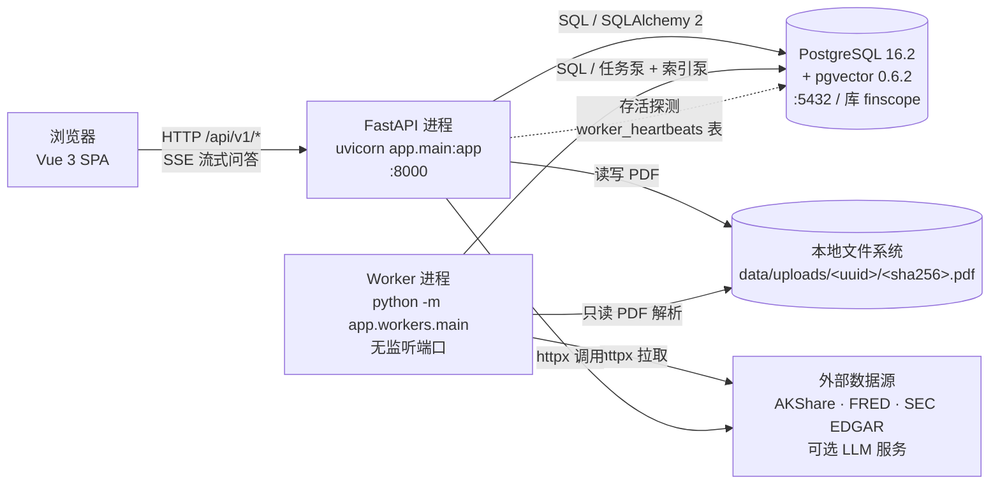
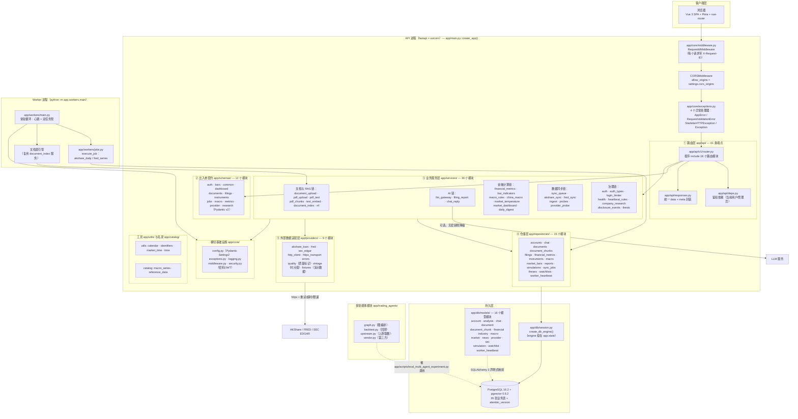
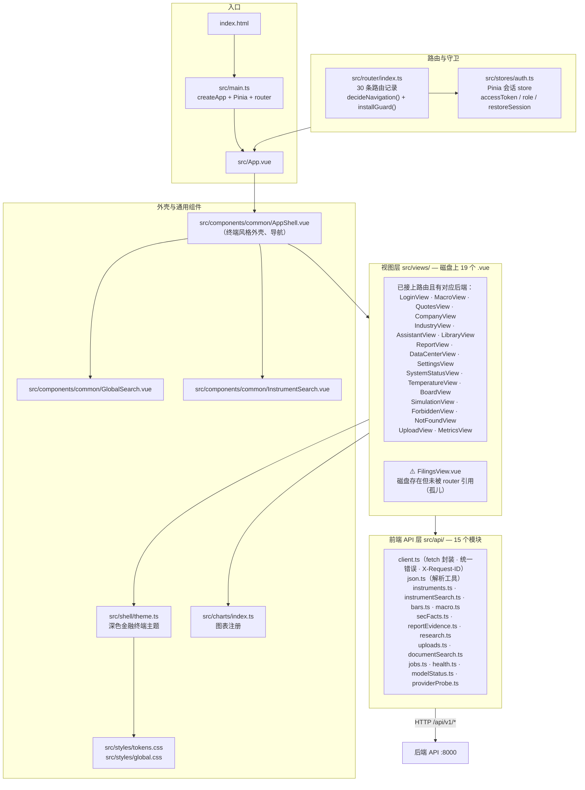
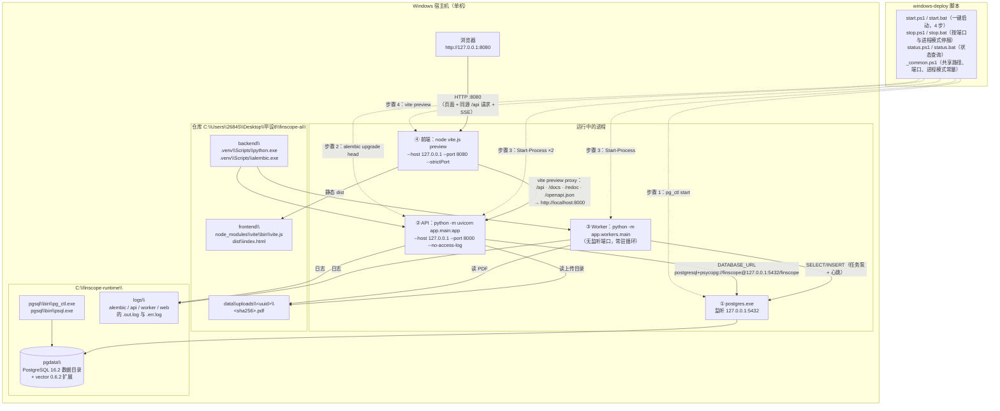
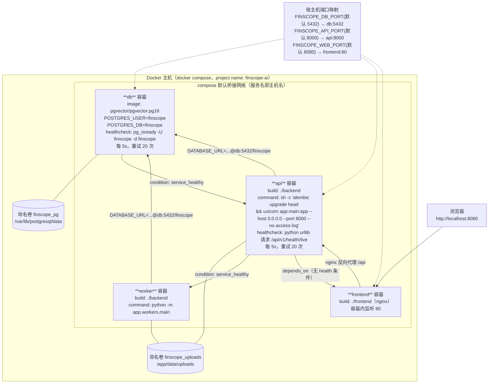
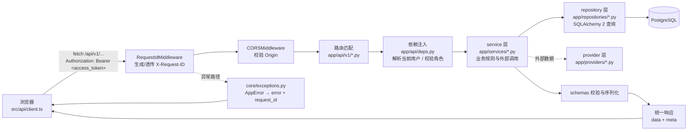

# FinScope AI 架构图

> 本文档所有模块、文件、端口、进程均**从仓库真实文件与脚本反查**得出，不包含规划中或不存在的东西。
> 每个模块名都能在仓库里 `grep` 到；每个端口都能在 `windows-deploy/_common.ps1` 与 `docker-compose.yml` 里查到。
> 图中标注 ⚠️ 的部分是**实测发现的缺陷**，如实列出。

---

## 0. 架构总览（一句话）

**模块化单体（Modular Monolith）**：一个 FastAPI 进程 + 一个独立 Worker 进程 + 一个 PostgreSQL（含 pgvector）实例 + 一个 Vue 3 单页应用。
不引入 Redis、不引入消息队列、不拆微服务 —— 这是 `docs/ADR-001-architecture.md` 明文记录的决策。

**关键设计点（均可在代码中核对）**

| 设计点 | 实现位置 | 说明 |
|---|---|---|
| API 与 Worker **不共享内存、不共享卷通信**，只通过数据库协作 | `docs/ADR-001-architecture.md:11` | Worker 把心跳写进 `worker_heartbeats` 表；API 的 `/health/ready` 读该表判断 Worker 是否活着 |
| API 与 Worker **共享上传目录**（本地文件系统） | `windows-deploy/_common.ps1` 中 `LogDir`/上传根；`docker-compose.yml` 的 `finscope_uploads` 卷 | 容器部署下用命名卷共享，本机部署下是同一路径 |
| 就绪与存活分离 | `app/api/v1/health.py`：`/health/live` 与 `/health/ready` | `/ready` 同时检查数据库 `SELECT 1` 与 `worker_heartbeats`；心跳过期返回 503 |
| 后台任务用**数据库当队列** | `app/services/sync_queue.py` + `sync_jobs` 表的 `lease_expires_at`、`uq_sync_jobs_active_dedupe` | 靠 `lease_expires_at` 租约与部分唯一索引实现"防重复认领 + 幂等入队"，不需要 Redis |
| AI 不可用时的降级是**显式文案**，不伪造 | `app/services/chat_reply.py`、`app/services/filing_report.py` | 见 `业务流程图.md` |

---

## 1. 后端组件图（真实分层）

分层约定来自 `finscope-ai/AGENTS.md`：**routes → services → repositories/providers → database**，路由里不放大段业务逻辑。

### 1.1 后端文件清单（实测计数，可用于答辩核对）

| 目录 | 模块数 | 真实文件 |
|---|---|---|
| `backend/app/api/` | 3 + 18 | `deps.py`、`responses.py`、`__init__.py`；`v1/` 下 18 个：`admin` `analysis` `assistant` `auth` `companies` `documents` `filings` `health` `industries` `instruments` `jobs` `macro` `market` `metrics` `research_board` `router` `watchlists` `__init__` |
| `backend/app/schemas/` | 12 + 1 | `auth` `bars` `common` `dashboard` `documents` `filings` `instruments` `jobs` `macro` `metrics` `provider` `research` + `__init__` |
| `backend/app/services/` | 30 + 1 | `akshare_sync` `auth` `auth_types` `bar_indicators` `chat_reply` `china_macro` `company_research` `daily_digest` `disclosure_events` `document_index` `document_upload` `filing_report` `financial_metrics` `fred_sync` `health` `heartbeat_rules` `ingest` `llm_gateway` `login_limiter` `macro_rules` `market_dashboard` `market_temperature` `pdf_chunks` `pdf_text` `pdf_upload` `probes` `provider_probe` `rrf` `sync_queue` `text_embed` `thesis` + `__init__` |
| `backend/app/repositories/` | 15 + 1 | `accounts` `chat` `documents` `document_chunks` `filings` `financial_metrics` `instruments` `macro` `market_bars` `reports` `simulations` `sync_jobs` `theses` `watchlists` `worker_heartbeat` + `__init__` |
| `backend/app/db/models/` | 16 + 1 | `account` `analysis` `chat` `document` `document_chunk` `financial` `industry` `macro` `market` `news` `provider` `sec` `simulation` `watchlist` `worker_heartbeat` + `__init__`（另有 `db/base.py`、`db/session.py`） |
| `backend/app/providers/` | 9 + 1 | `akshare_bars` `errors` `fixtures` `fred` `http_client` `httpx_transport` `quality` `sec_edgar` `vintage` + `__init__` |
| `backend/app/core/` | 5 + 1 | `config` `exceptions` `logging` `middleware` `security` |
| `backend/app/workers/` | 2 + 1 | `jobs.py`、`main.py` |
| `backend/app/trading_agents/` | 4 | `graph` `backtest` `upstream` `vendor`（**无 `__init__.py`，不是常规包布局**） |
| `backend/app/utils/` | 4 + 1 | `calendar` `identifiers` `market_time` `time` |
| `backend/app/catalog/` | 2 + 1 | `macro_series`、`reference_data` |
| `backend/app/scripts/` | 2 + 1 | `eval_multi_agent_experiment`、`seed` |
| `backend/app/prompts/` | 1 | `report_v1.txt`（报告提示词模板，被 `llm_gateway.py` 读取） |

`app/main.py` 装配顺序（实测 `backend/app/main.py:28-69`）：`configure_logging` → lifespan 建 engine 与 `LoginRateLimiter` → `FastAPI(...)` → `CORSMiddleware` → `RequestIdMiddleware` → 注册 4 个异常处理器 → `include_router(api_router, prefix="/api/v1")`。

---

## 2. 前端组件图（真实分层）

### 2.1 前端文件清单（实测）

| 目录 | 文件数 | 真实文件 |
|---|---|---|
| `frontend/src/views/` | **19** | `AssistantView` `BoardView` `CompanyView` `DataCenterView` `FilingsView` `ForbiddenView` `IndustryView` `LibraryView` `LoginView` `MacroView` `MetricsView` `NotFoundView` `QuotesView` `ReportView` `SettingsView` `SimulationView` `SystemStatusView` `TemperatureView` `UploadView` |
| `frontend/src/api/` | **15** | `bars.ts` `client.ts` `documentSearch.ts` `health.ts` `instruments.ts` `instrumentSearch.ts` `jobs.ts` `json.ts` `macro.ts` `modelStatus.ts` `providerProbe.ts` `reportEvidence.ts` `research.ts` `secFacts.ts` `uploads.ts` |
| `frontend/src/components/common/` | **3** | `AppShell.vue` `GlobalSearch.vue` `InstrumentSearch.vue` |
| `frontend/src/stores/` | **1** | `auth.ts` |
| `frontend/src/router/` | **1** | `index.ts` |
| `frontend/src/charts/` | **1** | `index.ts` |
| `frontend/src/shell/` | **1** | `theme.ts` |
| `frontend/src/styles/` | **2** | `global.css` `tokens.css` |

> **注意**：任务书描述的 `frontend/src/` 结构为 `api/ stores/ router/ views/ components/ charts/`，实测**还存在** `shell/theme.ts` 与 `styles/`（任务书未列）；`stores/` 下**只有一个** `auth.ts`，没有用户、行情、报告等其他 store。
> `frontend/src/api/` 下**没有** `filings.ts` 与 `documents.ts`：报表相关调用走 `secFacts.ts` / `reportEvidence.ts`，文档相关走 `uploads.ts` / `documentSearch.ts`。

### 2.2 ⚠️ 实测缺陷：前端路由引用了 11 个不存在的视图组件

用脚本把 `frontend/src/router/index.ts` 的 `import ... from "../views/X.vue"` 与 `frontend/src/views/` 磁盘文件做差集，结果：

| 结论 | 数量 | 明细 |
|---|---|---|
| router 引用的视图 | **29** | — |
| 磁盘上真实存在的视图 | **19** | — |
| **router 引用但磁盘不存在** | **11** | `CompanyAnalysisView` `CompanyFilingsView` `DashboardView` `HotspotsView` `IndustryDetailView` `MacroChinaView` `MacroLiquidityView` `MacroScenariosView` `MarketIndicesView` `MarketSectorsView` `WatchlistView` |
| **磁盘存在但未被 router 引用** | **1** | `FilingsView.vue` |

**影响**：`frontend/src/router/index.ts` 的这 11 个 `import` 指向不存在的文件，**当前前端无法通过构建**（Vite 会在打包阶段报 "Failed to resolve import"）。
**对应的路由**（`router/index.ts` 第 55–143 行）受影响的有：`/dashboard`、`/macro/china`、`/macro/liquidity`、`/macro/scenarios`、`/market/indices`、`/market/sectors`、`/company/:symbol/filings`、`/company/:symbol/analysis/:runId`、`/industry/:id`、`/hotspots`、`/watchlist` 。

> 这一点**无法从数据库或后端代码"证实为已实现"**，只能在答辩时如实说明为"前端路由表已按规格书 §1.3 铺开，其中 11 个视图组件尚未提交"。本文档不臆测其存在。

---

## 3. 部署图 A：本机 Windows 部署（当前实际运行方式）

由 `windows-deploy/` 下的脚本驱动，纯进程方式，**不使用容器**。

### 3.1 本机部署的真实参数（实测自 `windows-deploy/_common.ps1`）

| 常量 | 值 | 出处 |
|---|---|---|
| `$RuntimeHome` | `C:\finscope-runtime` | `_common.ps1:16` |
| `$PgHome` | `C:\finscope-runtime\pgsql` | `:17` |
| `$PgData` | `C:\finscope-runtime\pgdata` | `:18` |
| `$PgCtl` | `C:\finscope-runtime\pgsql\bin\pg_ctl.exe` | `:19` |
| `$LogDir` | `C:\finscope-runtime\logs` | `:20` |
| `$DbPort` | **5432** | `:22` |
| `$ApiPort` | **8000** | `:23` |
| `$WebPort` | **8080**（生产模式，vite preview 跑 dist） | `:24` |
| `$DevPort` | **5173**（`.\start.ps1 -Mode dev` 开发模式，带热更新） | `:25` |
| `$PythonExe` | `backend\.venv\Scripts\python.exe` | `:9` |
| `$AlembicExe` | `backend\.venv\Scripts\alembic.exe` | `:10` |
| `$ViteJs` | `frontend\node_modules\vite\bin\vite.js` | `:11` |
| `$DistIndex` | `frontend\dist\index.html` | `:12` |
| `$AppUser` / `$AppPassword` | `admin` / `FsScope!2026`（脚本文末打印的默认演示账号） | `:27-28` |
| API 进程识别模式 | `PythonExe + '.*uvicorn'` | `:31` |
| Worker 进程识别模式 | `PythonExe + '.*app\.workers'` | `:32` |
| 前端进程识别模式 | `ViteJs` | `:33` |

**`start.ps1` 的 4 个步骤（实测行号）**

| 步骤 | 内容 | `start.ps1` 行号 |
|---|---|---|
| 0 | 环境自检 | `:26` |
| 1 | 启动数据库（`pg_ctl` **分离式**启动 —— 脚本注释说明：若用 `Start-Process -RedirectStandardOutput` 启 `pg_ctl`，数据库进程会攥住调用方管道导致脚本无法返回） | `:43-61` |
| 2 | `alembic upgrade head` | `:63-65` |
| 3 | 启动 API（`-m uvicorn app.main:app --host 127.0.0.1 --port 8000 --no-access-log`）与 Worker | `:74-83` |
| 4 | 前端：生产模式跑 `vite preview --port 8080 --strictPort`；开发模式跑 `vite --port 5173 --strictPort`；`-Rebuild` 时先 `npm run build` | `:109-163` |
| 完成 | 打印前端地址、`/docs`、`/api/v1/health/ready`、演示账号与日志目录 | `:175-192` |

**可访问入口（本机）**：前端 `http://127.0.0.1:8080` · OpenAPI 文档 `http://127.0.0.1:8000/docs` · 就绪探针 `http://127.0.0.1:8000/api/v1/health/ready` · 日志 `C:\finscope-runtime\logs`。

---

## 4. 部署图 B：`docker-compose.yml` 容器部署

### 4.1 容器部署的真实参数（实测自 `docker-compose.yml`）

| 项 | 值 |
|---|---|
| project name | `finscope-ai` |
| 镜像 | `db` 用现成镜像 `pgvector/pgvector:pg16`；`api`/`worker` 都从 `./backend` 构建（**同一镜像，不同 command**）；`frontend` 从 `./frontend` 构建（nginx） |
| 数据库口令 | `change-me`（**与 ADR/AGENTS 要求一致地留作占位符，上线前必须替换**） |
| `JWT_SECRET` | `replace-with-long-random-secret`（同样是占位符） |
| `DATA_MODE` | `live` |
| `APP_ENV` | `development` |
| `FRONTEND_ORIGIN` | `http://localhost:5173,http://localhost:8080` |
| 心跳参数 | `WORKER_HEARTBEAT_INTERVAL_SECONDS=5`、`WORKER_HEARTBEAT_TTL_SECONDS=30` |
| 卷 | `finscope_pg`（数据库数据）、`finscope_uploads`（**api 与 worker 同时挂载**，这就是容器下两个进程共享上传文件的方式） |
| 启动依赖链 | `db --healthy--> api --healthy--> worker`；`frontend` 只 `depends_on: api`（不带 health 条件） |
| 前端反向代理 | **有** —— `vite.config.ts` 的 `preview.proxy`（:8080）与 `server.proxy`（:5173）都把 `/api` `/docs` `/redoc` `/openapi.json` 转到 `localhost:8000` | **有** —— `frontend/nginx.conf` 把 `/api/`、`/docs`、`/redoc`、`= /openapi.json` 反代到 `http://api:8000`，其余 `try_files ... /index.html` 做 SPA 回退 |
| 跨源（CORS）依赖 | 浏览器侧**不跨源**（走 vite 代理）；CORS 配置仅对直连 `:8000` 的客户端生效 | 浏览器侧**不跨源**（走 nginx 代理）；同上 |
| 无容器化的组件 | 无 —— 四个服务全部容器化 |

---

## 5. 两套部署方式的差异对照（答辩重点）

| 维度 | 本机 Windows 部署（部署图 A） | docker-compose 部署（部署图 B） |
|---|---|---|
| 数据库 | 宿主机原生 `C:\finscope-runtime\pgsql`，数据在 `pgdata\` | `pgvector/pgvector:pg16` 容器，数据在命名卷 `finscope_pg` |
| 数据库口令 | 本机开发口令，写在启动环境里 | `change-me` 占位符，需自行替换 |
| API 进程 | 宿主机 `backend\.venv\Scripts\python.exe -m uvicorn ...`，日志落 `C:\finscope-runtime\logs` | 容器内 `uvicorn app.main:app --host 0.0.0.0`，日志走容器 stdout |
| 迁移执行时机 | `start.ps1` **步骤 2** 独立跑 `alembic upgrade head` | `api` 容器 `command` 里**内联**执行 `alembic upgrade head && uvicorn ...` |
| Worker | 独立宿主机进程，靠**进程名模式**（`PythonExe.*app\.workers`）被 stop 脚本识别与终止 | 独立容器，靠容器生命周期管理 |
| 前端 | `vite preview`（生产模式 :8080）或 `vite`（开发模式 :5173，带 HMR） | `nginx` 容器，宿主 :8080 → 容器 :80 |
| 上传文件共享 | 同一本地路径 `data\uploads\`，天然共享 | 命名卷 `finscope_uploads` 同时挂到 `api` 与 `worker` |
| 启动编排 | `start.ps1` 顺序执行 4 步 + 端口/健康轮询（`Wait-ForPort`、`Wait-ForHttp`） | compose 的 `depends_on: condition: service_healthy` 声明式编排 |
| 停止方式 | `stop.ps1`：先按进程模式杀，再按端口兜底杀（`Get-NetTCPConnection -State Listen`） | `docker compose down` |
| 网络绑定 | 一律 `--host 127.0.0.1`，**仅本机可访问** | `--host 0.0.0.0` + 端口映射，**局域网/外网可访问** |
| 适用场景 | 毕业设计答辩演示（一键启停、日志集中、无需 Docker） | 可复现部署、跨机器迁移、CI 环境 |

**一致性结论**：两套部署的**应用代码、迁移版本、端口约定（5432/8000/8080）完全一致**，差异只在"进程如何被托管"。因此本机演示与容器部署的行为应当等价 —— 这是本项目"可复现"主张的技术依据。

---

## 6. 请求链路数据流（HTTP 一次请求经过什么）

---

## 7. 溯源（每张图的数据从哪来）

| 图 | 依据的真实来源 | 复核命令 |
|---|---|---|
| §0 架构总览图 | `docs/ADR-001-architecture.md:7-11`（模块化单体、不引 Redis/微服务、心跳表就绪检查）；`backend/app/main.py:28-69`（应用装配） | `Get-Content docs\ADR-001-architecture.md` |
| §1 后端组件图 | `backend/app/` 目录实际文件树（逐个子目录 `Get-ChildItem -Recurse -File -Filter *.py`）；`backend/app/api/v1/router.py:21-38`（18 个路由模块的 include 顺序）；`AGENTS.md` 分层规定 | `Get-ChildItem backend\app -Recurse -File -Filter *.py \| Measure-Object` |
| §1.1 文件清单计数 | 同上，逐目录实测 | 见上 |
| §2 前端组件图 | `frontend/src/` 实际文件树；`frontend/src/router/index.ts:50-144`（30 条路由记录 = 1 条重定向 + 29 条真实路由） | `Get-ChildItem frontend\src -Recurse -File` |
| §2.2 缺 11 个视图 | **脚本差集实测**：`Select-String -Path 'router\index.ts' -Pattern 'from\s+["'']\.\./views/([A-Za-z0-9_]+)\.vue["'']' -AllMatches` 提取 29 个 import，与 `Get-ChildItem views -File` 的 19 个文件做差集 | 见 §2.2 表 |
| §3 本机部署图 | `windows-deploy/_common.ps1:4-35`（路径与端口常量）、`:31-33`（进程识别模式）；`windows-deploy/start.ps1:26/43-61/63-65/74-83/109-163/175-192`（4 步流程与行号）；`windows-deploy` 下 8 个文件（`README.md`、`start/stop/status` 的 `.ps1`+`.bat`、`_common.ps1`）；前端代理边来自 `frontend/vite.config.ts:6-48` | `Select-String -Path 'windows-deploy\_common.ps1' -Pattern '^\s*\$[A-Za-z]+\s*='` |
| §4 容器部署图 | `docker-compose.yml` 全文（4 个 service、2 个卷、`depends_on` 条件、`command`、`healthcheck`、端口变量默认值）；nginx 代理边来自 `frontend/nginx.conf:7-31` | `Get-Content docker-compose.yml -Raw` |
| §5 差异对照 | 上述两份来源逐项对读 | — |
| §6 请求链路图 | `backend/app/main.py:49-68`（中间件与处理器注册顺序）；`backend/app/api/deps.py`（鉴权依赖）；`backend/app/core/exceptions.py`（`AppError` 与处理器） | `Get-Content backend\app\main.py` |

### 7.1 无法从代码证实的点（如实列出）

1. **`backend/app/trading_agents/` 是否真的被 API 或 Worker 调用**：目录下有 `graph.py`、`backtest.py`、`upstream.py`、`vendor.py` 四个文件，但**没有 `__init__.py`**，也不在 `app/main.py` 或 `app/workers/main.py` 的导入链上；只有 `app/scripts/eval_multi_agent_experiment.py` 这个名字暗示它可能被评估脚本调用。图中用**虚线**标注该关系，表示"疑似调用、未在本次核对中确证"。若要写入论文，请先确认 `eval_multi_agent_experiment.py` 的实际 import 语句。
2. **`frontend/src/api/` 中每个模块是否都被视图实际使用**：本次只统计了文件存在性，未做"谁 import 谁"的完整调用图。§2 图中列出的 API 模块名是文件清单，不代表引用关系已逐一核对。
3. **前端 `:8080` 与后端 `:8000` 之间的跨域/代理配置细节**：两套部署**机制不同，已分别核实，结论是两者都不依赖浏览器 CORS**——
   - 容器模式：`frontend/nginx.conf:7-27` 实测把 `location /api/`、`location /docs`、`location /redoc`、`location = /openapi.json` 全部 `proxy_pass http://api:8000`，其余走 `try_files $uri $uri/ /index.html`（第 29-31 行，SPA 回退）。
   - 本机模式：`frontend/vite.config.ts:8-25`（`server`，开发 :5173）与 `:30-47`（`preview`，生产 :8080）**两处都配置了** `/api`、`/docs`、`/redoc`、`/openapi.json` → `target: "http://localhost:8000"`、`changeOrigin: true`。
   - **因此两种模式前端都走同源代理**，浏览器侧不产生跨源请求；`settings.cors_origins`（环境变量 `FRONTEND_ORIGIN`）只在**绕过代理直连 `:8000`** 时（例如直接用 curl/Postman 带 Origin 头）才起作用。
   - 附带事实：`vite.config.ts:49-53` 配置了测试环境 `environment: "happy-dom"` 与 `setupFiles: ["./tests/setup.ts"]`，说明前端有 Vitest 测试目录 `frontend/tests/`。
4. **`worker_heartbeats` 的具体过期判定阈值**：本机脚本与 compose 都给了 `WORKER_HEARTBEAT_INTERVAL_SECONDS=5` / `TTL=30`，但判定逻辑在 `app/services/heartbeat_rules.py` 与 `app/api/v1/health.py` 里，本文档未逐行核对该文件，故不在此声明"过期即 503"的精确条件（该说法出自 `ADR-001-architecture.md:9`，属设计意图）。

### 7.2 与既有文档的关系

- `docs/ADR-001-architecture.md`（16 行）是本文档的**决策依据**，未做修改。
- `docs/thesis/结构图.md` 含少量更简略的组件示意；本文档是其超集，两者重叠处以本文档为准。
- `docs/thesis/部署与演示.md` 若已含启动命令，本文档的 §3/§4 **只补结构性部署图与参数出处**，不复述操作步骤。
