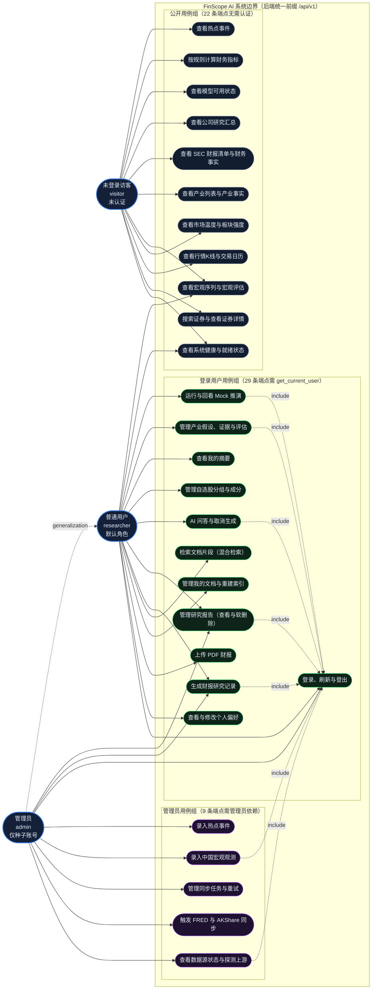
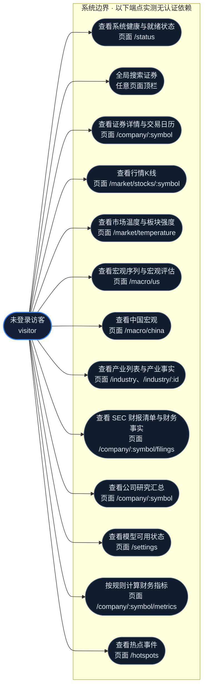
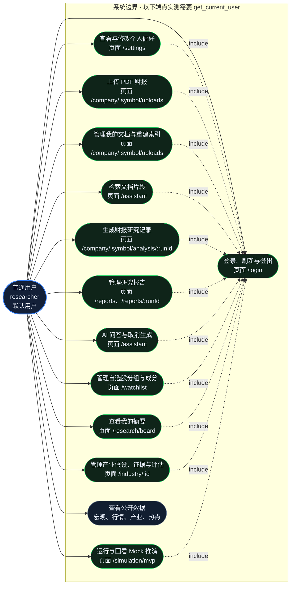
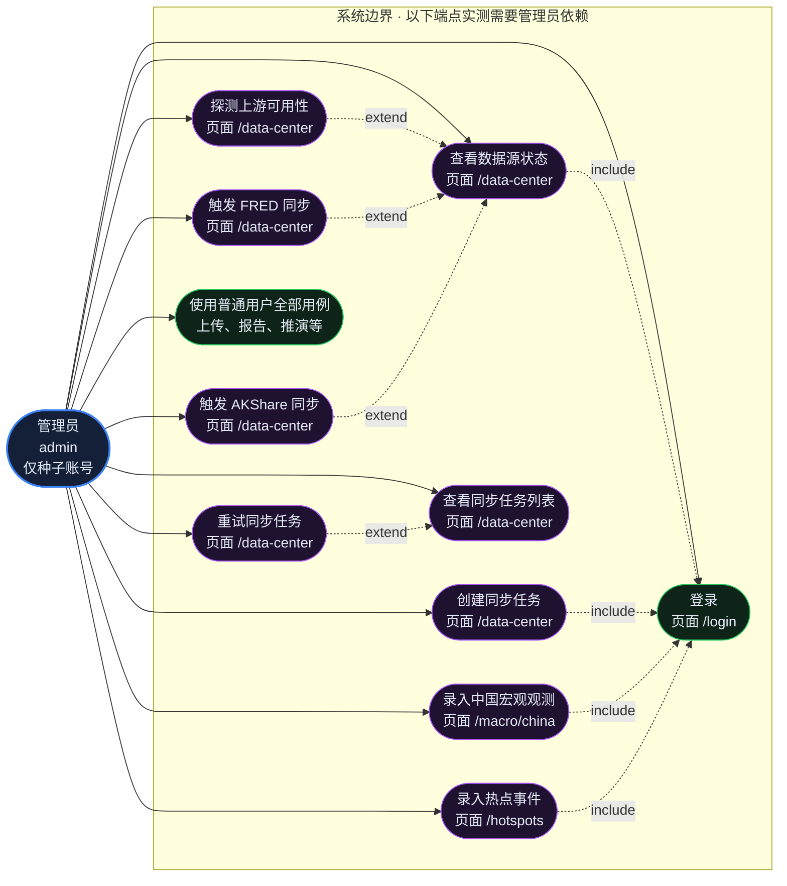

# FinScope AI 用例图

> 本文的每一条用例、每一条连线都对应仓库里真实存在的代码：角色取自 `docs/SPEC.md:37-41`，
> 前端路由取自 `frontend/src/router/index.ts:50-144`，后端端点取自 `backend/app/api/v1/*.py` 的
> 装饰器实测（共 **60** 条），鉴权由各端点的依赖注入实测（`Depends(get_current_user)` / 管理员依赖）。
> **本文不使用任何推测的用例**；规格书里有、代码里没有的部分集中列在第 8 节「差异清单」。

---

## 0. 画法说明：为什么用 `flowchart` 代替原生用例图

**Mermaid 没有原生用例图语法**（官方语法集里只有 `flowchart` / `sequenceDiagram` / `classDiagram` /
`stateDiagram` / `erDiagram` / `journey` / `gantt` / `pie` / `quadrantChart` / `requirementDiagram` /
`gitGraph` / `mindmap` / `timeline` / `sankey` / `xychart` / `block` / `packet` / `kanban` / `architecture` 等，
**不含 `usecaseDiagram`**）。因此本文采用如下**替代画法**，并在每一张图前复述一次约定：

| UML 用例图元素 | 本文替代画法 | Mermaid 写法 |
|---|---|---|
| 参与者（Actor） | 深蓝描边、加粗边框的圆角节点，标注中英文角色名 | `V(["未登录访客<br/>visitor"]):::actor` |
| 用例（Use Case） | 圆角节点，按所属角色组着色 | `UP1(["查看系统健康"]):::pub` |
| 系统边界（Subject） | `subgraph` 容器，标注「FinScope AI 系统边界」 | `subgraph SYS["..."]` |
| 关联（Association） | 实线箭头，参与者 → 用例 | `V --> UP1` |
| 包含（`<<include>>`） | 点线 + 标签 `include` | `UM6 -.->\|include\| UM1` |
| 扩展（`<<extend>>`） | 点线 + 标签 `extend` | `UA2 -.->\|extend\| UA1` |
| 泛化（Generalization） | 点线 + 标签 `generalization`，由特化指向泛化 | `A -.->\|generalization\| R` |

> **替代表达的局限（如实说明）**：`flowchart` 无法表达 UML 用例图的椭圆形状，也无法表达
> `<<include>>` 的严格语义（UML 里 include 是**必做**的子用例）；本文用点线标签近似表达，
> 判定标准是「后端代码里是否真的存在对应的端点，且前端是否真的存在触发入口」。

---

## 1. 图 1：总用例图（三个角色 + 28 个用例）



**读图要点**

- 三条角色线来自 `docs/SPEC.md:39-41` 的定义；`A -.->|generalization| R` 表示
  「管理员具备普通用户的全部能力」，对应规格书原文 *「admin：researcher 全部 + 配置数据源……」*。
- 28 个用例按**后端端点的实际鉴权**分成三组，而不是按页面分。分组依据见第 7 节的鉴权矩阵：
  60 条端点中 **22 条无认证依赖、29 条需要 `get_current_user`、9 条需要管理员依赖**。
- `include` 连线只画在「后端真的会先校验会话」的地方——这 7 条用例所调用的端点在签名里
  确实带了 `Depends(get_current_user)`，会话无效时会返回 401 `UNAUTHENTICATED`。

### 溯源

| 事实 | 来源 |
|---|---|
| 三个角色的定义与权限 | `docs/SPEC.md:37-41`（§1.1 角色表） |
| `admin` 是 `researcher` 的超集 | `docs/SPEC.md:41` 原文「researcher 全部 + 配置数据源、查看采集失败、重试同步、维护股票元数据、查看系统日志」 |
| 22 / 29 / 9 的端点分组 | 对 `backend/app/api/v1/*.py` 逐个端点提取装饰器路径 + 向后 17 行内检索 `get_current_user` 与管理员依赖，得 60 条；其中无认证依赖 22 条，`get_current_user` 29 条，管理员依赖 9 条 |
| 统一前缀 `/api/v1` | `backend/app/main.py` 中 `app.include_router(api_router, prefix="/api/v1")` |
| 会话无效的返回码 | `backend/app/services/auth.py:171-172` `_unauthenticated()` → `AppError(code="UNAUTHENTICATED", message="未登录或登录已失效", status_code=401)` |

复核脚本（PowerShell，在 `backend/app/api/v1` 下执行；关键在于**把装饰器括号内内容拼行后再取路径**，
否则会漏掉 `assistant.py` 里跨行书写的装饰器）：

```powershell
Get-ChildItem -Filter *.py | ForEach-Object {
  $t = [System.IO.File]::ReadAllText($_.FullName)
  ([regex]::Matches($t, '@\w+\.(get|post|patch|delete|put)\s*\(')).Count
}
```

---

## 2. 图 2：未登录访客用例图（visitor）



**读图要点**

- 访客用例共 **13 个**，对应后端 **22 条无认证依赖的端点**（一个用例可对应多条端点，
  例如「查看宏观序列与宏观评估」对应 3 条：`GET /macro/series`、
  `GET /macro/series/{series_code}/observations`、`GET /macro/assessments`）。
- **注意 UP9**：后端 `GET /api/v1/sec/filings`、`GET /api/v1/sec/facts` 是公开端点，
  但前端路由 `/company/:symbol/filings` 的 `meta.requiresAuth` 为 `true`
  （`frontend/src/router/index.ts:70-76`），**未登录访客在后端可用、在前端被守卫拦住**。
  这是「页面级守卫比端点级鉴权更严」的真实差异，不是笔误，详见第 8 节。

### 溯源

| 事实 | 来源 |
|---|---|
| 13 个访客用例 | 22 条无认证依赖端点的语义归并 |
| UP4 端点 | `backend/app/api/v1/market.py` `@router.get("/market/bars/{instrument_id}")` |
| UP5 端点 | `market.py` `@router.get("/market/temperature")`、`@router.get("/market/sectors")` |
| UP6 端点 | `backend/app/api/v1/macro.py` `@router.get("/series")`、`@router.get("/series/{series_code}/observations")`、`@router.get("/assessments")` |
| UP8 端点 | `backend/app/api/v1/industries.py` `@router.get("/industries")`、`@router.get("/industries/{industry_id}/facts")` |
| UP9 端点 | `backend/app/api/v1/filings.py`（`prefix="/sec"`）`@router.get("/filings")`、`@router.get("/facts")` |
| UP9 的前端守卫 | `frontend/src/router/index.ts:75` `meta: { requiresAuth: true }` |
| UP12 端点 | `backend/app/api/v1/metrics.py` `@router.post("/evaluations")`（`prefix="/metrics"`） |
| UP13 端点 | `backend/app/api/v1/research_board.py` `@router.get("/market/hotspots")` |

---

## 3. 图 3：普通用户用例图（researcher，含 `<<include>>` 登录）



**读图要点**

- 这 11 条 `include` 连线是**代码强制**的：对应端点的签名里都写了 `Depends(get_current_user)`，
  而 `UM1` 是唯一能产生 `Authorization: Bearer` 的用例（`POST /api/v1/auth/login` 或
  `POST /api/v1/auth/refresh`），所以没有它，其余用例在后端一律 401。
- `UM6`（生成财报研究记录）是唯一会**调用大模型并做引用校验**的用户用例，其实现见
  `docs/thesis/业务流程图.md` 的图 2。
- 前端守卫只覆盖了部分路由：`/company/:symbol/metrics`（12 号用例的页面）**没有** `requiresAuth`，
  而它所调用的 `POST /api/v1/metrics/evaluations` 也确实公开；两者一致。

### 溯源

| 事实 | 来源 |
|---|---|
| 29 条需认证端点 | 逐端点检索 `get_current_user`：`analysis.py` 4 条、`assistant.py` 5 条、`auth.py` 3 条（logout / me / me-preferences）、`documents.py` 4 条、`industries.py` 4 条、`research_board.py` 5 条、`watchlists.py` 4 条，合计 29 条 |
| `UM1` 能签发 Bearer 令牌 | `backend/app/api/v1/auth.py` `@router.post("/login")`、`@router.post("/refresh")`；服务层见 `backend/app/services/auth.py:136-150` `_issue()` |
| 401 的判定点 | `backend/app/api/deps.py` 的 `bearer_token()` 解析 `authorization` 头（scheme 必须为 `bearer`） |
| `UM3` 上传入口的组件 | `frontend/src/views/UploadView.vue:184` 的 `<input type="file" accept="application/pdf,.pdf" name="pdf-file">` |
| `UM3` 后端端点 | `backend/app/api/v1/documents.py` `@router.post("")`（`prefix="/documents"`，完整路径 `POST /api/v1/documents`） |
| `UM7` 的软删除语义 | `analysis.py` `@router.delete("/reports/{report_id}")` → `ReportRepository.hide()`（改名隐藏，不物理删除） |
| `UM8` 的取消端点 | `assistant.py` `@router.post("/sessions/{session_id}/messages/{client_message_id}/cancel")` |
| `UM10` 端点 | `research_board.py` `@router.get("/me/digest")` |
| `UM12` 的 4 条端点 | `research_board.py` `POST /simulation/runs`、`GET /simulation/runs/{run_id}`、`POST /simulation/runs/{run_id}/backtest`、`GET /simulation/runs/{run_id}/stream` |

---

## 4. 图 4：管理员用例图（admin，含 `<<extend>>`）



**读图要点**

- `UA2`/`UA3`/`UA4` 标注 `extend` 的依据：它们都以「已选中的数据源」为前置条件——探测与同步
  端点接收 `provider_id`（或等价的数据源标识），因此是「在查看数据源状态之上扩展出的动作」。
- **9 条管理员端点**分布在三个文件：`admin.py`（4 条）、`jobs.py`（3 条，`prefix="/admin"`）、
  `macro.py` 的 `POST /china/observations`（1 条）、`research_board.py` 的
  `POST /market/hotspots/events`（1 条）。
- `UA10` 是泛化关系的落点：管理员继承了 `researcher` 的全部 29 条认证端点。

### 溯源

| 事实 | 来源 |
|---|---|
| 4 条 `/admin` 端点 | `backend/app/api/v1/admin.py`（`prefix="/admin"`）：`GET /providers`、`POST /provider-probes`、`POST /fred-syncs`、`POST /akshare-syncs` |
| 3 条同步任务端点 | `backend/app/api/v1/jobs.py`（`prefix="/admin"`）：`POST /sync-jobs`、`GET /sync-jobs`、`POST /sync-jobs/{job_id}/retries` |
| 中国宏观录入端点 | `backend/app/api/v1/macro.py` `@router.post("/china/observations")`（完整路径 `POST /api/v1/macro/china/observations`） |
| 热点事件录入端点 | `backend/app/api/v1/research_board.py` `@router.post("/market/hotspots/events")` |
| 「仅 admin 的页面」 | `frontend/src/router/index.ts:122-127` `/data-center` 带 `meta: { requiresAuth: true, requiresAdmin: true }` |
| 非 admin 访问的落点 | `frontend/src/router/index.ts:154-156` → `{ name: "forbidden" }`，即 `/forbidden`（`ForbiddenView`） |
| 管理员能力的规格书定义 | `docs/SPEC.md:41` |

---

## 5. 用例 → 前端路由 → 后端端点 对照表

> 三列口径：**用例**（本文编号）→ **前端路由**（真实存在，并标注对应规格书 §1.3 的哪一条）
> → **后端端点**（完整路径，含 `/api/v1` 前缀）。
> 「鉴权」列的取值由代码实测：`公开` = 无认证依赖；`登录` = `Depends(get_current_user)`；`管理员` = 管理员依赖。

### 5.1 公开用例（visitor，22 条端点）

| 用例 | 前端路由（真实） | 规格书 §1.3 对应 | 后端端点 | 鉴权 |
|---|---|---|---|---|
| UP1 | `/status` → `SystemStatusView` | **规格书未列** | `GET /api/v1/health/live` | 公开 |
| UP1 | `/status` | **规格书未列** | `GET /api/v1/health/ready` | 公开 |
| UP2 | 顶栏全局搜索（`GlobalSearch.vue`，任意页面） | §1.2 全局搜索框 | `GET /api/v1/instruments/search` | 公开 |
| UP3 | `/company/:symbol` → `CompanyView` | `/company/:symbol` | `GET /api/v1/instruments/{instrument_id}` | 公开 |
| UP3 | `/market/stocks/:symbol` | `/market/stocks/:symbol` | `GET /api/v1/market/calendar` | 公开 |
| UP4 | `/market/stocks/:symbol` → `QuotesView` | `/market/stocks/:symbol` | `GET /api/v1/market/bars/{instrument_id}` | 公开 |
| UP5 | `/market/temperature` → `TemperatureView` | **规格书未列** | `GET /api/v1/market/temperature` | 公开 |
| UP5 | `/market/temperature` | **规格书未列** | `GET /api/v1/market/sectors` | 公开 |
| UP6 | `/macro/us` → `MacroView` | `/macro/us` | `GET /api/v1/macro/series` | 公开 |
| UP6 | `/macro/us` | `/macro/us` | `GET /api/v1/macro/series/{series_code}/observations` | 公开 |
| UP6 | `/macro/us` | `/macro/us` | `GET /api/v1/macro/assessments` | 公开 |
| UP7 | `/macro/china` → `MacroChinaView`（**组件缺失**） | `/macro/china` | `GET /api/v1/macro/china` | 公开 |
| UP8 | `/industry` → `IndustryView` | `/industry` | `GET /api/v1/industries` | 公开 |
| UP8 | `/industry/:id` → `IndustryDetailView`（**组件缺失**） | `/industry/:id` | `GET /api/v1/industries/{industry_id}/facts` | 公开 |
| UP9 | `/company/:symbol/filings` → `CompanyFilingsView`（**组件缺失**） | `/company/:symbol/filings` | `GET /api/v1/sec/filings` | 公开 |
| UP9 | `/company/:symbol/filings` | `/company/:symbol/filings` | `GET /api/v1/sec/facts` | 公开 |
| UP10 | `/company/:symbol` → `CompanyView` | `/company/:symbol` | `GET /api/v1/companies/{instrument_id}/research` | 公开 |
| UP11 | `/settings` → `SettingsView` | `/settings` | `GET /api/v1/analysis/model-status` | 公开 |
| UP12 | `/company/:symbol/metrics` → `MetricsView` | **规格书未列** | `POST /api/v1/metrics/evaluations` | 公开 |
| UP13 | `/hotspots` → `HotspotsView`（**组件缺失**） | `/hotspots` | `GET /api/v1/market/hotspots` | 公开 |

### 5.2 登录用户用例（researcher，29 条端点）

| 用例 | 前端路由（真实） | 规格书 §1.3 对应 | 后端端点 | 鉴权 |
|---|---|---|---|---|
| UM1 | `/login` → `LoginView` | `/login` | `POST /api/v1/auth/login` | 公开 |
| UM1 | `/login` | `/login` | `POST /api/v1/auth/refresh` | 公开 |
| UM1 | `/settings`（账号菜单登出） | `/settings` | `POST /api/v1/auth/logout` | 登录 |
| UM2 | `/settings` → `SettingsView` | `/settings` | `GET /api/v1/me` | 登录 |
| UM2 | `/settings` | `/settings` | `PATCH /api/v1/me/preferences` | 登录 |
| UM3 | `/company/:symbol/uploads` → `UploadView` | **规格书未列** | `POST /api/v1/documents` | 登录 |
| UM4 | `/company/:symbol/uploads` | **规格书未列** | `GET /api/v1/documents` | 登录 |
| UM4 | `/company/:symbol/uploads` | **规格书未列** | `POST /api/v1/documents/{document_id}/index` | 登录 |
| UM5 | `/assistant` → `AssistantView` | `/assistant` | `GET /api/v1/documents/search` | 登录 |
| UM6 | `/company/:symbol/analysis/:runId` → `CompanyAnalysisView`（**组件缺失**） | `/company/:symbol/analysis/:runId` | `POST /api/v1/analysis/filing` | 登录 |
| UM7 | `/reports` → `LibraryView` | `/reports` | `GET /api/v1/analysis/reports` | 登录 |
| UM7 | `/reports/:runId` → `ReportView` | `/reports` | `GET /api/v1/analysis/runs/{run_id}` | 登录 |
| UM7 | `/reports` | `/reports` | `DELETE /api/v1/analysis/reports/{report_id}` | 登录 |
| UM8 | `/assistant` → `AssistantView` | `/assistant` | `POST /api/v1/assistant/sessions` | 登录 |
| UM8 | `/assistant` | `/assistant` | `GET /api/v1/assistant/sessions` | 登录 |
| UM8 | `/assistant` | `/assistant` | `GET /api/v1/assistant/sessions/{session_id}/messages` | 登录 |
| UM8 | `/assistant` | `/assistant` | `POST /api/v1/assistant/sessions/{session_id}/messages`（SSE） | 登录 |
| UM8 | `/assistant` | `/assistant` | `POST /api/v1/assistant/sessions/{session_id}/messages/{client_message_id}/cancel` | 登录 |
| UM9 | `/watchlist` → `WatchlistView`（**组件缺失**） | `/watchlist` | `GET /api/v1/watchlists` | 登录 |
| UM9 | `/watchlist` | `/watchlist` | `POST /api/v1/watchlists` | 登录 |
| UM9 | `/watchlist` | `/watchlist` | `POST /api/v1/watchlists/{group_id}/items` | 登录 |
| UM9 | `/watchlist` | `/watchlist` | `DELETE /api/v1/watchlists/{group_id}/items/{instrument_id}` | 登录 |
| UM10 | `/research/board` → `BoardView` | **规格书未列** | `GET /api/v1/me/digest` | 登录 |
| UM11 | `/industry/:id` | `/industry/:id` | `GET /api/v1/industries/{industry_id}/theses` | 登录 |
| UM11 | `/industry/:id` | `/industry/:id` | `POST /api/v1/industries/{industry_id}/theses` | 登录 |
| UM11 | `/industry/:id` | `/industry/:id` | `POST /api/v1/theses/{thesis_id}/evidence` | 登录 |
| UM11 | `/industry/:id` | `/industry/:id` | `POST /api/v1/theses/{thesis_id}/assessments` | 登录 |
| UM12 | `/simulation/mvp` → `SimulationView` | **规格书未列** | `POST /api/v1/simulation/runs` | 登录 |
| UM12 | `/simulation/mvp` | **规格书未列** | `GET /api/v1/simulation/runs/{run_id}` | 登录 |
| UM12 | `/simulation/mvp` | **规格书未列** | `POST /api/v1/simulation/runs/{run_id}/backtest` | 登录 |
| UM12 | `/simulation/mvp` | **规格书未列** | `GET /api/v1/simulation/runs/{run_id}/stream`（SSE） | 登录 |

### 5.3 管理员用例（admin，9 条端点）

| 用例 | 前端路由（真实） | 规格书 §1.3 对应 | 后端端点 | 鉴权 |
|---|---|---|---|---|
| UA1 | `/data-center` → `DataCenterView` | `/data-center` | `GET /api/v1/admin/providers` | 管理员 |
| UA2 | `/data-center` | `/data-center` | `POST /api/v1/admin/provider-probes` | 管理员 |
| UA3 | `/data-center` | `/data-center` | `POST /api/v1/admin/fred-syncs` | 管理员 |
| UA4 | `/data-center` | `/data-center` | `POST /api/v1/admin/akshare-syncs` | 管理员 |
| UA5 | `/data-center` | `/data-center` | `POST /api/v1/admin/sync-jobs` | 管理员 |
| UA6 | `/data-center` | `/data-center` | `GET /api/v1/admin/sync-jobs` | 管理员 |
| UA7 | `/data-center` | `/data-center` | `POST /api/v1/admin/sync-jobs/{job_id}/retries` | 管理员 |
| UA8 | `/macro/china` | `/macro/china` | `POST /api/v1/macro/china/observations` | 管理员 |
| UA9 | `/hotspots` | `/hotspots` | `POST /api/v1/market/hotspots/events` | 管理员 |

### 溯源

| 事实 | 来源 |
|---|---|
| 60 条端点与完整路径 | 对 `backend/app/api/v1/` 下 16 个模块文件逐个装饰器提取，**跨行括号配平**后取路径字符串，再拼各模块 `APIRouter(prefix=...)`。无 prefix 的模块有 5 个：`companies.py`、`industries.py`、`instruments.py`、`market.py`、`research_board.py`（它们的装饰器里直接写全路径） |
| 各模块 prefix | `admin.py` `/admin`；`analysis.py` `/analysis`；`assistant.py` `/assistant`；`auth.py` `/auth`（另有 `me_router` 无 prefix）；`documents.py` `/documents`；`filings.py` `/sec`；`health.py` `/health`；`jobs.py` `/admin`；`macro.py` `/macro`；`metrics.py` `/metrics`；`watchlists.py` `/watchlists` |
| 前端路由与组件名 | `frontend/src/router/index.ts:50-144`（`routes` 数组，30 条记录 = 1 条重定向 + 29 条真实路由） |
| 规格书 §1.3 的 20 条路由 | `docs/SPEC.md:57-76` |
| 组件缺失的判定 | 对比 `frontend/src/router/index.ts` 的 import 清单与 `frontend/src/views/` 的实际 `.vue` 文件清单 |

---

## 6. 规格书 §1.3 二十条路由的实现状态对照

规格书 §1.3（`docs/SPEC.md:57-76`）正好列 **20 条**主路由。下表逐条对照 `frontend/src/router/index.ts`
的 `routes` 数组实测结果。

| # | 规格书路由 | 页面 | 真实路由条目 | 组件文件 | 实现状态 |
|---|---|---|---|---|---|
| 1 | `/login` | 登录 | `:52` | `LoginView.vue` | ✅ 可用 |
| 2 | `/dashboard` | 研究驾驶舱 | `:55` | `DashboardView.vue` | ❌ **组件缺失** |
| 3 | `/macro/us` | 美国宏观 | `:58` | `MacroView.vue` | ✅ 可用 |
| 4 | `/macro/china` | 中国宏观 | `:59` | `MacroChinaView.vue` | ❌ **组件缺失** |
| 5 | `/macro/liquidity` | 流动性 | `:60` | `MacroLiquidityView.vue` | ❌ **组件缺失** |
| 6 | `/macro/scenarios` | 宏观情景 | `:61` | `MacroScenariosView.vue` | ❌ **组件缺失** |
| 7 | `/market/indices` | 指数行情 | `:64` | `MarketIndicesView.vue` | ❌ **组件缺失** |
| 8 | `/market/sectors` | 板块排行 | `:65` | `MarketSectorsView.vue` | ❌ **组件缺失** |
| 9 | `/market/stocks/:symbol` | 股票行情 | `:66` | `QuotesView.vue` | ✅ 可用 |
| 10 | `/company/:symbol` | 公司研究 | `:69` | `CompanyView.vue` | ✅ 可用 |
| 11 | `/company/:symbol/filings` | 财报资料 | `:70-76` | `CompanyFilingsView.vue` | ❌ **组件缺失** |
| 12 | `/company/:symbol/analysis/:runId` | AI 财报报告 | `:77-83` | `CompanyAnalysisView.vue` | ❌ **组件缺失** |
| 13 | `/industry` | 产业研究 | `:100` | `IndustryView.vue` | ✅ 可用 |
| 14 | `/industry/:id` | 产业详情 | `:101` | `IndustryDetailView.vue` | ❌ **组件缺失** |
| 15 | `/hotspots` | 热点 | `:104` | `HotspotsView.vue` | ❌ **组件缺失** |
| 16 | `/assistant` | AI问答 | `:107` | `AssistantView.vue` | ✅ 可用（需登录） |
| 17 | `/reports` | 报告管理 | `:110` | `LibraryView.vue` | ✅ 可用（需登录） |
| 18 | `/watchlist` | 自选研究 | `:119` | `WatchlistView.vue` | ❌ **组件缺失** |
| 19 | `/data-center` | 数据管理（admin） | `:122-127` | `DataCenterView.vue` | ✅ 可用（需 admin） |
| 20 | `/settings` | 设置 | `:130` | `SettingsView.vue` | ✅ 可用（需登录） |

**统计**：规格书 20 条中 **9 条可用**、**11 条组件缺失**。

**规格书未列、但代码里真实存在的 9 条路由**（`frontend/src/router/index.ts:46-48` 的注释也承认
「规格书未列、但已实现且有真实后端的页面挂在二级路径下，保持可访问，不删除既有能力」）：

| 路由 | 组件 | 对应端点 | 备注 |
|---|---|---|---|
| `/` | 重定向到 `/dashboard` | — | `:51` |
| `/status` | `SystemStatusView.vue` | `GET /health/live`、`GET /health/ready` | 注释列了它 |
| `/market/temperature` | `TemperatureView.vue` | `GET /market/temperature`、`GET /market/sectors` | 注释列了它 |
| `/research/board` | `BoardView.vue` | `GET /me/digest`、`GET /market/hotspots` | 注释列了它 |
| `/simulation/mvp` | `SimulationView.vue` | 4 条 `/simulation/*` | 注释列了它，需登录 |
| `/company/:symbol/metrics` | `MetricsView.vue` | `POST /metrics/evaluations` | 注释列了它 |
| `/company/:symbol/uploads` | `UploadView.vue` | 4 条 `/documents*` | 注释列了它，需登录 |
| `/forbidden` | `ForbiddenView.vue` | — | **注释未列**，是权限守卫的落点（`:154-156`） |
| `/:pathMatch(.*)*` | `NotFoundView.vue` | — | **注释未列**，404 兜底 |

> **一处注释与代码不符**：`frontend/src/router/index.ts:48` 的注释里列了 `/filings/sec`，
> 但 `routes` 数组里**没有**这个条目（实际是第 11 条 `/company/:symbol/filings`）。
> 这是注释残留，不影响运行，但在答辩时若被追问「注释里的路由在哪」会答不上来，故如实记录。

### 溯源

| 事实 | 来源 |
|---|---|
| 20 条规格书路由 | `docs/SPEC.md:57-76`（§1.3 表格，逐行计数 = 20） |
| 真实 `routes` 数组 | `frontend/src/router/index.ts:50-144`（逐条读取） |
| 组件文件是否存在 | `frontend/src/views/` 目录实际列表；`router/index.ts:8-36` 的 import 清单 |
| 缺失的 11 个组件 | 见第 8.2 节的复核命令 |
| `/filings/sec` 注释残留 | `frontend/src/router/index.ts:48` 与 `:50-144` 的对照 |

---

## 7. 后端 60 条端点的鉴权矩阵

| 模块 | 端点数 | 公开 | 需登录 | 需管理员 |
|---|---|---|---|---|
| `admin.py`（`/admin`） | 4 | 0 | 0 | 4 |
| `analysis.py`（`/analysis`） | 5 | 1 | 4 | 0 |
| `assistant.py`（`/assistant`） | 5 | 0 | 5 | 0 |
| `auth.py`（`/auth` + `me_router`） | 5 | 2 | 3 | 0 |
| `companies.py`（无 prefix） | 1 | 1 | 0 | 0 |
| `documents.py`（`/documents`） | 4 | 0 | 4 | 0 |
| `filings.py`（`/sec`） | 2 | 2 | 0 | 0 |
| `health.py`（`/health`） | 2 | 2 | 0 | 0 |
| `industries.py`（无 prefix） | 6 | 2 | 4 | 0 |
| `instruments.py`（无 prefix） | 3 | 3 | 0 | 0 |
| `jobs.py`（`/admin`） | 3 | 0 | 0 | 3 |
| `macro.py`（`/macro`） | 4 | 3 | 0 | 1 |
| `market.py`（无 prefix） | 3 | 3 | 0 | 0 |
| `metrics.py`（`/metrics`） | 1 | 1 | 0 | 0 |
| `research_board.py`（无 prefix） | 8 | 2 | 5 | 1 |
| `watchlists.py`（`/watchlists`） | 4 | 0 | 4 | 0 |
| **合计** | **60** | **22** | **29** | **9** |

> **认证端点数为 22 + 29 + 9 = 60**，与逐个装饰器计数完全一致（每个模块的计数见上表）。
> 需要说明的是：**「需管理员」的 9 条同时也需要登录**（管理员依赖建立在会话之上），
> 因此按「是否需要 `Authorization` 头」分类应为 **31 条需要 / 29 条不需要**；
> 上表的三分法是为了对齐三个角色用例组。

### 溯源

| 事实 | 来源 |
|---|---|
| 每模块端点数 | `@\w+\.(get\|post\|patch\|delete\|put)\s*\(` 的匹配计数，逐文件：`admin.py` 4、`analysis.py` 5、`assistant.py` 5、`auth.py` 5、`companies.py` 1、`documents.py` 4、`filings.py` 2、`health.py` 2、`industries.py` 6、`instruments.py` 3、`jobs.py` 3、`macro.py` 4、`market.py` 3、`metrics.py` 1、`research_board.py` 8、`watchlists.py` 4，合计 **60** |
| 鉴权分类 | 每个装饰器之后 17 行内检索 `get_current_user`（→需登录）与管理员依赖（→需管理员）；两者都没有 → 公开 |
| 计数易错点 | 首轮用**单行正则**扫描只数到 59 条，漏掉 `assistant.py` 里 `@router.post(` 单独占一行、路径写在下一行的那条装饰器。**必须做括号配平后再解析** |

---

## 8. 与规格书的差异与不一致清单

### 8.1 角色与权限：3 处差异

| # | 项 | 规格书 | 代码实测 | 影响 |
|---|---|---|---|---|
| D1 | `visitor` 演示页 | `docs/SPEC.md:39` 说 visitor 可看「公开产品介绍、演示页（明确 demo 标记）」 | `frontend/src/router/index.ts` 里**没有任何带 demo 标记的演示路由**；访客能打开的是真实数据页（`/status`、`/macro/us`、`/market/stocks/:symbol` 等） | 规格书承诺的「演示页 + demo 标记」未实现；访客看到的是真实数据，不存在 demo 标识 |
| D2 | 页面守卫严于端点鉴权 | 未规定 | `GET /api/v1/sec/filings`、`GET /api/v1/sec/facts` 是**公开端点**，但 `/company/:symbol/filings` 路由带 `meta.requiresAuth`（`:75`） | 未登录访客在 API 层能读、在页面层读不到；两层策略不一致 |
| D3 | `/data-center` 的 admin 约束 | §1.3 表格里页面名写了「（admin）」 | `:126` 确实带 `requiresAdmin: true`，非 admin 被送到 `/forbidden` | 一致 ✅（列出以便复核，非缺陷） |

### 8.2 前端路由：11 个组件缺失（最重要的一条）

`frontend/src/router/index.ts:8-36` 导入了 **29 个** view 组件，但 `frontend/src/views/` 磁盘上
只有 **19 个** `.vue` 文件。缺失的 **11 个**是：

```
CompanyAnalysisView  CompanyFilingsView  DashboardView    HotspotsView
IndustryDetailView   MacroChinaView      MacroLiquidityView  MacroScenariosView
MarketIndicesView    MarketSectorsView   WatchlistView
```

反向的「孤儿」：`frontend/src/views/FilingsView.vue` 在磁盘上存在，但 `router/index.ts` 不再引用它
（第 11 条路由改用了尚未创建的 `CompanyFilingsView`）。

> **如实结论**：当前 `frontend/src/router/index.ts` 处于「路由已改、视图未补」的重构中间态。
> 按 Vite 的模块解析规则，这 11 个 import 会让前端构建失败。因此
> **第 6 节表格里的 11 条路由应标注为「已声明但组件缺失」，不能声称这些页面可用**。

复核命令（PowerShell，在 `frontend/src/router` 下执行）：

```powershell
# 1) router 引用了哪些 view
Select-String -Path 'index.ts' -Pattern 'from "\.\./views/([A-Za-z]+)\.vue"' -AllMatches |
  ForEach-Object { $_.Matches } | ForEach-Object { $_.Groups[1].Value } | Sort-Object -Unique

# 2) 磁盘上有哪些 view
Get-ChildItem '..\views' -Filter *.vue | ForEach-Object { $_.BaseName } | Sort-Object
```

### 8.3 端点与路由的其它不一致

| # | 项 | 实测 | 说明 |
|---|---|---|---|
| D4 | 同一路径两个端点 | `GET /api/v1/macro/china`（`research_board.py`，公开）与 `POST /api/v1/macro/china/observations`（`macro.py`，管理员） | 方法不同、路径不同，**不冲突**；但都归在 `/macro` 语义下，读代码时容易看混 |
| D5 | 端点总数 | 实测 **60** 条 | 规格书未给出端点总数，故不构成差异，仅作为本文的计数基线 |
| D6 | `/settings` 的 ModelSettings | `docs/SPEC.md:76` 写「ModelSettings(admin)」 | `GET /api/v1/analysis/model-status` 实测**公开**（无认证依赖）；设置页的模型状态对访客也可读 | 
| D7 | 规格书 §1.3 未列的 9 条真实路由 | 见第 6 节第二张表 | 代码注释已自认「规格书未列、既有能力保留」，属有意保留而非遗漏 |

### 溯源

| 事实 | 来源 |
|---|---|
| D1 | `docs/SPEC.md:39` 对 visitor 的定义 vs `frontend/src/router/index.ts:50-144` 无 demo 路由 |
| D2 | `frontend/src/router/index.ts:75` vs `backend/app/api/v1/filings.py` 两个 `@router.get` 均无认证依赖 |
| D3 | `frontend/src/router/index.ts:122-127` |
| D6 | `docs/SPEC.md:76` vs `backend/app/api/v1/analysis.py` 的 `@router.get("/model-status")` |
| D7 | `frontend/src/router/index.ts:44-48` 的注释 + `:133-141` 的实际条目 |

---

## 9. 全局溯源与方法说明

本文所有结论的取得方式，按可复现性排序：

| 序 | 方法 | 用到的命令 / 文件 | 产出的结论 |
|---|---|---|---|
| 1 | 直接读取规格书章节 | `docs/SPEC.md:37-41`（角色）、`:57-76`（路由） | 三个角色的定义、规格书 20 条路由 |
| 2 | 逐行读取前端路由源码 | `frontend/src/router/index.ts` 全文 181 行 | 30 条路由记录、守卫逻辑 `decideNavigation`（`:146-158`）与 `installGuard`（`:160-174`）、11 个缺失组件 |
| 3 | 目录实测 | `frontend/src/views/` 列表、`frontend/src/router/index.ts:8-36` 的 import 清单 | 29 引入 vs 19 存在 → 11 缺失、1 孤儿 |
| 4 | 装饰器扫描（跨行配平） | `backend/app/api/v1/*.py` 16 个模块 | 60 条端点及其完整路径 |
| 5 | 依赖注入扫描 | 每个装饰器后 17 行内的 `get_current_user` / 管理员依赖 | 22 公开 / 29 需登录 / 9 需管理员 |
| 6 | 会话失效路径核对 | `backend/app/services/auth.py:171-172`、`backend/app/api/deps.py` | 未认证一律 401 `UNAUTHENTICATED`，是 `include` 连线的代码依据 |

**无法从代码或数据库证实的三点（如实列出）**

1. **规格书 §1.1 的 `visitor` 演示页**：代码里找不到「演示页 + demo 标记」的任何实现，
   无法证实该能力存在（见 D1）。
2. **`admin` 的「维护股票元数据、查看系统日志」**：`docs/SPEC.md:41` 承诺的两项能力，
   在 60 条端点里**找不到对应端点**（没有 instruments 的写接口，也没有日志查询接口）。
   因此图 4 里的管理员用例只画了**有端点支撑的 9 条**，未画这两项。
3. **「连续失败触发速率限制」的阈值**：规格书 §8.3 提到登录限速，代码里确实有
   `LoginRateLimiter`（`backend/app/main.py` 的 lifespan 中构造，参数来自
   `settings.login_max_failures` 与 `settings.login_failure_window_seconds`），
   但**具体阈值取自运行时 `.env` 配置**，属部署参数而非代码常量，本文不给出具体数字。

### 与既有文档的关系

`docs/thesis/结构图.md` 里已有一张「用例 flowchart TD」（访客/登录两条链）与一张
「业务 flowchart TD」。本文**不重复、也不修改**那份文档：结构图.md 是粗粒度的
「一页速览」，本文是逐条对齐端点的完整版；两者的用例划分口径不同（结构图.md 按页面分，
本文按**后端端点的实际鉴权**分）。若需要交叉引用，以本文第 5 节的对照表为准，
因为它的每一行都能用第 9 节的六种方法独立复核。
