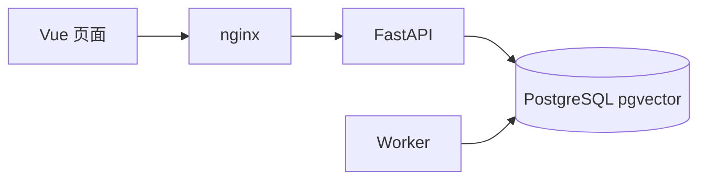
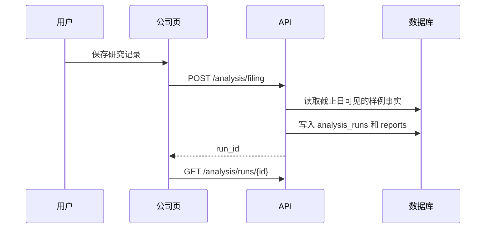
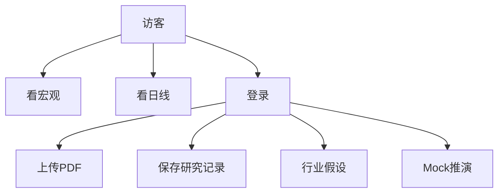
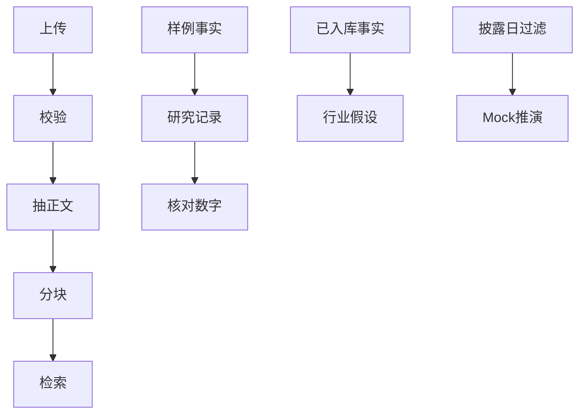

# 从当前代码整理的结构图

表名来自 Alembic 修订，不是设想中的库。

## 架构

## 研究记录

## 用例

## 业务

## 主要表

`users`、`instruments`、`trading_calendars`、`market_bars`、`macro_series`、`macro_observations`、`filings`、`sec_facts`、`financial_metrics`、`documents`、`document_chunks`、`analysis_runs`、`reports`、`chat_sessions`、`chat_messages`、`watchlist_groups`、`watchlist_items`、`industries`、`industry_theses`、`thesis_evidence`、`news_events`、`agent_simulation_runs`、`agent_node_traces`、`agent_debate_rounds`、`agent_risk_assessments`、`agent_simulation_decisions`。

`agent_backtest_evaluations` 已建表，但没有写入收益率，因为推演不模拟成交。
