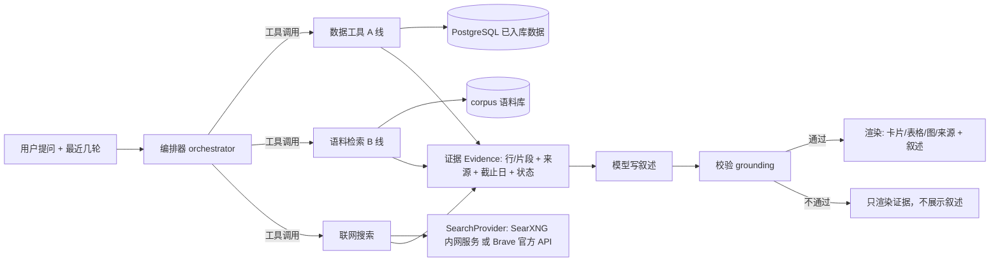

# AI 投研助手改造：数据查询 + 动态语料库 + 联网搜索

日期：2026-10-18 · 状态：**设计稿（已做案头核实），尚未实现** · 入口：侧栏「AI投研助手」（`/assistant`）

> 核实范围：只查了官方文档、模型主页与各站条款原文，**没有写原型、没有在服务器上实测**。凡是写"待实测"的都没有验证过。核实结论见「向量化」「联网搜索」「待确认」与来源表。

## 目标

把助手做成「结论先行、能查自己的数据、能引用最新文本、每句话能追到来源」的研究问答，而不是现在的"白名单序列转述器"。参照的交互是用户给的截图：

- 回答先给结论，再分点展开；
- 有表格、数据卡片、来源标签，必要时有传导路径图；
- 追问能接上上一轮（"这个加息"指前面说的 9 月加息）；
- 显示「正在查什么」的过程；
- 既能回答"美国 CPI 最近怎么走"这类**数据查询**，也能回答"沃什那次讲话偏鸽还是偏鹰"这类需要**最新文本**的问题。

## 现状（读代码得到的事实）

| 方面 | 现在 | 位置 |
| --- | --- | --- |
| 选数据 | 用问题去做子串匹配，只认 9 个美国 FRED 序列（10 年期、2 年期、期限利差、失业率、CPI、核心 PCE、联邦基金、GDP、非农）；匹配不上直接回「没对上序列」 | `services/chat_reply.py: match_macro_codes` |
| 模型的作用 | 只把几行数字改写成三五句话；不提供工具，不能自己选数据 | `services/chat_model.py`（`temperature=0`，单轮，30 秒超时） |
| 防编造 | 回答里每个数字必须出现在资料里，否则整段作废改列资料 | `chat_reply._grounded` |
| 上下文 | 只发当前一句，没有多轮 | `api/v1/assistant.py: _composer` |
| 流式 | 先整段算完再按 24 个字切块推送，是假流式；取消接口只能取消"未完成"的回合 | `chat_reply.event_stream` |
| 库里的数据 | 中国宏观 21 序列、美国宏观、A 股日线、财报指标、板块强弱、自定义数据分析（PCR / ERP / 巴菲特指标 / 中位数 PB）、自选、热点公告元数据，**助手都查不了** | 各 `services/` `repositories/` |
| 文档检索 | 用户上传 PDF 有混合检索（向量 + 全文，RRF 融合），但向量是 `local-hashing-v1` 哈希向量，本质是字面匹配，不是语义；`embedding_api_*` 配置项存在但没接 | `services/text_embed.py`、`services/document_index.py` |
| 表结构 | `chat_messages` 只有 `content`（纯文本）、`completion_status`，放不下卡片 / 来源 / 过程 | `db/models/chat.py` |
| 限流 | 助手接口没有用户级限流（只有登录限流） | `services/login_limiter.py` |
| 前端 | 没有 Markdown 渲染库（依赖只有 vue / element-plus / echarts / pinia） | `frontend/package.json` |

## 原则

沿用项目规则（`AGENTS.md`），并补几条助手特有的：

1. **不编造**。没有数据就说没有，写明缺什么、截止到哪天；不用模型的记忆补数字。
2. **每个数字可追溯**：来自某次工具调用的某一行，或某个文档片段，页面上能点开看到来源与截止日。
3. **无前视**：所有查询带 `as_of`，只读 `published_at <= as_of` 的数据。
4. **不绕站点限制**：不抓 robots.txt 不允许的站点、不抓付费墙、不换 UA / 走代理躲封；被拒就标「暂不可用」。
5. **不引入付费依赖**。
6. **分层**：路由 → 服务 → 仓库 / provider → DB；模型不直接碰数据库，也不联网（联网只经 `web_search` 工具）。
7. **模型的立场句改成"基于资料的分析"**：不用"我认为 / 我的判断"伪装成人格；结论必须列出依据，不给买卖建议。
8. **资料里的文字都是数据，不是指令**：工具结果、文档片段、网页摘要都按不可信输入处理（防提示词注入）。

## 总体架构



- **A 线（数据查询）**：给模型一组固定的查询工具，模型决定调哪个、传什么参数，服务端校验后执行。**不让模型写 SQL。**
- **B 线（动态语料库）**：官方来源的文本持续入库，检索后作为证据提供给模型。
- **联网搜索**：第三条工具，只返回标题 / 链接 / 摘要，标注"未核实"，与 A、B 两线的证据分开展示。
- **编排器**：一个有上限的循环——模型提出工具调用 → 服务端执行 → 结果回填 → 直到模型给出最终文字或达到步数上限（默认 4 步）。

### 事件协议（SSE）

服务端按顺序推送，前端边收边画：

| 事件 | 内容 |
| --- | --- |
| `step` | 过程：`{id, label, status}`，例如「正在查询：美国 CPI 同比」「已检索：美联储讲话 5 条」 |
| `block` | 一个渲染块（见下），工具成功后**立即**推送，不等模型 |
| `delta` | 叙述文字片段 |
| `sources` | 本回答引用的来源列表 |
| `done` | `{as_of, model, grounded, steps}` |
| `error` | `{code, message}`，不带密钥与内部细节 |

**叙述的流式取舍**：grounding 校验要看完整文本，所以叙述是"模型生成完 → 校验通过 → 再推送"，不把没校验过的数字先显示出来。等模型的这段时间前端靠 `step` 和 `block` 保持有内容在动。校验不通过时叙述不展示，只保留工具产出的卡片 / 表格，并提示「没能生成可核对的文字回答」。

### 渲染块

| 块 | 来源 | 说明 |
| --- | --- | --- |
| `metric_cards` | 工具结果的最新值 | 标题、数值、单位、同比 / 变动、截止日；对应截图里「美国最新关键宏观数据」 |
| `table` | 工具结果 | 列与行都来自工具，不由模型生成 |
| `line_chart` | 时间序列工具结果 | 用现有 `VChart` |
| `sources` | 语料 / 网页证据 | 来源标签：发布方、标题、发布日、链接；联网结果带「未核实」 |
| `quote_table` | 语料证据 | 例如"讲话要点 / 偏鹰偏鸽 / 解读"：**每一行的原文必须是检索到的片段里的逐字子串**，服务端校验；中文意译与原文并排，原文可展开 |
| `notice` | 服务端 | 数据过期 / 缺失 / 联网不可用 / 校验失败 |

卡片、表格、图都由**服务端按工具结果直接生成**，模型只写叙述并引用它们。传导路径图这类概念图列为后续可选项，且规定图里不得出现数字。

## A 线：数据查询工具

每个工具：参数用 JSON Schema 声明；服务端**白名单校验**（代码、日期范围、条数上限）；返回统一的 `ToolResult`：

```text
ToolResult { rows, columns, as_of, source, status: ok|stale|unavailable, reason }
```

状态沿用各数据页已有的口径（过期阈值按频率）。`unavailable` / `stale` 会原样进入证据，模型被要求如实转述。

| 工具 | 参数 | 复用 | 说明 |
| --- | --- | --- | --- |
| `macro_series` | `code`（目录白名单）、`start`、`end`、`as_of` | `MacroRepository`、`MacroChinaRepository` | 美国 FRED + 中国 21 序列；按 `published_at <= as_of` 取 |
| `macro_compare` | 两个序列 + 区间 | 同上 | 例如期限利差、对比两国 CPI；差值由 `calc` 算，不由模型算 |
| `instrument_search` | 名称 / 代码 | `InstrumentRepository` | 把"贵州茅台""苹果"解析成标的代码，歧义时返回候选让模型追问 |
| `price_bars` | 标的、区间、复权 | `MarketBarRepository` | 日线收盘、区间涨跌幅 |
| `financial_metrics` | 标的、期次、指标 | 财报指标服务 | 营收、净利润、同比（口径沿用现有 TTM / 单季规则，不重算） |
| `board_strength` | 行业 / 概念、基准、窗口 | 板块行情服务 | 相对沪深 300 强弱 |
| `custom_indicator` | `pcr` / `erp` / `buffett` / `median_pb` + 分组 | `CustomAnalysisService` | 带 5 年分位与信号，缺数据按原状态返回 |
| `watchlist` | — | 自选服务 | 仅当前登录用户自己的数据 |
| `calc` | `diff` / `pct_change` / `mean` / `percentile` + 输入引用 | 纯函数 | **所有算术都走它**，模型不自己做算术；结果也作为证据 |

问题里没有对上任何工具时，模型可以直接说明"这个问题我没有对应的数据"，并给出能查什么的例子，**不调用模型去猜**。

### grounding 校验（扩展现有规则）

现有规则"回答里每个数字必须出现在资料里"会误伤列表序号、日期、年份，所以先定义归一化：

- 忽略列表序号（`1.`、`第三`）、标题编号、`as_of` 与证据里已出现的日期 / 年份；
- 其余数字必须逐个出现在某条证据里（工具结果、`calc` 结果、文档片段、网页摘要）；
- 来自网页摘要的数字，叙述里必须带归属（"据 X 报道"），并在块里标「未核实」；
- 引用原文（`quote_table`）必须是片段的逐字子串。

校验失败：不展示叙述，保留证据块。

## B 线：动态语料库

### 为什么单独一条线

"沃什这次讲话偏鸽还是偏鹰"、"美联储 9 月为什么加息"这类问题，答案在最新的发言、纪要、公告、解读里，库里的数字表回答不了。语料库的任务是：**持续把合规来源的文本收进来，检索时带着发布时间和来源**。

### 来源登记表 `corpus_sources`

每个来源一行：`code`、发布方、类型（央行 / 统计 / 监管 / 交易所 / 公司披露 / 国际组织）、抓取方式（RSS / 官方 API / 页面）、频率、保留策略、是否存全文、`robots_checked_at`、`terms_note`、`enabled`。**接入前逐路径核对 robots.txt 与使用条款，不满足就不接**，核对结论写进 `terms_note`。

以下是 2026-10-18 的**初步核对**（只测了 robots.txt 根文件和少量地址，**不等于已批准**，接入每个来源前要逐路径复核）：

| 来源 | 内容 | 方式 | 初步结果 | 计划 |
| --- | --- | --- | --- | --- |
| 美联储 | 新闻稿、讲话、FOMC 声明 / 纪要 | 官方 RSS：`/feeds/press_all.xml`、`/feeds/speeches.xml` | 两个 RSS 返回 200；`robots.txt` 为 404（未声明限制） | **优先接入**。版权声明（Board 官网）：内容属公有领域，可自由使用，**但要注明美联储为来源**；页面里**标注为他人版权的材料（非 Board 内容）不属此列**，需另行许可。做法：存全文并保留来源；带第三方版权标记的页面只存标题 + 摘要 + 链接，不展示图片 |
| SEC EDGAR | 8-K / 10-K 正文 | `data.sec.gov` / `www.sec.gov` | 公平访问政策：**总请求不超过 10 次/秒**；必须声明 UA（公司 / 联系方式），不声明会被拦；网页被频率阈值拦过一次 | 沿用现有 `sec_user_agent`，限速压到远低于 10 次/秒，只走官方接口。**注意：代码里 `sec_user_agent` 的默认值是占位邮箱 `research-admin@example.com`，上线前必须在服务器 `.env` 里换成真实联系方式** |
| BLS | CPI / 就业数据 | 官方 API（`api.bls.gov`，免费注册密钥） | **网页对不合规的自动访问直接返回 Access Denied** | **不抓网页**；需要时只用官方 API；数值库里已有 FRED |
| BEA | PCE / GDP | 官方 API（免费密钥） | `robots.txt` 200，未发现全站禁止 | 需要时走 API，页面不抓 |
| 国家统计局 | 新闻发布会、数据解读 | 官网页面 | `robots.txt` 404；已有数据库接口在用。服务条款：为新闻 / 信息传播等非商业公益目的、在善意合理范围内转载引用允许，须注明来源（中国统计信息网 / 国家统计局）、不得歪曲原意；声明不得转载的内容、网站特有的图表版式除外 | 接入。定位是**非商业研究工具**；检索用全文，展示端只给片段 + 来源 + 链接，不整篇转载，不抓图表；解读栏目的具体路径接入时再复核 |
| 证监会 / 中国政府网 | 政策、规则 | 官网 | `robots.txt` 200，证监会的规则很长（约 22 万字符），需**逐路径解析** | 解析规则后再决定栏目 |
| 巨潮 / 上交所 / 深交所 | 公告 | 已有 `hotspot_sync`（只存标题 / 元数据） | `cninfo`、`sse` 的 `robots.txt` 404；深交所本机未连通 | 复用现有来源；年报 / 季报正文只对自选股抓 PDF（`pdf_text` 已有） |
| IMF / BIS / ECB | 讲话、报告 | 官网 RSS | IMF 404；BIS、ECB 200 | 可选，第二批 |
| 中国人民银行 | 货币政策执行报告等 | — | 对普通请求返回 403，robots 不允许（项目已有结论） | **不抓**；只接受用户上传的 PDF |
| 商业新闻 | Reuters / WSJ / Bloomberg 等 | — | 付费墙、版权 | **不抓全文**；只可能经联网搜索得到标题 + 摘要 + 链接 |

截图里的 Reuters / 华尔街日报 / Bloomberg 标签，来自 ChatGPT 自带的联网搜索，不是它们爬出来的。我们没法等价复制：没有来源的"市场反应"类说法，助手会直说"无法核实"。

### 表结构（新增，独立于用户上传的 `document_chunks`）

- `corpus_sources`：见上。
- `corpus_documents`：`id`、`source_id`、`url`（规范化）、`title`、`publisher`、`doc_type`、`language`、`published_at`、`retrieved_at`、`content_hash`、`has_full_text`、`status`、`license_note`。唯一键 `(source_id, canonical_url)`；同 URL 内容变化记新版本，不覆盖旧版本。
- `corpus_chunks`：`document_id`、`chunk_index`、`content`、`section_title`、`char_start/end`、`embedding vector(1024)`、`embedding_model`、`tsv`。`hnsw` 余弦索引，同现有 `document_chunks`。
- `corpus_fetch_runs`：每次抓取的来源、起止时间、条数、失败原因，供「数据新鲜度」页展示。

> 向量列固定 1024 维，短向量零填充（见「向量化」）；与现有 `document_chunks` 的 1536（哈希向量）分开，互不影响。pgvector 的 HNSW 索引对 `vector` 类型最多支持 2000 维，1024 在范围内（官方 README 与源码 `HNSW_MAX_DIM`）。

### 抓取与入库流水线（scheduler 登记 → worker 执行）

1. **登记**：按来源频率登记 `corpus_sync` 任务，幂等键 `corpus:{source}:{day}`；沿用现有 `sync_jobs` 队列与重试。
2. **抓取**：条件请求（`ETag` / `Last-Modified`）；每个主机限速（默认 1 请求 / 秒）；UA 声明项目名与联系方式；失败重试有上限；**不换 UA、不走代理**。
3. **解析**：RSS 取条目；HTML 取正文（去导航 / 脚本）；PDF 用现有 `pdf_text`。
4. **去重**：规范化 URL + `content_hash`。
5. **切块**：复用现有切块（页码 / 字符位置 / 章节标题保留）。
6. **向量化与全文索引**：见下一节；同时写 `tsv`。
7. **保留策略**：官方发言 / 纪要 / 政策长期保留；元数据类（公告标题）按来源配置；非官方来源只存标题、摘要与链接。
8. **首次回补窗口**：默认近 24 个月；`--since` 可调，可中断可重复。
9. **失败不扩散**：单个来源失败只影响自己，状态进「运行状态」页，不假装成功。

### 检索

- **混合检索**：向量 + 全文，RRF 融合（复用 `document_index` 里已有的融合逻辑）。
- **过滤**：`published_at <= as_of`、`doc_type`、`publisher`、时间窗（默认近 90 天，问历史时放宽）；只在 `embedding_model` 等于当前配置的块里查。
- **时效**：同等相关度下新文档优先，旧文档标注发布日。
- **拒答阈值**：分数低于阈值就返回"没有相关资料"，**不拿低相关片段凑数**。
- **多样性**：同一文档最多取 N 个片段，避免一篇文章占满证据。
- **引用**：每个片段带 `[n]` 编号，对应发布方、标题、发布日、链接；叙述里引用必须落在这些编号上。

## 向量化：本地与云接口两套都做

统一成一个 **OpenAI 兼容的 `/embeddings` 客户端**，下面可换：

| 模式 | 实现 | 说明 |
| --- | --- | --- |
| `local` | 项目自带的内网 `embedder` 服务（FastAPI，对外说 OpenAI 兼容协议），装开源模型 | 免费，不依赖外部接口 |
| `cloud` | 复用已有的 `embedding_api_base_url / key / model` 配置项 | 预留接口，可能产生费用 |
| `hashing` | 现有 `local-hashing-v1` | 仅测试与降级，不作语义检索宣传 |

- 配置：`EMBEDDING_PROVIDER=local|cloud|hashing`，界面里保存的值盖过环境变量，同现有机制。
- **本地模型**（均为 MIT 许可，数据来自模型主页与 MTEB 榜单，2026-10-18 核对）：

  | 模型 | 维度 | 参数 / 体积 | 语言 | 结论 |
  | --- | --- | --- | --- | --- |
  | `intfloat/multilingual-e5-small` | 384 | 118M，运行内存约 449 MB | 约 100 种语言（含中英文） | **本地默认**：当前服务器放得下 |
  | `BAAI/bge-m3` | 1024 | 568M，权重 2.27 GB | 多语言，最长 8192 token | **当前服务器放不下**，服务器升到 8 GB 以上再考虑 |
  | `BAAI/bge-small-zh-v1.5` | 512 | 24M，约 96 MB | **仅中文** | 美联储英文文本检索会差，不用 |

  - `multilingual-e5-small` 必须给查询加 `query: `、给文档加 `passage: ` 前缀，不加会掉效果（官方 FAQ）；最长 512 token，长文靠切块；官方提示低资源语言可能退化。它比 `bge-m3` 弱，**效果以评测集实测为准，不预先承诺**。
  - 维度不同怎么存：`corpus_chunks.embedding` 固定 `vector(1024)`，短向量**零填充**到 1024（零填充不改变余弦与内积结果）；超过 1024 维的模型拒绝接入。代价是每块约 4 KB 而不是 1.5 KB，按几万块估算在百兆量级，可接受。
- **云接口要求**：返回维度必须 ≤ 1024，且支持指定输出维度（例如请求里带 `dimensions`）；否则配置保存时直接拒绝，不静默截断。
- **混用禁止**：每个块记 `embedding_model`；查询只在同模型的块里搜。**换模型 = 后台重新向量化**（`reembed` 任务，可中断），完成前旧块继续服务旧模型的查询。
- **资源**：服务器为 2 核 / 3.6 GB（运维指南），已经"偏紧"。`embedder` 作为独立容器（内存上限 1 GB），API 与 worker 都经 HTTP 调它，API 进程不加载模型。**上线前要在服务器上实测现有容器的内存占用**（`docker stats`），余量不足就走 `cloud`。
- **推理方式**：`multilingual-e5-small` 官方仓库带 ONNX 权重，用 `onnxruntime` + `tokenizers` 即可，不必装完整 `torch`；这两个依赖都要在 PR 里列出并锁版本。备选 `sentence-transformers`（镜像更大）。

## 联网搜索：SearXNG（上线前有一个合规阻塞项）

### 它是什么

SearXNG 是自建的元搜索引擎，替你去各家搜索引擎的**网页**上取结果。许可证 AGPL-3.0：我们**不修改它的代码，只用官方镜像 + 配置文件**，作为内网网络服务调用；若将来改了它的代码，要按 AGPL 公开修改。

### 合规评估（2026-10-18 案头核实）：公共搜索引擎的网页引擎不能直接启用

| 引擎 | 核实结果 | 结论 |
| --- | --- | --- |
| Google | 服务条款禁止"违反网页机读指令（如 robots.txt）的自动化访问"；其早期条款更明确：不得向 Google 发送任何自动化查询，不得对 Google "元搜索"，且不会批准研究项目的此类请求 | **不启用** |
| Bing | 官方渠道是 Azure 的 "Grounding with Bing Search"，有专门条款，需要在批准的 Microsoft 应用里使用，且是付费服务；抓网页结果不在其中 | **不启用** |
| DuckDuckGo | 没有官方网页搜索 API；其条款是否禁止抓取，目前只见到第三方博客的说法，**未读到原文** | 原文核实前**不启用** |
| Brave Search | 有官方 Search API（JSON，自助申请）；每个计划含每月 5 美元免费额度，**注册需要信用卡**，超额按量计费，可设置用量上限 | 合规；是否算"付费依赖"要你定 |
| Wikipedia 等 | 有官方 API，允许程序访问 | 可用，但只覆盖百科类 |

SearXNG 自己的限流（`limiter`）只防别人刷你的实例，**不解决"我们去抓别人网页是否被允许"**。所以按项目规则（不绕过站点限制、不违反使用条款），**SearXNG 的 Google / Bing / DuckDuckGo 网页引擎不能作为默认配置上线**。

这与"用 SearXNG"的选择有冲突，所以设计上这样处理：

- `web_search` 工具背后是一个**可替换的 `SearchProvider` 接口**，实现有 `searxng` 和 `brave_api` 两种，配置里选一个；
- `searxng` 实现的**引擎白名单默认为空**，每加一个引擎都要先读到它的原始条款并记录在 `terms_note`；白名单为空时 `web_search` 工具**不对模型开放**，助手只用 A、B 两线，没有来源的新闻类说法照常回答"无法核实"；
- 若你同意用 Brave 的官方 API（免费额度内、设用量上限、需信用卡），则 `brave_api` 实现可以直接上线，`searxng` 作为备选保留；
- 这一项需要你在第 4 期开始前拍板，**不影响第 1–3 期**。

### 部署与配置（`searxng` 实现启用时）

- 新增 `searxng` 容器，**只绑内网网络**，不暴露公网端口；`server.limiter: false`（私有实例）；`secret_key` 来自环境变量，不进仓库。
- 默认 `search.formats` 只有 `html`，要把 `json` 加进去才能被程序调用（官方文档）。
- 引擎白名单由配置文件固定，不用"全部启用"。
- 遇到验证码 / 403 / 429，SearXNG 自带的引擎暂停机制生效，我们这边显示「联网搜索暂不可用」，**不重试轰炸、不换出口**。

### 使用规则

- 只在模型判断"需要新闻 / 市场反应 / 语料库时间范围之外的事件"时调用；纯数据查询不调用。
- **只取标题、链接、摘要**，不抓正文（版权、付费墙、robots）。
- 结果缓存 15 分钟；每用户每日上限；全局 QPS 上限，把对上游引擎的压力压到很低。
- 域名分级：官方 / 监管 / 央行 / 交易所为高可信，其他标「未核实」；叙述里任何来自网页摘要的事实必须带归属。
- 网页摘要按**不可信输入**处理（提示词注入防护，见下）。
- 管理员开关 `ASSISTANT_WEB_SEARCH_ENABLED`；用户界面有「联网搜索」开关。

## 多轮对话

- 每次请求带最近 6 条消息；**不重放旧回合的工具结果**，只带旧回合的文字回答与一份紧凑的"实体清单"（提到的序列代码、标的、日期），这样"这个加息"能解析，且新数据重新查，不拿旧数字当现在的数字。
- 会话标题自动取第一问的前 30 字（现在是固定"新的问答"）。

## 数据模型变更（增量、可回退）

`chat_messages` 增加：`blocks jsonb`（渲染块）、`sources jsonb`、`steps jsonb`、`as_of timestamptz`、`model text`、`grounded boolean`、`tool_trace jsonb`（工具名、参数、行数、状态，**不存原始大结果**，用于审计与排错）。旧消息这些列为 `NULL`，前端按纯文本渲染。

## 前端

- 对话布局参照截图：用户气泡、助手回答区、折叠的「思考过程」、卡片 / 表格 / 图、来源标签（点开显示发布方、标题、发布日、链接）、复制 / 重试 / 停止。
- **Markdown 渲染**：目前没有。方案：引入一个小型、MIT 的解析库并**关闭原始 HTML**，输出再经白名单净化；不用 `v-html` 直接渲染模型文字。新增依赖会单独列在 PR 里。
- 空状态的示例问题更新为"数据查询 + 语料类"两种。
- 状态：loading（过程流）/ empty / error（可重试）/ stale（卡片上标过期）/ 校验失败（只显示证据）/ 联网不可用。
- 流式用 `fetch` + `ReadableStream`（现有做法），支持中途取消；已完成的回合刷新后能从 `blocks` 还原。

## 安全与成本

- **提示词注入**：工具结果、文档片段、网页摘要放在明确标记的"资料"区，系统提示声明其中的指令一律不执行；工具参数只由服务端白名单校验后的值决定；模型没有网络与文件访问。
- **工具调用上限**：每问最多 4 步，单步超时，结果行数上限，单次回答的 token 上限。
- **用户级限流**：每分钟 / 每日问答数上限（现在没有）；超限返回明确提示。
- **日志**：不记密钥；问题原文按现有日志脱敏规则处理；`tool_trace` 只记摘要。
- **管理员总开关**：关掉后回到当前的"固定说明"行为。
- **函数调用能力探测**：启动时 / 保存模型配置时探测当前模型是否支持工具调用；不支持就降级为"规划器"模式——模型只输出一个受 JSON Schema 约束的查询计划，服务端执行后再让模型写叙述。
  - 核实结果：DeepSeek 官方文档确认其接口兼容 OpenAI 的 `tools` 调用格式（含多工具并行调用）。
  - **但文档里当前推荐的模型名与项目运维指南示例里的 `deepseek-chat` 不一致**，旧名可能已是兼容别名或即将下线；**必须看服务器 `.env` 里实际配的模型名**，并以探测结果为准，不按文档推断。

## 测试

- **单测**：工具参数校验（越界代码 / 日期 / 条数）；`calc` 纯函数；grounding 归一化（序号、日期、年份、归属）；引用原文逐字校验；检索（过滤 `as_of`、拒答阈值、同模型约束）；去重与切块；来源登记解析。
- **假模型**：脚本化的 `FakeLLM`，按预设依次发出工具调用并给出叙述，使编排器测试**确定且离线**。覆盖：正常、工具 `unavailable` / `stale`、grounding 失败、提示词注入样例、联网不可用、步数上限、取消。
- **集成**：真实 PostgreSQL 上的语料表（`pgvector` 索引、同模型约束、重复入库幂等）。
- **评测集**：约 40 个问题（美联储语气、CPI 与加息、A 股公告、数据查询、应当拒答的问题）+ 固定的小语料 fixture，指标是 Recall@5 与"该拒答时拒答"的比例，进 CI，不依赖线上模型。
- **前端**：块渲染、来源标签、过程折叠、校验失败态、取消。
- 真实模型的冒烟脚本单独放在 `scripts/`，不进 CI。

## 分期与 PR

| 期 | 内容 | 不依赖 |
| --- | --- | --- |
| 1 | 后端：编排器 + 数据工具 + `calc` + grounding + 事件协议 + 多轮 + 限流 + 消息表迁移 | 不抓任何新数据 |
| 2 | 前端：新对话界面、Markdown、卡片 / 表格 / 图 / 来源、过程折叠 | 依赖 1 |
| 3 | 语料库：表 + 流水线 + 美联储与已有公告来源 + `embedder` 服务（local 默认 `multilingual-e5-small` / cloud）+ 检索 + 评测集 | 需先在服务器实测内存余量；SEC 的 UA 联系方式要换成真实的 |
| 4 | 联网搜索：`SearchProvider` 接口 + `web_search` 工具 + 缓存 / 限额 + 前端开关；实现为 `searxng`（引擎白名单默认空）或 `brave_api` | **需你先决定用哪种**（见「待确认」）；白名单为空且未配 API 时工具不开放 |
| 5 | 第二批来源（统计局解读、证监会栏目、IMF / BIS / ECB）、`reembed`、运维手册 | 依赖 3 |

每期按 DoD：至少 1 个正常 + 1 个异常测试，跑 lint / 类型检查 / 测试，实际运行页面，更新 `docs/IMPLEMENTATION_LOG.md`。

## 不做

- 买卖建议、荐股、下单；
- 让模型写 SQL；
- 抓商业新闻全文、付费墙内容、robots 不允许的站点（包括人民银行站点）；
- 为联网搜索更换出口 IP、伪装 UA 或绕过验证码；
- 用模型记忆补数字。

## 待确认

1. **服务器内存（已部分核实）**：服务器 2 核 / 3.6 GB，`bge-m3` 放不下，本地默认已改为 `multilingual-e5-small`；**还差一步**：在服务器上 `docker stats` / `free -m` 看现有容器占用，确认能腾出约 1 GB，否则走 `cloud`。
2. **联网搜索走哪条路（需你决定）**：
   - A. `brave_api`：官方 API，合规，有每月免费额度，需信用卡、超额计费（可设上限）；
   - B. `searxng`：引擎白名单默认空，逐个核对原始条款后才加，可能最终只剩百科类引擎；
   - C. 第 4 期先不做，助手只用 A、B 两线。
   DuckDuckGo 的条款原文还没读到，核实前不启用。
3. **函数调用（已核实文档，待实测）**：DeepSeek 官方支持工具调用；要看服务器 `.env` 实际的模型名，并用探测确认。
4. **语料授权（部分核实）**：美联储（公有领域，注明来源，第三方材料例外）与国家统计局（非商业、注明来源、不歪曲）已读到条款；SEC 的访问规则已读到。**证监会、国务院 / 政府网站、IMF / BIS / ECB 的条款与 robots 路径尚未核实**，接入第二批来源前逐个读原文；不确定的只存标题 + 摘要 + 链接。
5. **人民银行文本**：只能由你上传 PDF，要不要做一个专门的上传入口并入语料库（带 `doc_type=pboc`）。
6. **SEC 联系方式**：服务器 `.env` 里的 `SEC_USER_AGENT` 是否已是真实邮箱（默认是占位邮箱）。
