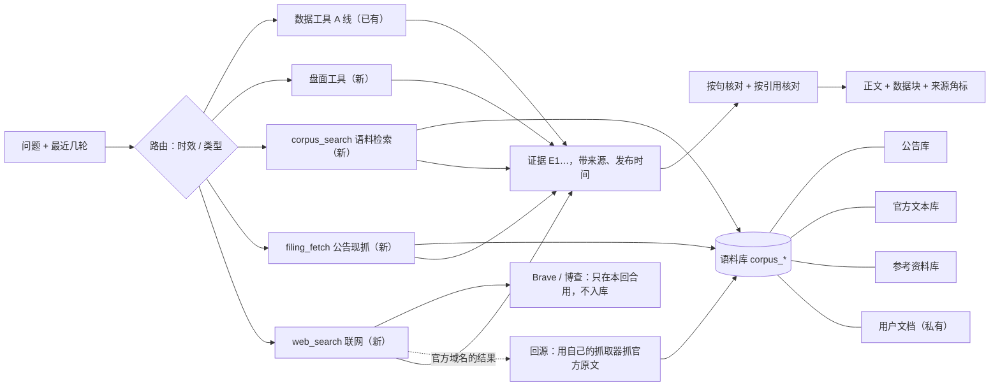

# AI 投研助手：知识库设计（公告库 + 官方文本 + 参考资料 + 联网检索）

日期：2026-10-20 · 状态：**设计稿，尚未实现** · 上游：[`AI助手改造设计.md`](AI助手改造设计.md)、[`AI助手技术规格.md`](AI助手技术规格.md)（§10–§12 语料表、抓取、检索）

> 本稿在规格 3a / 3b / 4 期的基础上扩展，不推翻已上线的 1a、1b、2 期（编排器、按句核对、渲染块、Markdown、来源角标）。两者冲突时，**落地前先改规格**，以规格为准。
>
> 核实范围：Brave、博查的条款与价格读了官方页面原文（2026-10-20）；业界做法来自公开文章与论坛（来源见文末）。**没有写原型，没有在服务器上实测。**

## 0. 已定的取舍（2026-10-20 用户选择）

| 问题 | 选择 |
| --- | --- |
| 第一批覆盖哪些问题 | 全部六类：公告 / 财报、美联储与官员讲话、中国宏观政策、盘面（涨停连板龙虎榜）、海外新闻、历史制度类；并参考业界最佳实践 |
| 联网检索 | Brave 官方 API 与国内付费搜索 API（博查）**都接** |
| 公告正文范围 | 问到时现抓 + 自选股定时抓 + 全市场只抓业绩预告 / 快报 |
| 分析深度与核对 | 允许明确标「假设」的情景数字，推导结果必须由 `calc` 算出；事实数字仍须来自资料 |
| 检索方式 | 先全文检索（模型给出中英文关键词），评测不够再加向量 |
| 用户上传的 PDF | 进助手检索，只对上传者本人可见 |

## 1. 目标：能答好哪些问题

参照 [`对话完整问答整理_2026-10-20.md`](对话完整问答整理_2026-10-20.md) 的 15 类问题。那份文档的回答来自带联网搜索的通用助手，**没有逐项核验**；我们的目标是「同样的问法，答案每个事实都能点开看到出处」，不是复刻它的每个数字。

| 编号 | 问题 | 要的资料 | 由哪一层提供 | 现在 |
| --- | --- | --- | --- | --- |
| 01 | 沃什讲话偏鹰还是偏鸽 | 讲话 / 访谈原文 | 官方文本库；访谈若无文字稿 → 联网 | 无 |
| 02、10 | 9 月加息对不对、是不是加息周期 | FOMC 声明、纪要、点阵图；CPI / PCE / 非农 / 失业率 | 官方文本库 + 已有宏观工具 | 数字有，文本无 |
| 03 | 中国科技股估值还有没有下跌空间 | PE / PB、盈利预测 | 已有估值序列（A 股部分）；港股无 | 部分 |
| 04 | 长鑫三季报 / 业绩预告的亮点和风险 | 公告 PDF 正文、半年报 | **公告库（问到时现抓）** | 只有标题 |
| 05、15 | 二连板、首板、机器人 + 汽车筛选、龙虎榜 | 涨停池、连板数、龙虎榜、概念成分、市值 | **盘面结构化工具**（不是知识库） | 无 |
| 06–09 | 海外科技公司消息、高管讲话、具身智能表态 | 新闻、公司公告、讲话 | 联网检索；美股公司 8-K → 公告库 | 无 |
| 11 | 中期选举两院全丢的可能性 | 民调、选区评级 | 联网检索 | 无 |
| 12 | 历届中期选举 | 历史席位统计 | 参考资料库（一次性导入） | 无 |
| 13 | 特朗普选后政策行为 | 历史事件 | 参考资料库 + 联网 | 无 |
| 14 | 三季报 + PCR + 宏观能否扭转 A 股 | 预喜统计、期权 PCR、中国宏观、指数、涨跌家数 | 已有工具为主；公告库补预喜统计；涨跌家数 → 盘面工具 | 大部分有 |

## 2. 业界做法：采纳什么、不采纳什么

| 做法 | 出处 | 本项目 |
| --- | --- | --- |
| **结构化数字走接口，文本走检索**：数字类问题不要从文本里检索 | 金融 RAG 实践文章 [F1][F2] | 采纳（已经是：A 线工具 + B 线语料） |
| **按结构切块**：按章节、表格边界切，表格行不拆散，块上带公司、期次、报告类型 | [F1][F2][F3] | 采纳：公告按「节」切；表格行粘连的相邻块合并 |
| **先按元数据过滤再排序**：公司、报告类型、期次、发布时间 | [F1][F3] | 采纳：`corpus_search` 的参数里有实体、类型、期次、时间窗 |
| **按时效路由**：「今天 / 最新」走实时抓取，历史问题走已入库 | [F4][R1] | 采纳：见 §6 |
| **时间衰减**：相关度乘发布时间的半衰期，半衰期按来源类型配 | [R1][T1] | 采纳，参数用评测集校准；论文提醒参数敏感，不当成万能 |
| **内容哈希 + 版本**：同 URL 内容变了记新版本，引用时核对版本 | [R2] | 采纳（规格 §10 已有 `version` / `content_hash`） |
| **引用要逐条核对**：引用编号必须对应真实取回的片段，片段里要有这句话的数字 | [F4][P1] | 采纳并加严：见 §7「按引用核对」 |
| **证据之间冲突要说出来**，不要静默挑一个 | [R1][P1] | 采纳：官方与网页冲突时两边都列，以官方为准 |
| **上下文块头（Contextual Retrieval）**：每块前加一段说明它属于哪篇文档 | Anthropic [A1] | **只用便宜版**：块头用模板拼（公司、代码、标题、期次、章节），不逐块调模型 |
| 中文分词用 zhparser | [C1][C2] | **不采纳**：官方 pgvector 镜像里没有，要自建镜像；先用规格里的二字词方案，评测不够再议 |
| 重排（reranker） | [C3][A1] | 备选：博查有中英文重排接口（¥0.005 / 次）；评测不达标时先试它，再考虑本地向量 |
| 联网结果与内部库**分开索引、分开展示** | [R1] | 采纳：联网结果不进语料库（条款也不允许，见 §5.5） |

## 3. 总体架构



四个库共用规格 §10 的 `corpus_*` 表，用 `kind` 区分；联网结果**不进库**。

## 4. 数据模型（在规格 §10 上增量）

`corpus_documents` 增加：

| 列 | 说明 |
| --- | --- |
| `kind` | `filing`（公告）/ `official`（官方文本）/ `reference`（参考资料）/ `user`（用户文档） |
| `owner_user_id` | 只有 `user` 有值；检索时 `owner_user_id IS NULL OR owner_user_id = 当前用户` |
| `instrument_id`、`symbol` | 公告所属证券（可空）；用于「长鑫」这类按公司过滤 |
| `period` | 期次，例如 `2026Q3`、`2026H1`、`2026FY`（可空） |
| `report_type` | 公告细类：`annual` / `semiannual` / `q1` / `q3` / `forecast`（业绩预告）/ `express`（快报）/ `inquiry` / `other` |
| `authority` | 可信度：`official`（央行、统计局、交易所、公司公告本身）/ `reference`（管理员导入）/ `user` |
| `license_note` | 来源条款摘要（规格已有 `terms_note` 在来源表，这里记单篇例外，比如带第三方版权标记的美联储页面） |

`corpus_chunks` 增加 `context_header`（模板拼的块头，例如「长鑫科技 688825｜2026 年前三季度业绩预告｜2026-10-16｜一、本期业绩预计情况」），**写进 `tsv`（权重 B）但不显示给用户**，引用逐字核对只对 `content` 做。

用户上传：现有 `documents` / `document_chunks` 保留给「我的文档」页；解析完成后**另写一份**到语料库（`kind=user`）。不迁移旧表，避免动已有页面；代价是存两份文本。

## 5. 各库怎么进数据

### 5.1 公告库（A 股巨潮 + 美股 SEC）

已有基础：`providers/disclosures.py` 能按证券查（`cninfo_query_form`），也能全市场按类别 / 关键词查（`cninfo_market_form` 的 `category`、`searchkey`），标题已经分类（`earnings`、`filing`…）；热点同步已经把全市场公告标题存进 `news_events`。缺的是**正文**。

三条进数据的路：

1. **问到时现抓**（工具 `filing_fetch`，实时性最好）：
   - 参数：证券（经 `instrument_search` 解析）、报告类型、期次或日期范围；
   - 流程：查巨潮 → 选中最匹配的一份 → 下载 PDF（只允许 `static.cninfo.com.cn`，5 MB / 200 页上限，沿用 `UPLOAD_MAX_*`）→ 现有 `pdf_text` 解析 → 按节切块 → 入库 → 立即可检索；
   - 时间预算：本回合内最多 20 秒；超时就把任务交给 worker 继续，回答里说「公告还在读取，稍后再问」，并显示已拿到的标题和链接；
   - 已入库（同 URL、同哈希）直接命中，不重复下载。
2. **自选股定时抓**：所有用户自选股的去重集合，每个交易日 18:00、21:00 各扫一次当天新公告，只抓 `filing` / `earnings` / `inquiry` 三类正文。
3. **全市场业绩预告 / 快报**：财报季（1、4、7、8、10 月）交易日每 30 分钟按类别扫一次，其余月份每天一次。预告多是一两页，解析便宜。

切块规则：
- 定期报告按「第 X 节」标题切，节内再按段落切（规格 `target=280, max=360, overlap=40`）；
- 业绩预告 / 快报通常整篇一两块；
- 表格行粘连：上一块以表格行结尾、下一块以表格行开头时合并（上限 720 字），避免「营收」和数字被切开 [F2]；
- PDF 抽出来的表格会丢结构，这是已知风险（§10）。

美股：自选里的美股，`sec_edgar` 已有 submissions；正文只抓 8-K（含 Exhibit 99.1 新闻稿）与 10-Q / 10-K 的 MD&A 节，遵守 SEC 每秒 10 次以下的访问规则，UA 用真实联系方式（规格已要求）。

### 5.2 官方文本库

| 来源 | 内容 | 方式 | 频率 | 期次 |
| --- | --- | --- | --- | --- |
| 美联储 | 新闻稿、讲话、FOMC 声明、纪要、点阵图（SEP） | 官方 RSS + 正文页（规格 §11 已设计） | 每小时；FOMC 会议日 14:00–16:00（美东）每 10 分钟 | 第一批 |
| 国家统计局 | 新闻发布、数据解读 | 栏目页轮询（逐路径核 robots） | 每天 3 次（9:30、10:30、16:00） | 第一批 |
| 证监会、沪深交易所 | 政策、规则、问询函 | 栏目页（证监会 robots 很长，逐路径解析） | 每天 2 次 | 第二批 |
| IMF / BIS / ECB | 讲话、报告 | RSS | 每天 | 第二批 |
| 人民银行 | — | 不抓（robots 不允许）；只接受用户上传 | — | — |

限制要事先说清：**访谈、炉边对话常常没有文字稿**。美联储的讲话 RSS 只收有讲稿的讲话；像「沃什在 IMF 年会的访谈」这类，官方渠道可能只有视频页。这时只能靠联网检索找到报道，答案会标「未核实」。

### 5.3 参考资料库

管理员在「数据管理」导入长期有效的资料：Markdown、CSV 或 PDF，每份必须填发布方、标题、原始链接、许可说明。例子：历届中期选举席位变化（从公开数据集整理）、FOMC 制度说明、交易所涨跌停规则。导入后和其他库一样切块、检索、引用，`authority=reference`。

### 5.4 用户文档（私有）

用户在公司页上传的 PDF，解析完成后写入语料库，`kind=user`、`owner_user_id=上传者`。别的用户永远检索不到。回答里这类来源标「你上传的文档」。

### 5.5 联网检索（第 4 期）：Brave + 博查

两家都接在 `SearchProvider` 接口后面，按问题语言和类型选：中文新闻优先博查，英文 / 海外优先 Brave；一家失败或额度用完时换另一家。

**条款带来的硬约束（2026-10-20 读原文）**：

| | Brave Search API | 博查 Web Search API |
| --- | --- | --- |
| 价格 | $5 / 千次；每个计划每月送 $5 额度（约 1000 次）；注册要信用卡，可把预付设为 0 | ¥0.036 / 次（目录价，按月日均量阶梯）；预充值，余额不足停服 |
| 能不能存结果 | **不能**：条款禁止「存储、缓存或建库」，只允许运行所需的临时存储；要长期保存须联系 Brave | 条款禁止「从博查服务中抓取、挖掘或收集数据」；**存进聊天记录是否算「收集」没写清，需要问博查** |
| 其他义务 | 免费额度要求在网站 / 关于页署名 Brave | **内容安全义务**：调用方要对用户输入的搜索词和输出的结果做审查，建立关键词表等过滤机制，后果自负 |

所以设计成：

- **联网结果只在本回合使用**：标题、链接、摘要进入本回合证据，显示在来源清单里，标「未核实」；**不写进语料库，也不写进 `chat_messages.sources`**。刷新后，这条回答的联网来源显示为「联网来源按服务条款不保存，可点『重新生成』再查」。在拿到博查书面确认之前，博查也按这个规则处理。
- **发现—回源**：如果联网结果的域名在官方白名单里（`federalreserve.gov`、`stats.gov.cn`、`cninfo.com.cn`、`sec.gov`…），就用我们自己的抓取器去抓**官方原文**入库。入库的是官方页面，不是搜索结果，可以长期保存、可以引用。搜索只负责发现。
- **内容安全**：搜索词先过本地关键词表（违法、涉政敏感、色情暴力等）再发出去；返回的摘要同样过滤；命中就不调用，回答说「这个问题不能联网检索」。关键词表放托管配置，管理员可改。
- 额度与成本：每用户每天联网次数上限、全局每月预算上限（到了自动关），结果在**一个回合内**去重复用，不跨回合缓存。
- 开关：`ASSISTANT_WEB_SEARCH_ENABLED`（总开关）+ 每个供应商的密钥与开关（托管配置）。

## 6. 检索与实时性

### `corpus_search` 工具

参数由模型给，服务端校验：

```text
corpus_search {
  keywords_zh: [..], keywords_en: [..],   # 跨语言：查英文来源时必须给英文关键词
  kind?: filing|official|reference|user,
  symbol?: "688825", report_type?: "forecast", period?: "2026Q3",
  publisher?: "美联储", since?: date, until?: date
}
```

排序：

1. **先过滤**：`published_at <= as_of`、最新版本、`kind` / 实体 / 期次 / 时间窗、私有可见性；
2. 全文命中：标题权重 A、块头 B、正文 D（规格 §11 的二字词 + `english` 词形还原）；
3. 分数 = `ts_rank_cd` × 时间衰减 × 可信度系数。时间衰减的半衰期按 `kind` 配：公告与讲话 30 天，制度与参考资料不衰减。数值用评测集定；
4. 同一文档最多 2 块，取前 8；最高分低于阈值就返回「没有相关资料」，不拿低相关片段凑数。

### 时效路由

| 问题信号 | 走哪条 |
| --- | --- |
| 「今天」「刚刚」「最新」「这次」+ 公司名 / 报告名 | 先 `corpus_search`（近 3 天）；没命中 → `filing_fetch` 现抓 |
| 官员 / 机构讲话、会议 | `corpus_search(kind=official)`；没命中且问的是近 7 天 → `web_search` |
| 海外公司新闻、民调、市场反应 | `web_search`；结果里的官方域名 → 回源入库 |
| 历史、制度 | `corpus_search(kind=reference)` |
| 数字、行情、宏观 | 已有数据工具，不检索 |

「今天」「明天」按上海时间解析；美国事件同时给出美东时间。每条来源显示发布时间；回答末尾的「资料截止」取所有证据里最新的发布时间。

### 新鲜度怎么看

「运行状态」页加一栏：每个来源的最近一次抓取时间、最新一篇的发布时间、入库延迟（发布 → 可检索）、失败原因。延迟超过阈值（公告 2 小时、美联储 1 小时）标红。

## 7. 回答规则

### 回答的形状

对照参考文档，固定成：

1. **结论**一句（例如「政策底色偏鹰，本次措辞中性偏鸽」）；
2. **依据表**：讲话类用 `quote_table`（原文摘录 / 倾向 / 理由），原文必须是检索片段里的**逐字子串**，服务端核对；数据类用已有的表格、指标卡；
3. **情景表**（可选）：每个情景的条件、可能走势；
4. **需要继续验证的点**；
5. 来源清单与资料截止。

「偏鹰 / 偏鸽 / 中性」「亮点 / 风险」这类判断是分析，不是事实，允许写，但每个判断后面必须跟着出处（`[n]` 或数据块）。

### 假设与情景数字（新规则）

- `calc` 增加一种输入：`{"assume": 30, "label": "假设预期市盈率"}`。用了假设输入的计算结果登记为**假设证据**（连环计算会把上游的假设一起带上）；
- 正文里的数字如果只在假设证据里出现，这一句必须带「假设 / 假定 / 假如 / 如果 / 倘若 / 若 / 情景」之一（「若干」不算），否则照样拦；
- 假设证据不参与事实放行：它的数字、截止日、假设名都不进事实数字池、日期池和序列名，免得模型给假设起个带数字的名字来放行；
- 每次假设计算在回答下方出一条 `info` 提示（`code = ASSUMPTION`），写明假设和算得的结果，读者分得清哪些数字不是查到的（已实现，见 ASSISTANT-3A0）；
- 事实数字（营收、CPI、席位）规则不变：必须来自工具结果或检索片段。

### 按引用核对（加严）

现在的核对是「数字在**任何**证据里出现过」。有了 `[n]` 之后改成：**带 `[n]` 的句子，句中数字必须出现在第 n 条来源的片段里**（或者在本句另外引用的数据块里）。这样能防住「数字是真的，但挂错了出处」[F4]。

### 冲突

官方来源与网页摘要不一致时，两边都列出，正文以官方为准，并写「资料之间不一致」。

## 8. 盘面结构化工具（不是知识库，但 05、15 题要用）

| 工具 | 返回 | 数据 |
| --- | --- | --- |
| `limit_up_pool(date, board?, streak?)` | 当日涨停：代码、名称、连板数、首封时间、封单、换手、总市值、所属概念 | 收盘后快照入库（历史连板统计要靠自己积累） |
| `dragon_tiger(date, symbol?)` | 龙虎榜席位与净额 | 收盘后快照 |
| `concept_members(concept)` | 概念成分 | 已有东财板块数据可以扩展 |
| `market_breadth(date)` | 涨跌家数、涨停跌停数、成交额 | 收盘后快照 |

数据源大概率还是东方财富（项目里板块、情绪已经在用），**接入前要单独核对接口与条款**，核对结论写进来源表。这部分和知识库互不依赖，可以并行做。

## 9. 评测

- 题目：参考文档 15 题改写成 60 题左右，外加「应当拒答」的题（库里没有、需要编造才能答的）；中文问英文语料的题占一半以上；
- 固定的小语料 fixture（几篇美联储声明、几份业绩预告 PDF 抽出的文本、几条参考资料）进仓库；
- 指标：Recall@5、该拒答时拒答的比例、引用正确率（按引用核对的通过率）、quote 逐字通过率；
- 进 CI，不依赖线上模型和网络；真实模型的冒烟脚本放 `scripts/`，不进 CI；
- 评测不达标时的顺序：先调块头和关键词提示词 → 试博查重排 → 最后才上向量（规格 3b）。

## 10. 风险

| 风险 | 影响 | 应对 |
| --- | --- | --- |
| PDF 表格抽取丢结构 | 业绩预告里的数字和标签对不上，核对失败或引用错行 | 表格行粘连合并；评测集里放表格题；失败时回答给公告链接让用户看原文 |
| 服务器 2 核 / 3.6 GB | 现抓 PDF 吃 CPU，和 API 抢资源 | 解析只在 worker 里、并发 1、单份 30 秒预算（沿用 `UPLOAD_PARSE_TIME_BUDGET_SECONDS`）；现抓超时转后台 |
| 联网条款 | Brave 不许存；博查未写清；博查要求内容审查 | 见 §5.5：只在本回合用、发现—回源、关键词过滤；博查书面确认前按不保存处理 |
| 访谈无文字稿 | 01 类问题可能只能给「未核实」的报道 | 如实说明；有讲稿的讲话优先 |
| 二字词检索精度 | 中文召回噪声多 | 块头 + 元数据过滤先缩小范围；评测不达标再议 zhparser 或向量 |
| 巨潮、东财接口条款 | 项目已在用，但正文批量下载是新用法 | 限速 1 次 / 秒，只下载明确需要的；接入前复核 robots 与条款 |
| 对外开放 | 若将来面向公众提供生成式问答，涉及备案等监管要求 | 现阶段定位为个人研究工具；对外前单独评估 |

## 11. 分期（替换规格里 3a / 3b / 4 的划分）

| 期 | 内容 | 依赖 |
| --- | --- | --- |
| 3a-0 | 回答规则：假设证据（`calc` 的 `assume`）、提示词 v3 的回答形状（**已实现**，ASSISTANT-3A0） | 无（只改编排器） |
| 3a-1 | 语料底座：`corpus_*` 表（含 §4 新增列）、`corpus_search` 工具、`sources` 事件、按引用核对、`quote_table`（逐字核对要用检索片段，所以放这里）、评测框架；**用户文档接入**（数据现成，最先能验证整条链路）。**已实现**（ASSISTANT-3A1）；`PoliteClient` 挪到 3a-2（只有抓取用得到） | 3a-0 |
| 3a-2 | 公告库：`PoliteClient`、`filing_fetch` 现抓、自选股定时抓、全市场业绩预告 / 快报；美股 8-K | 3a-1 |
| 3a-3 | 官方文本库：美联储（RSS、FOMC、SEP）、国家统计局 | 3a-1；服务器能访问美联储网站 |
| 3c | 盘面工具：涨停池、连板、龙虎榜、涨跌家数、概念成分 | 无（可与 3a 并行） |
| 4 | 联网：`SearchProvider` + Brave + 博查、发现—回源、关键词过滤、额度 | 3a-1；两家的密钥；博查关于保存的答复 |
| 3b | 仅当评测不达标：先试博查重排，再考虑向量 | 3a 评测结果 |
| 5 | 参考资料库导入界面、第二批来源（证监会、交易所、IMF / BIS / ECB） | 3a-1 |

## 12. 需要你提供或确认

1. **Brave**：注册（要信用卡，可把预付设为 0），拿到密钥；免费额度要求在网站上署名 Brave，你看放在「关于」页是否可以。
2. **博查**：注册充值；**问他们一句「搜索结果的标题和链接能不能保存在用户的聊天记录里」**，拿到书面答复前按不保存处理。
3. **SEC 联系方式**：「集成设置」里 `SEC_USER_AGENT` 换成真实邮箱（规格早就要求，公告库的美股部分要用）。
4. **服务器**：能否访问 `www.federalreserve.gov`、`api.search.brave.com`、`api.bochaai.com`。
5. **参考资料**：第一批想导入哪些（中期选举历史、FOMC 制度说明…），以及数据从哪来。

## 来源

- [F1] Matchpoint Partners, *RAG for Financial Research*（结构化切块、元数据过滤）：https://www.matchpoint-partners.com/our-insights/retrieval-augmented-generation-financial-research.html
- [F2] *MimirRAG: A Multi-Agent RAG Framework for Financial Data Retrieval*（表格感知切块、相邻表格块合并）：https://arxiv.org/html/2605.25030
- [F3] Tensorlake, *Advanced RAG*（按报告类型路由、权威来源优先、增量入库）：https://tensorlake.ai/blog/advanced-rag
- [F4] FinTech Studios, *RAG for Finance: Beyond the Tutorial*（五层引用链、按时效路由）：https://www.fintechstudios.com/blog/rag-pipelines-financial-intelligence-best-practices
- [R1] r/Rag, *Live web retrieval in RAG is harder than I expected*（联网与内部库分开、时效分类、时间衰减、冲突）：https://www.reddit.com/r/Rag/comments/1tbrefa/live_web_retrieval_in_rag_is_harder_than_i/
- [R2] r/Rag, *The docs are fresh but the RAG answers are still six weeks behind*（内容哈希、版本核对）：https://www.reddit.com/r/Rag/comments/1voj6df/the_docs_are_fresh_but_the_rag_answers_are_still/
- [T1] *Freshness and the Limits of Heuristic Trend Detection in Temporal RAG*（半衰期时间先验有效但对参数敏感）：https://arxiv.org/html/2509.19376v2
- [P1] *Production RAG: evidence, freshness & operations*（回答与引用契约、引用存在不等于引用正确）：https://anothernoise.github.io/sa-ai/docs/03-data-context/02-rag-patterns.html
- [A1] Anthropic, *Contextual Retrieval*（块头上下文：检索失败率降 49%，加重排降 67%）：https://www.anthropic.com/engineering/contextual-retrieval
- [C1] Langhuan, *Chinese hybrid search with pgvector + PostgreSQL full-text*：https://langhuan.dev/en/blog/pgvector-chinese-hybrid-search/
- [C2] nageoffer/ragent PR #37（zhparser 映射到 simple 词典）：https://github.com/nageoffer/ragent/pull/37
- [C3] Baiyuan RAG 白皮书第 4 章（RRF、重排的收益与延迟）：https://baiyuan-tech.github.io/rag-whitepaper/en/ch04-l2-rag.html
- Brave Search API 条款（存储限制第 (i) 项、署名）：https://api-dashboard.search.brave.com/documentation/resources/terms-of-service ；价格与免费额度：https://api-dashboard.search.brave.com/documentation/resources/help-feedback
- 博查用户服务协议（第 4 条禁止行为、内容安全义务）：https://open.bochaai.com/terms-of-service ；价格（产品服务文档）：https://market.aliyun.com/detail/cmgj00071702.html
